## Facet API Key Guide

**本手册怎么用**：按厂家分节，每节给出「注册 → 拿 Key → 填进 Facet」的完整步骤。
文中所有 📷 是**截图位**——按说明操作到对应页面时截图，保存到
`docs/images/api-key-guide/` 目录并使用标注的文件名，图片会自动显示在本文档中。

**为什么值得照着注册（不花您的钱）**：国内主流厂家（百炼、火山、魔搭、智谱、千帆、DeepSeek、Kimi、MiniMax）
都给实名个人账号**免费额度**——新模型 90 天窗口、每日登录领魔粒、新人 100 万 token……
这些额度**不用就作废，用了不扣您的钱**。用户不知道有免费、也不知道去哪领，是普遍痛点；
本手册把注册入口、Key 位置、免费额度规则聚合在一起，照着点一遍即可。Facet 还会**每日自动对齐**
哪些模型还有免费额度（见 [4.3 百炼](#43-阿里云百炼) 的 `usage free` 定时任务），帮您把白嫖额度一直用满。

真正「匿名免注册」现在几乎绝迹（多数平台都以注册送免费额度为前提），
其余各家**注册是拿免费额度的前提**，不是收费门槛。

密钥属于敏感信息：截图前请**遮住或截掉完整 Key**，只保留开头几个字符（如 `nvapi-…`）。

平台界面会随时间变化，本手册按 2026-11 时点整理；若界面不同，以实际为准并顺手更新本文。

---

## 目录

- [一、密钥怎么填进 Facet](#一密钥怎么填进-facet)
- [二、厂家总览](#二厂家总览)
- [三、免费渠道（零成本起步）](#三免费渠道零成本起步)
- [四、国内主流厂家](#四国内主流厂家)
- [五、海外按量付费厂家](#五海外按量付费厂家)
- [六、订阅聚合类](#六订阅聚合类)
- [七、在 Trae / IDE 里使用 Facet](#七在-trae-ide-里使用-facet)
- [八、常见问题](#八常见问题)

---

## 一、密钥怎么填进 Facet

渠道配置时的关键字段：

| 字段 | 说明 | 示例 |
|---|---|---|
| **协议** | 决定请求格式（OpenAI/Anthropic/共享/自定义） | `openai`、`anthropic` |
| **端点** | API 服务地址 | `https://api.openai.com/v1` |
| **模式** | `payg`（按量）/`agent`（套餐/`token_plan`）/`coding`（编程套餐） | 参见各厂家章节 |
| **免费额度** | `free_quota`（tokens + period）或 `free_limits`（rpm/rpd/note） | 参见各厂家章节 |
| **Key** | 平台颁发的调用凭据 | `sk-proj-...`、`sk-ant-...` 等 |

**模式对照**：

| 模式键 | 对应计费类型 | 典型厂家 |
|---|---|---|
| `payg` | 按量付费 | 大部分厂家 |
| `agent` / `token_plan` | Token 包月/套餐 | xiaomi、bailian、hunyuan、qianfan、minimax |
| `coding` / `coding_plan` | 编程套餐 | zhipu、volcengine、commandcode |

---

## 二、厂家总览

| # | 厂家 | 免费 | 付费形态 | 备注 |
|---|------|------|----------|------|
| 1 | 火山引擎方舟 | ✅ 各模型约50万tokens/模型 | payg + coding_plan + agent_plan | 一致；遗漏企业版Coding Plan |
| 2 | 智谱 GLM | ✅ 注册送2000万tokens + Flash系列免费 | payg + coding_plan | payg应加免费标注 |
| 3 | 阿里云百炼 | ✅ 新人每模型100万tokens(90天) | payg + token_plan | 一致；遗漏旧版Coding Plan |
| 4 | 魔搭 ModelScope | ✅ 魔粒免费（登录 200/日） | 无 | 免费靠魔粒抵扣（0.5/1/2 粒/次，随模型）；完善邮箱即可用，无需阿里云实名 |
| 5 | 小米 MiMo | ✅ 新人¥10体验金(40天) | payg + token_plan | payg应加免费标注 |
| 6 | Kimi (月之暗面) | ✅ 新人15元代金券(3个月) | payg（API无订阅） | payg应加免费标注 |
| 7 | DeepSeek | ❌ 无明确免费额度 | payg（峰谷计价） | 一致 |
| 8 | 腾讯混元 | ✅ 开通送100万tokens(1年) | payg + token_plan(TokenHub) | **已补 token_plan 模式**：Token Plan 28/78/238/468 元/月；payg 加免费额度 100 万 tokens/1 年 |
| 9 | 百度千帆 | ⚠️ 新人免费额度以控制台领取页为准 | payg + token_plan + 算力包 | **已补 token_plan 模式**；Token Plan 个人版五档 Mini/Lite/Standard/Pro/Max（Mini ¥4.9 为首购限时价，Standard ¥49.9）；免费额度口径以官方活动页为准 |
| 10 | Grok xAI | ❌ 无标准免费层（活动:数据共享换$150/月） | payg | 基本一致 |
| 11 | OpenAI | ❌ 新账号无赠送credits | payg（订阅不含API） | 一致 |
| 12 | Anthropic | ⚠️ 一次性$5试用 | payg（Max/Ultra订阅送API credits） | 一致；可加免费note |
| 13 | OpenCode | ✅ 12+免费模型 | payg + agent_plan(Go订阅) | Go $10/月、Go Plus $40/月、Go Teams $20/人/月；v2 文档含 console.opencode.ai/inference 域名变体 |
| 14 | Command Code | ✅ 免费模型1000请求/天 | 套餐订阅（Provider $15/月，含 $15 额度按量扣） | 免费模型随 agent 套餐 models 清单下发（tier: free） |
| 15 | LLM7 | ✅ 60次/分·250/时·10万tokens/24h | Pro $12/月订阅 | Pro $12/月 为官网订阅档，注册表仅登记免费 payg 模式（见 6.3） |
| 16 | NVIDIA NIM | ✅ 免费层=速率限制（约 40 RPM，控制台右上角显示） | ❌ 无按量付费通道；提额需付费部署/自托管 | 免费层是速率限制非 credits；10,000 请求/日为页面嵌入值、非官方承诺 |
| 17 | OpenRouter | ✅ :free模型50→1000次/天 | payg（预付credits，5.5%手续费） | 一致 |
| 18 | MiniMax | ⚠️ 新人赠金（一次性，以账户页为准） | payg + Token Plan 包月 | **已接入**：余额/Token Plan 余量查询；双 Key 体系（`sk-api-` 按量 / 订阅 Key Token Plan） |

---

## 三、免费渠道（零成本起步）

### 3.1 NVIDIA NIM——免费层

**官方入口**：[https://build.nvidia.com/](https://build.nvidia.com/)

**使用方式**：
- **速率限制而非余额**：登录 [build.nvidia.com](https://build.nvidia.com)，导航栏右上角显示账号的最大速率限制（例如 "Up to 40 RPM"），不是余额。官方 FAQ 原话："Your personal rate limit is shown in the top-right of the dashboard"。
- **请求速率**：多数模型最高 40 RPM，无 per-token billing（官方 FAQ 公开口径）。
- **每日上限**：10,000 requests/day——存在于页面嵌入 JSON，**非官方承诺值**，dashboard 未必显示。
- **每模型具体值**：不公布，随模型、用途、当前总流量浮动；版主明确 "The rate limits vary for each model, and we do not publish those"。
- **试用期限**：无时间限制（"The trial period is not limited by a time period"）。
- **提额**：免费档无官方通道——想提高只能付费部署或自托管 NIM。

**步骤**

1. 打开 [build.nvidia.com](https://build.nvidia.com)，点「创建账户」用邮箱注册；
   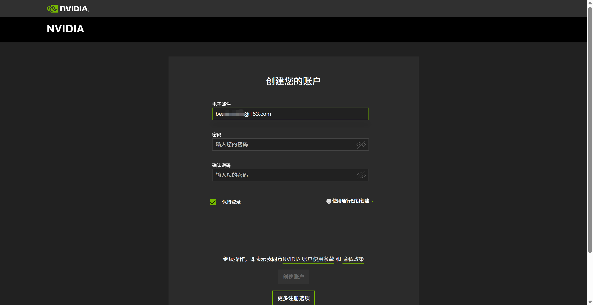
2. 首次生成 Key 前需验证手机号（一次性 OTP），官方提示验证通过后账号才能生成 API Key；
   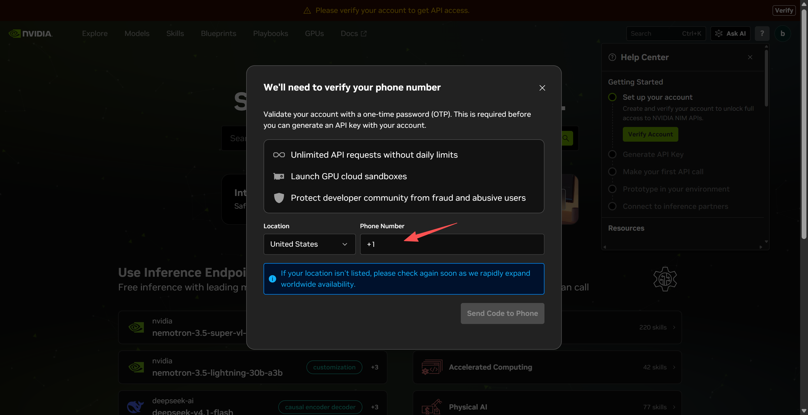
3. 登录后展开右上角账号菜单——这里就是官方 FAQ 说的「速率限制显示位置」（示例账号显示 "Up to 40 rpm"）；菜单内点 **API Keys** 进入密钥页；
   
4. 点 **Generate API Key**，填 Key 名称与有效期（默认 12 months），生成后立即复制保存。
   

**渠道参数**（在 Facet 中配置时）：

| 字段 | 值 |
|---|---|
| 协议 | `openai` |
| 端点 | `https://integrate.api.nvidia.com/v1` |
| 模式 | `free`（免费层按速率限制运行，无 per-token 计费；限额随模型浮动，免费档无提额通道） |
| free_limits | `rpm: 40（官方口径上限）+ note：每日 10,000 请求为页面嵌入值、非官方承诺；试用无时间限制` |

**常见模型**：`nvidia/nemotron-3-ultra-550b-a55b`, `nvidia/nemotron-3-super-120b-a12b`, `nvidia/mistral` 等。

**适用场景**：个人开发试用、快速原型验证、不需要大规模生产的场景。

---

### 3.2 OpenRouter——免费池

**官方入口**：[https://openrouter.ai](https://openrouter.ai)

**使用方式**：
- **免费模型**：25+ `:free` 模型，每日配额根据账号余额动态调整：
  - 余额 **< $10**：50 次/天
  - 累计充值 **≥ $10**：1,000 次/天
  - 同时共享率限制：20 RPM（每分钟请求数）
- **付费模型**：预付 credits 按量（pass-through 原价），Standard 档购值收 5.5% 手续费（Business 8%），BYOK 每月 $25,000 推理额免平台费。

**步骤**

1. 打开 [openrouter.ai](https://openrouter.ai)，点 **Get API Key** 注册登录；
   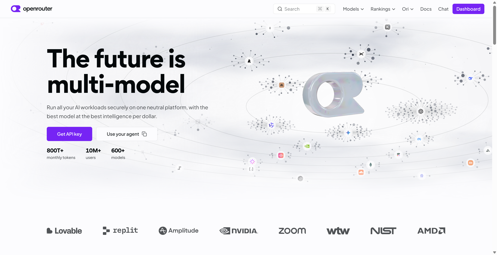
2. 进入 **Activity** 仪表盘，可查看消费（Total spend）、请求量、token 用量与缓存命中率等汇总；
   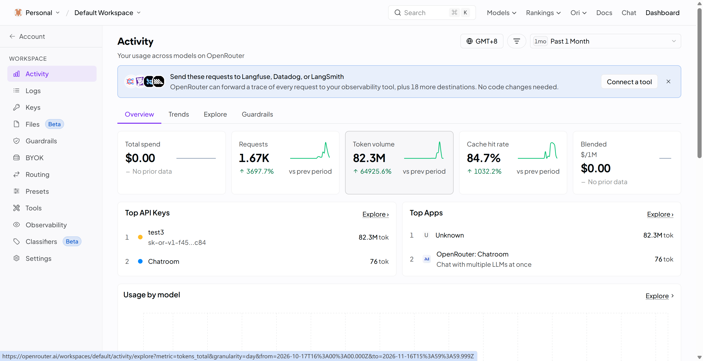
3. **Models** 页搜「free」筛出当前所有 `:free` 免费模型（输入输出均 $0/M tokens），示例：NVIDIA Nemotron 3 Ultra (free)、Nemotron 3.5 Super VL (free)、Baidu ERNIE-5.5-Flash-Preview (free)；
   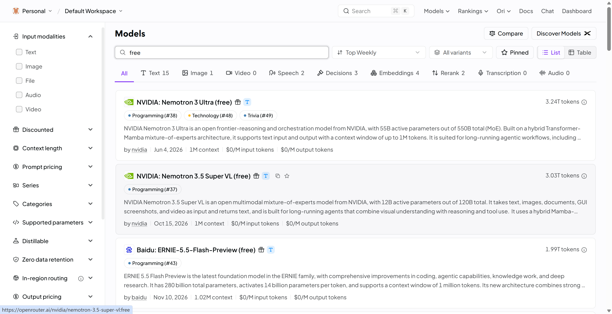
4. 侧栏 **Keys** → **New key** 创建 API Key（可为单 Key 设 Key limit 消费上限），创建后立即复制。
   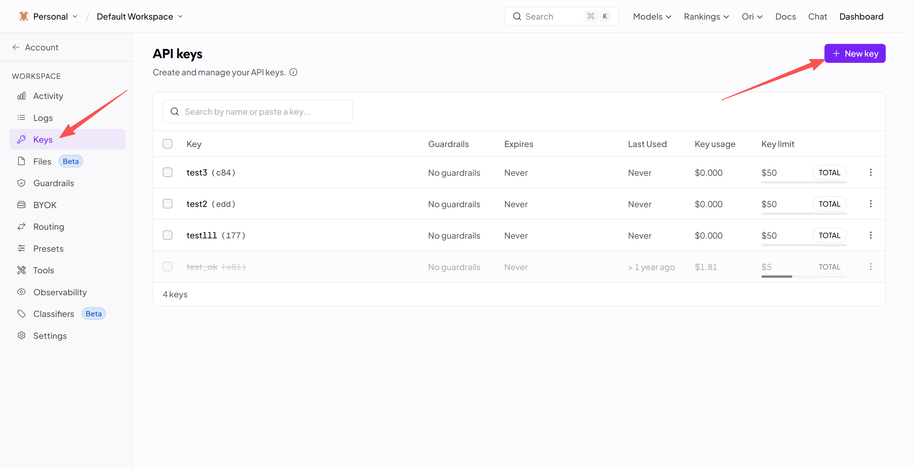

**渠道参数**（在 Facet 中配置时）：

| 字段 | 值 |
|---|---|
| 协议 | `openai` |
| 端点 | `https://openrouter.ai/api/v1` |
| 模式 | `payg`（预付 credits） |
| free_limits | `note: :free 模型 50→1000次/天（余额<$10→50/≥$10累充1000），20 RPM` |

**常见免费模型**：`nvidia/nemotron-3.5-lightning:free`, `google/gemma-4-31b-it:free`, `nvidia/nemotron-3-ultra-550b-a55b` 等（随平台更新而变化）。

**适用场景**：希望同时使用多家厂家模型、免费额度有需求的开发者、跨平台兼容性要求。

---

## 四、国内主流厂家

### 4.1 火山引擎方舟

**官方入口**：[https://console.volcengine.com/ark](https://console.volcengine.com/ark)

**第一步：开通服务，并开启「免费额度用完即停」**

- 实名账号登录后按提示开通方舟模型服务。只有开通后，各模型才会发放免费推理额度（约 **50 万 tokens/模型**，一次性，仅抵扣按量后付费）。没开通时拿不到额度，调用会直接计费。
- **按量付费是后付费结算**：免费额度用完后，如果没有停服保护，请求会继续走付费通道并产生扣款。开通页 / 模型广场里的「安心体验模式 / 免费额度用完即停」务必打开——这是避免后付费扣款的关键，不要只依赖余额告警。
- 开通后再去模型广场逐个开通要用到的模型，免费额度是按模型分别发放的。

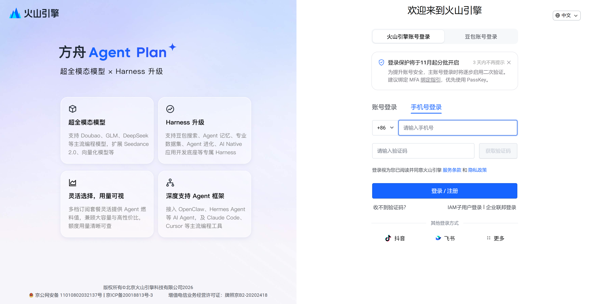

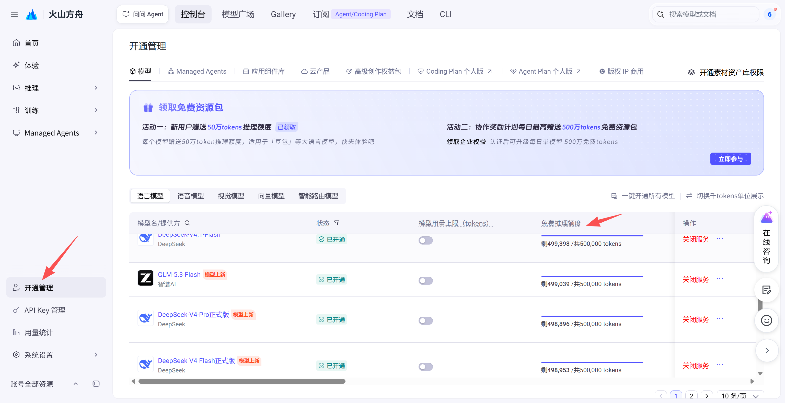

**第二步：建只读 IAM 子账号，用来查免费 token 剩余额度**

- 免费 token 余量不在数据面 API Key 里，要通过管理面 OpenAPI（`GetPersonalPlan` 等，AK/SK 签名）查询，所以**必须用 IAM 的 AK/SK**，不能用 `ark-` 开头的推理 Key。
- 到 [访问控制 → 用户](https://console.volcengine.com/iam/identitymanage/user) 新建一个**子账号**，访问方式选「编程访问 / API 调用」（无需控制台登录密码）。
- 权限设为**只读**：勾选系统策略 `ArkReadOnlyAccess` 即可，不要给主账号、也不要挂写权限（如 `ArkFullAccess`）。查询场景只读足够，能降低密钥泄露后的风险。
- 在该子账号详情页「密钥」Tab 新建密钥，得到 **Access Key ID（AK）** 与 **Secret Access Key（SK）**——SK 只在创建时显示一次，立刻复制保存。把 AK/SK 填到 Facet 火山渠道的「管理凭据 / credential_envs（`VOLC_ACCESSKEY`、`VOLC_SECRETKEY`）」里；它们只用于查额度与套餐余量，不是推理调用 Key。

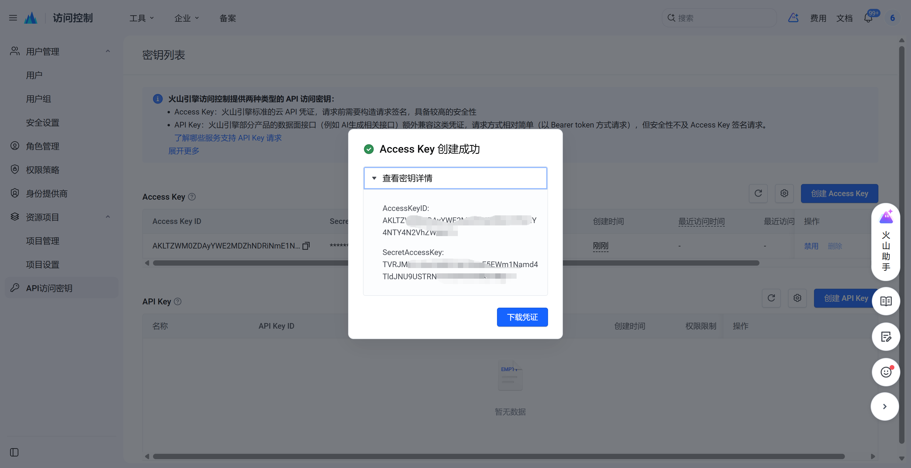

**第三步：按量付费、Agent Plan、Coding Plan 的 Key 各不相同，要分别获取**

三套凭据相互独立，**不能互换**，每个都要单独获取：

| 形态 | Key 类型 | 获取位置 |
|---|---|---|
| 按量付费 `payg` | `ark-` 开头的 API Key（数据面推理 Key） | [方舟 API Key 管理](https://console.volcengine.com/ark/region:cn-beijing/apiKey) |
| Coding Plan `coding` | Coding 套餐专用 Key | 同上页面，开通 Coding 套餐后才显示 |
| Agent Plan `agent` | Agent 套餐专用 Key | [Agent Plan 订阅页](https://console.volcengine.com/ark/region:cn-beijing/subscription/agent-plan?projectName=default) 开通后获取 |

注意区分：第二步建的是 **IAM AK/SK**（管理面，查额度用），这里三种是 **`ark-` 推理 Key**（数据面，调模型用），两套东西别填混；同厂家三种模式也各填各的 Key。

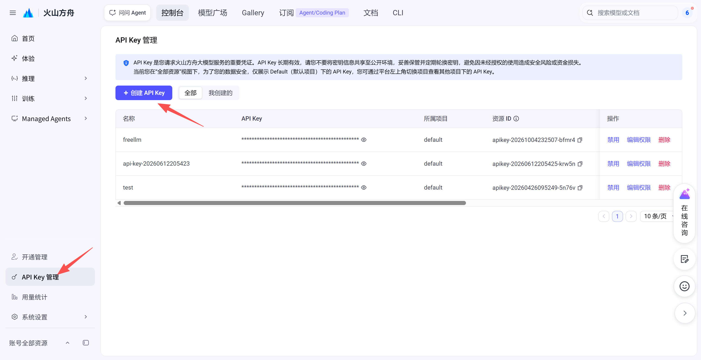

**第四步：三种形态的调用 URL 也不一样**

| 形态 | 协议 | `base_url` |
|---|---|---|
| 按量付费 `payg` | `openai` | `https://ark.cn-beijing.volces.com/api/v3` |
| Coding Plan `coding` | `openai` | `https://ark.cn-beijing.volces.com/api/coding/v3` |
| Agent Plan `agent` | `openai` | `https://ark.cn-beijing.volces.com/api/plan/v3` |

在 Facet 里选对模式后 URL 会自动带出；手工填写时务必按上表选，否则会出现 404 或「模型不存在 / 无权限」。路径只需填 `/chat/completions`（或留空自动补），**不要**在已含 `/v3` 的 `base_url` 后再拼 `/v1/chat/completions`，否则会变成 `/v3/v1/...` 而 404。

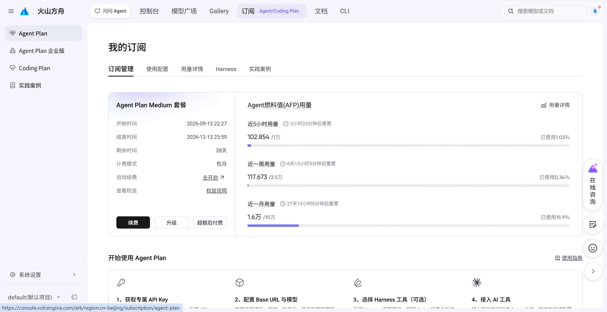

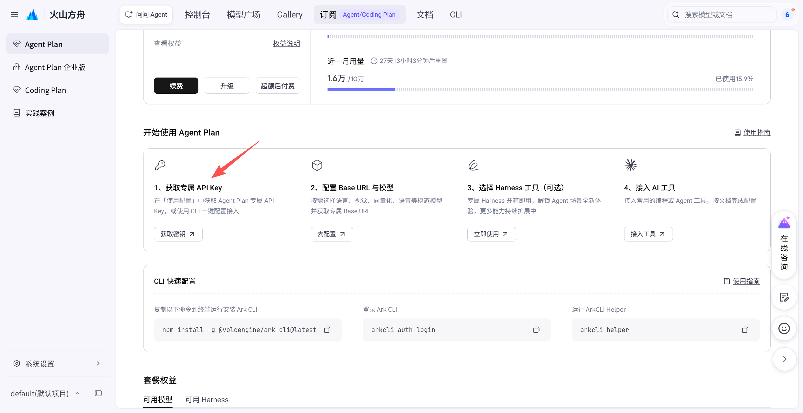

**付费形态**：

| 形态 | 说明 | 价格 |
|---|---|---|
| **按量付费** | 计费：doubao-seed-1.6 输入 0.8~2.4 元/百万 tokens；免费额度用完即停 | - |
| **Coding Plan 个人版** | Lite 40 元/月、Pro 200 元/月（新用户首购特惠已于 2026-03-17 暂停） | - |
| **Coding Plan 企业版** | Team Lite 120 / Team Pro 600 元/月 | - |
| **Agent Plan 个人版** | Small 40 / Medium 200 / Large 500 / Max 1000 元 | - |

**模式说明**：

- `payg`：按量付费，免费额度 `free_quota: {tokens: 500000, period: "total"}`（约 50 万 tokens，一次性，**务必配合用完即停**）
- `coding`：Coding Plan 套餐，`tier: "paid"`，月付制，`base_url` 为 `/api/coding/v3`
- `agent`：Agent Plan 套餐，`tier: "paid"`，月付制，含 `billing: "agent_plan"` 标识，`base_url` 为 `/api/plan/v3`

**常见模型**：`doubao-seed-1.6`, `doubao-seed-32b`, `ernie-turbo`, `ernie-speed` 等。

**适用场景**：企业级应用开发、代码辅助、对话式 AI 等。

#### 套餐使用说明（Coding Plan / Agent Plan）

Facet 已接入火山套餐用量查询，在「套餐订阅」页和仪表板「订阅用量」卡里可直接看余量。

**Coding Plan**（编程包月）：

| 项目 | 说明 |
|---|---|
| 档位 | Lite / Pro（个人版），Team Lite / Team Pro（企业版） |
| 用量窗口 | **会话窗口**（session）、**周窗口**（weekly）、**月窗口**（monthly） |
| 余量口径 | 百分比（已用百分比，上限 100%）；不显示绝对 token 数 |
| 重置时间 | 厂家返回 `ResetTimestamp`（epoch 秒，`-1` 表示无重置计划） |
| 可用模型 | 以控制台套餐页实际显示为准；Facet 订阅行 `models` 字段记录当前映射（如 `doubao-seed-evolving`、`doubao-seed-2.1-pro`、`glm-5.3`、`deepseek-v4-pro`、`kimi-k3.1-pro` 等） |
| 用量查询 | 管理面 OpenAPI `GetCodingPlanUsage`（AK/SK 签名）；Facet 用渠道绑定的 AK/SK 自动拉取，TTL 5 分钟 |

**Agent Plan**（Agent 包月，AFP）：

| 项目 | 说明 |
|---|---|
| 档位 | Small / Medium / Large / Max |
| 用量窗口 | **5 小时窗口**（five_hour）、**日窗口**（daily）、**周窗口**（weekly）、**月窗口**（monthly） |
| 余量口径 | **绝对值**（Quota / Used，可显示已用 X / Y tokens），比 Coding Plan 的百分比更直观 |
| 重置时间 | 滚动窗口，厂家返回 `ResetTime`（毫秒时间戳自动转秒） |
| 可用模型 | 以控制台 Agent Plan 页为准（待官网核实：完整模型清单） |
| 用量查询 | 管理面 OpenAPI `GetAFPUsage`（AK/SK 签名）；Facet 自动拉取，TTL 5 分钟 |

**冷却联动**：套餐窗口的 `reset_ts` 会驱动渠道 429 冷却——某窗口到 100% 时，Facet 自动把该渠道冷却到窗口重置时间（最长 45 天），避免无意义重试。

---

### 4.2 智谱 GLM

**官方入口**：[https://www.bigmodel.cn](https://www.bigmodel.cn)

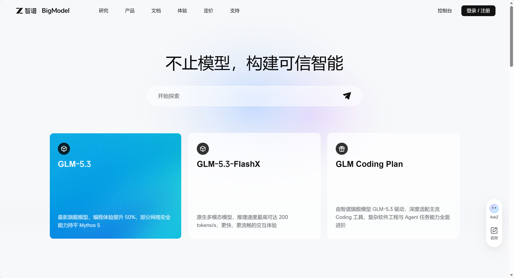

**免费额度**：
- **注册送 2000 万 tokens 体验包**（注册页横幅实测文案，https://www.bigmodel.cn/invite）；
- **GLM-4-Flash 长期免费**（官方文档：https://docs.bigmodel.cn/cn/guide/start/pricing.md）；
- **GLM-4.7-Flash / FlashX 等限时免费**（以官网公告为准）；
- **邀好友领资源包**：控制台右上角活动入口，最高 **2 亿 Tokens**，是体验包用完后的补充免费来源。

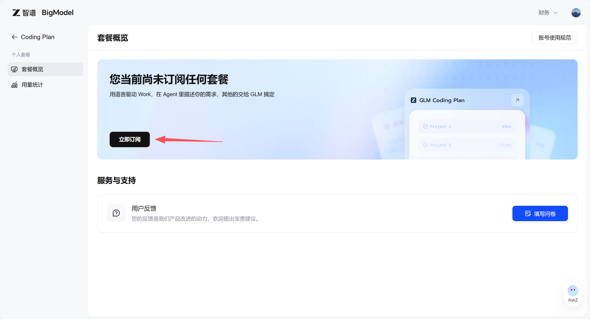

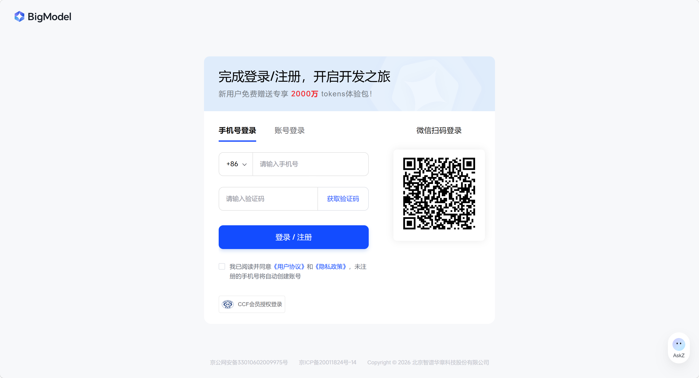

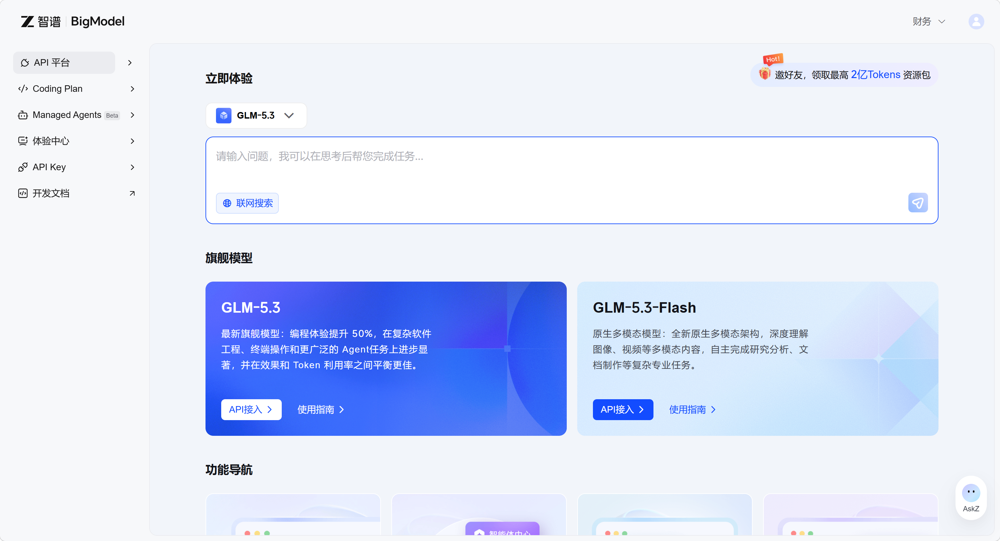

**付费形态**：

| 形态 | 说明 | 价格 |
|---|---|---|
| **按量付费** | GLM-5.3 输入 8 元/输出 28 元/百万 tokens | - |
| **GLM Coding Plan**（积分制） | Lite 118 / Pro 538 / Max 1078 元/月（老用户保留 49/149 元） | - |
| **Coding 团队版** | 2 席位起购 | - |

**渠道参数**：协议 `openai`，端点 `https://open.bigmodel.cn/api/paas/v4`。

**Key 获取注意：标准 Key 与套餐 Key 分开管理**

- 「模型标准 API（按量计费/资源包）」与「套餐的 API Key」是两套凭据，自 10 月 16 日起在「API Key」页新建的 Key **仅可用于标准 API**（页面提示原文）；
- Coding Plan 的 Key 要在 Coding Plan 订阅流程里单独获取，不能拿标准 Key 调套餐额度，反之亦然——和火山引擎三种 Key 各自独立是同一个道理。
- 标准 Key 入口：控制台左侧「API Key」→「标准 API key」→「+ 新建API Key」。

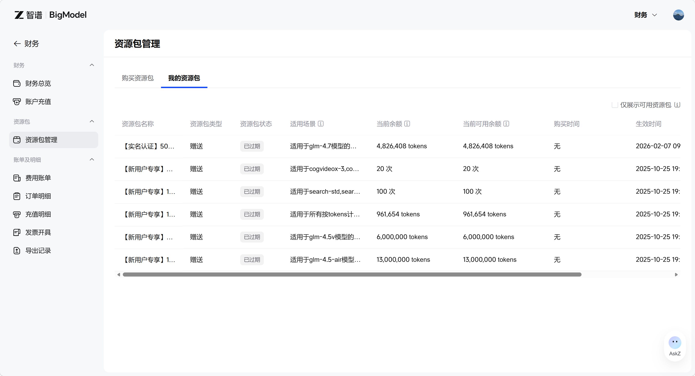

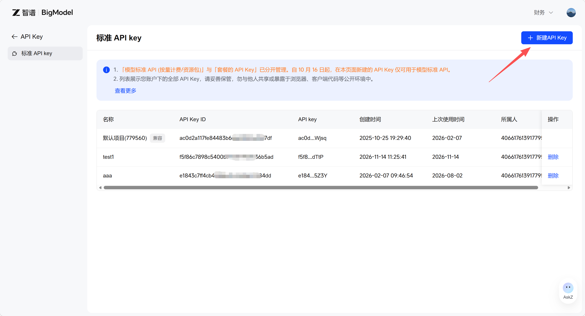

**模式说明**：

- `payg`：按量付费，实际有免费层（注册赠金 + Flash 系列），建议在渠道配置中添加 note 标注
- `coding`：Coding Plan 订阅，`tier: "paid"`，月付制，含 `billing: "coding_plan"` 标识

**常见模型**：`glm-5.3`, `glm-5.3-flash`, `glm-5.3-flashx` 等。

**适用场景**：自然语言理解、代码生成、多模态交互等。

#### 套餐使用说明

- **按量付费（payg）**：Facet 已接入账户余额查询，渠道配置页渠道卡「厂家用量」行显示「余额 / 充值 / 累计消费」（接口 `GET /api/biz/account/query-customer-account-report`，用渠道 key 直查）。
- **GLM Coding Plan（积分制）**：待接入套餐用量查询。控制台「Coding Plan → 用量统计」页可直接人工查看套餐消耗（见上方 zhipu-05 截图）；需调研项：Coding Plan 的积分消耗窗口（日/周/月）、积分余额接口、可用模型清单（待官网核实）。

---

### 4.3 阿里云百炼

**官方入口**：[https://bailian.console.aliyun.com/ ](https://bailian.console.aliyun.com/)

**第一步：注册/登录阿里云，进入百炼控制台**

1. 打开阿里云登录页，用手机号验证码登录（没有账号点「前往注册」；右下角「RAM 登录」是子账号入口，主账号不用管）；
   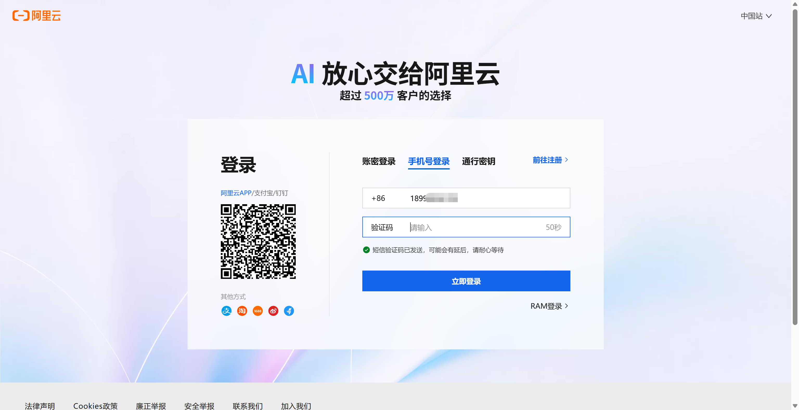
2. 登录后进入百炼控制台，首页底部三个入口各管一件事：**API Key**（创建数据面推理 Key）、**Token Plan**（购买/管理套餐）、**免费额度**（查看各模型免费 Token 余量）；
   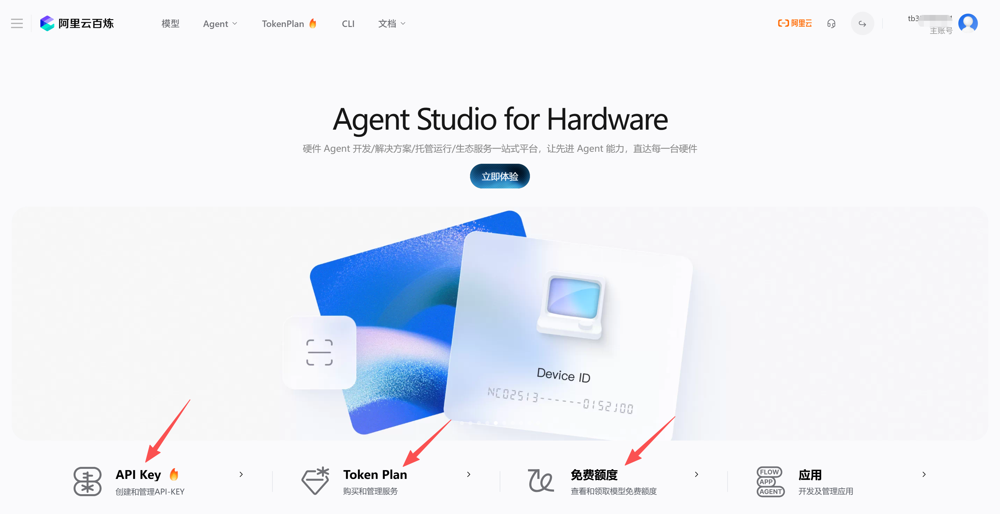

**第二步：查看新人免费额度**

- **新人每款模型约 100 万 tokens**（全平台约 7000 万），90 天有效；实名认证后额外赠送少量 tokens。
- 「费用用量 → 免费额度」页可逐模型查看剩余额度、到期时间与状态（示例账号 68 个模型有额度）。每行的「用完即停」开关默认开启——官方机制是免费额度用尽即返回 403（`AllocationQuota.FreeTierOnly`）并自动停止服务，**不会转按量扣费**；
  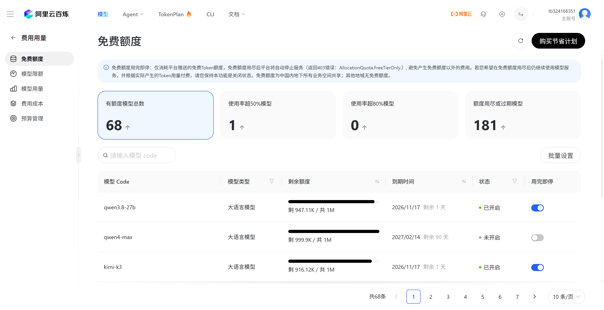

**付费形态**：

| 形态 | 说明 | 价格 |
|---|---|---|
| **按量付费** | 所有模型均支持按量计费 | - |
| **Token Plan 个人版** | Lite 39 / Essential 79 / Standard 139 / Pro 312 元/月，月 Credits 20,000 / 45,000 / 80,000 / 200,000；新客首购 Lite、Essential 享 5 折 | - |
| **Token Plan 团队版** | 150 元/坐席/月 | - |
| **Coding Plan（旧版）** | 仅剩 Pro 200 元/月，停售过渡中 | - |

Token Plan 个人版四档价格、月 Credits 与可并发 Agent 数（首购 5 折限时活动）：

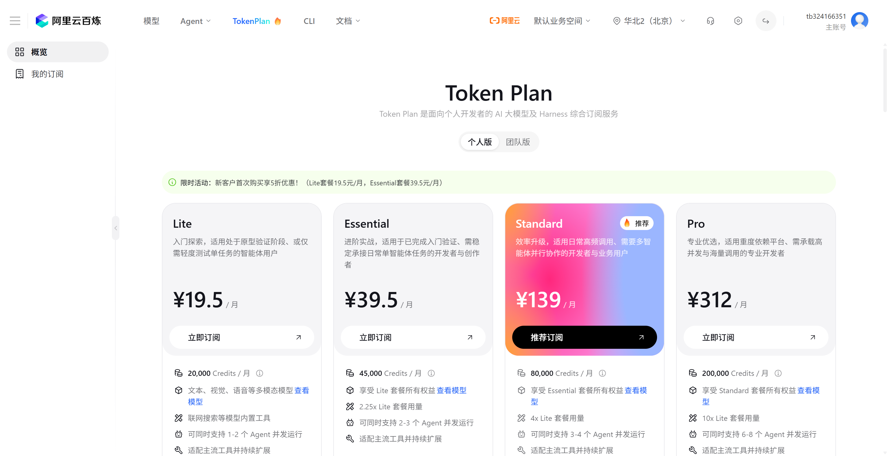

**渠道参数**：协议 `openai`，端点 `https://dashscope.aliyuncs.com/compatible-mode/v1`（控制台 API-KEY 页展示的业务空间专属域名 `*.maas.aliyuncs.com` 亦可；DashScope 旧域名自 2026-09-10 起进入维护状态，仍可正常使用但不再新增特性）。

**第三步：创建数据面 API Key（`sk-` 开头，调模型用）**

- 控制台首页「API Key」进入 API-KEY 管理页，点「创建 API-KEY」；Key 创建后**只显示一次**，立即复制保存；
- 页面顶部同时展示按量付费 Base URL（openai 与 anthropic 两种协议端点），配置 Facet 渠道时可直接参考；
  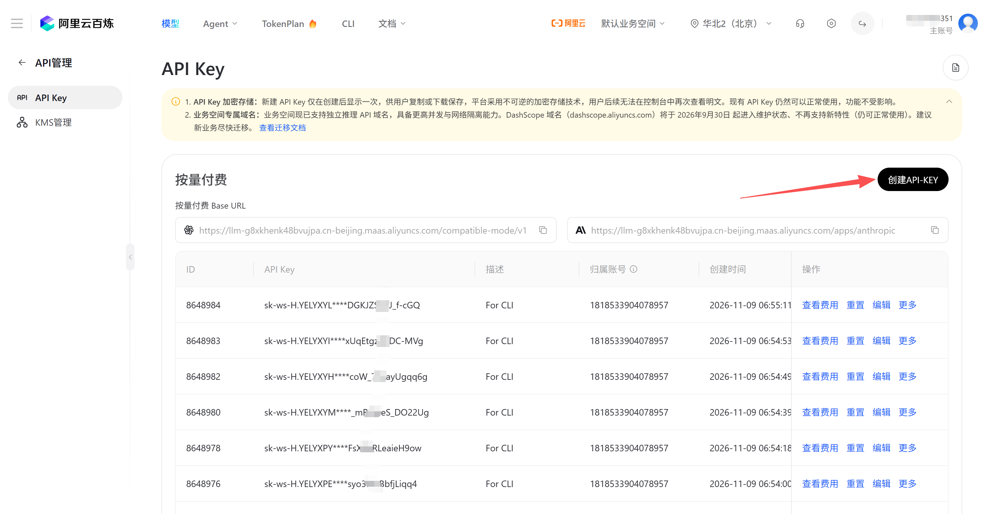

**模式说明**：

- `payg`：按量付费
- `token_plan`：Token Plan 套餐，`tier: "paid"`，月付制，`billing: "token_plan"` 标识，`plan_key: "agent"`（对应 agent 键名）
- `coding`：旧版 Coding Plan（可选 note）

**常见模型**：`qwen-turbo`, `qwen-plus`, `qwen-max`, `embedding` 等。

**适用场景**：企业级应用、大规模并发、长文本处理等。

**第四步：新建 RAM 子用户拿 AK/SK，并完成双重授权（查免费 token 使用量的前提）**

- 免费 token 使用量**不在 `sk-` 数据面 Key 里**，要经百炼管理面 OpenAPI 查询（Facet 的 `bl usage free` 免费额度对齐任务用的就是它），所以**必须新建一个 RAM 子用户**（[https://ram.console.aliyun.com/users](https://ram.console.aliyun.com/users)）获取 AccessKey ID / AccessKey Secret 两个参数，不要用数据面 Key，也不要直接用主账号 AK/SK。
- 主账号打开 [RAM 访问控制 → 用户](https://ram.console.aliyun.com/users)，点「创建用户」；
  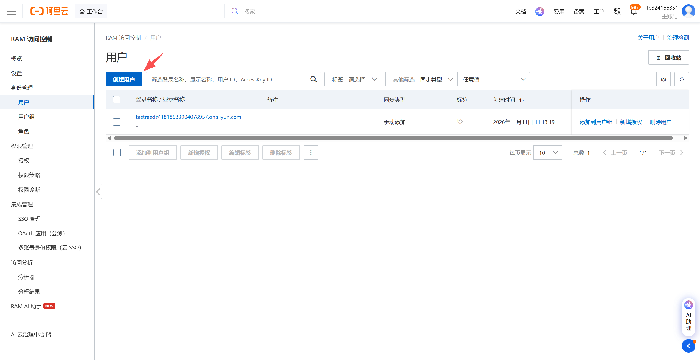
- 填写登录名（如 `facet`），访问方式**勾选「使用永久 AccessKey 访问」**（生成 AK/SK，无需控制台登录密码）；创建成功后立即复制 AccessKey ID / AccessKey Secret——**Secret 只显示一次**；
  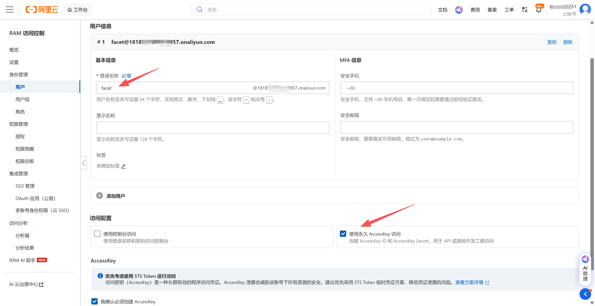
- **RAM 授权**：在该用户「权限管理」→「新增授权」，勾选系统策略 **AliyunBailianFullAccess**（免费额度查询走百炼 OpenAPI 需要它；仅调模型可改挂 AliyunBailianDataFullAccess），缺这一步查询报 `NoPermission`；
  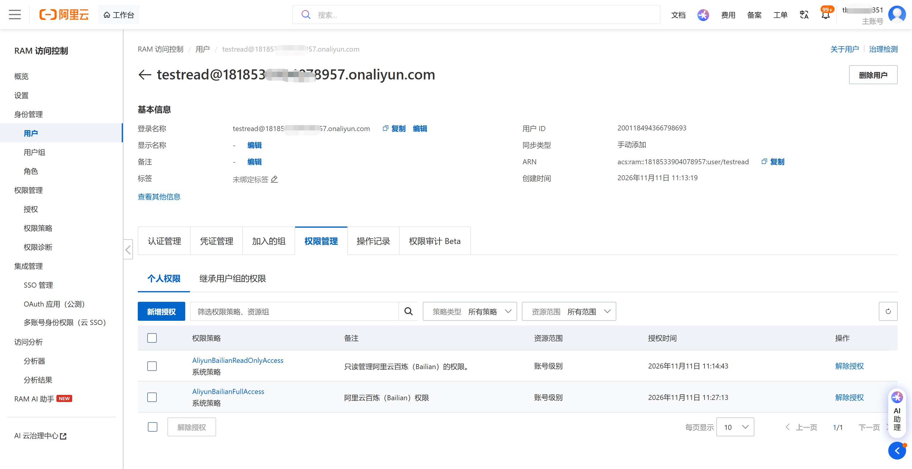
- **百炼控制台授权（把子账号加进业务空间）**：RAM 策略只解决「能访问百炼」，还要在百炼控制台把该 RAM 用户**关联到业务空间**，缺这一步查询报 `Team.NotAuthorised`：
  1. 打开百炼控制台 [业务空间管理](https://bailian.console.aliyun.com/cn-beijing/settings/workspace)（左侧「管理 → 业务空间管理」），确认要使用的业务空间——**默认业务空间**即可，其「业务空间 ID」就是控制台 API Host 的前缀（示例 `llm-g8xkhenk48bvujpa`）；
     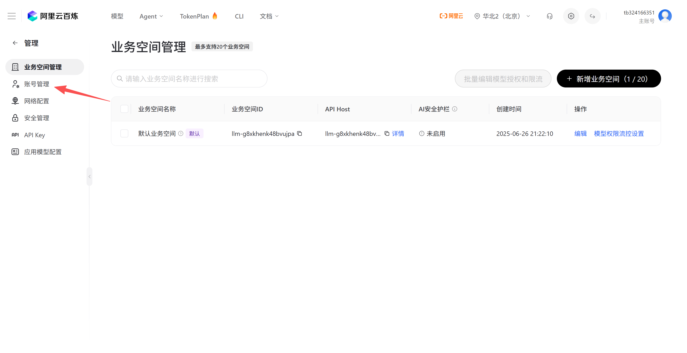
  2. 在该业务空间的「账号管理」中点「添加用户」，类型选 **RAM 用户**，在下拉列表中选中刚创建的子账号（如 `facet`），点「确定」；
     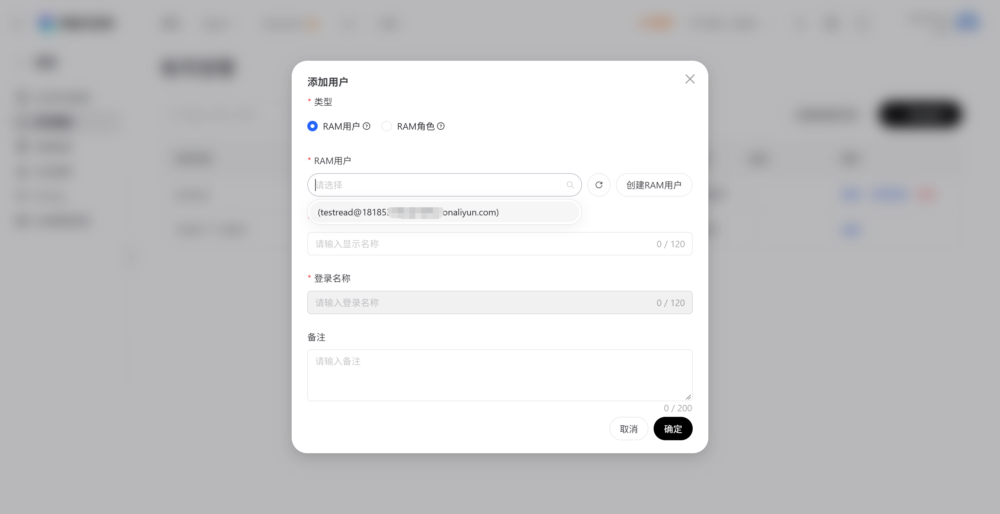
  3. 添加成功后「账号管理」列表会出现这条记录（类型列显示 **RAM 用户**，含登录名称与 RAM ID），行内「权限管理」可继续细分它在空间内的模型 / 功能权限；
     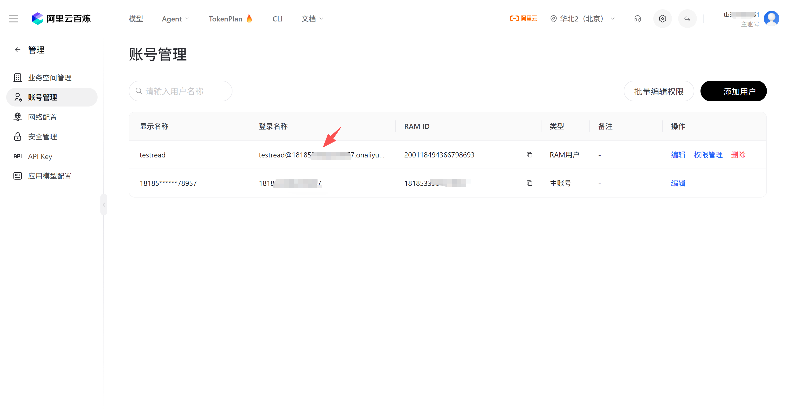
- 默认业务空间全部模型可调；自建业务空间还需由超级管理员在空间内为模型开通「模型调用」，否则报 `Workspace.NotAuthorised`。
- 最后把 AK/SK 填到 Facet 百炼渠道「管理凭据 / credential_envs（`BAILIAN_ACCESS_KEY_ID`、`BAILIAN_ACCESS_KEY_SECRET`）」——它们只用于查免费额度使用量，**不是**推理调用的 `sk-` Key。

#### 套餐使用说明

- **免费额度使用量查询（已接入）**：RAM 子用户 AK/SK 完成上述 RAM 授权 + 业务空间成员双重授权后，Facet 经 `bl usage free` 每日定时对齐各模型剩余免费额度，额度用尽的模型自动移出免费渠道并向用户告警。
- **Token Plan（个人/团队版）**：待接入套餐用量查询。需调研项：Token Plan 的额度窗口（日/月）、用量查询接口、各档位可用模型清单（待官网核实）。
- **按量付费**：余额/欠费查询待接入（需确认百炼是否提供 API key 可查的余额接口）。

---

### 4.4 魔搭 ModelScope

**官方入口**：[https://modelscope.cn](https://modelscope.cn)

**免费额度**：
- **每日登录领 200 魔粒**（24h 有效，约 200–400 次调用）；
- **API-Inference 按魔粒计费**（0.5 / 1 / 2 粒/次，随模型浮动），**完善邮箱即可使用**，无需绑定阿里云实名；
- 魔粒不可购买，官方明示商用请用商业平台 API。

**步骤**

1. 打开[魔搭官网](https://modelscope.cn)，注册/登录账号（手机号或邮箱，也可用 CSDN / GitHub / 淘宝第三方登录，新用户限时赠免费 GPU 算力）；
   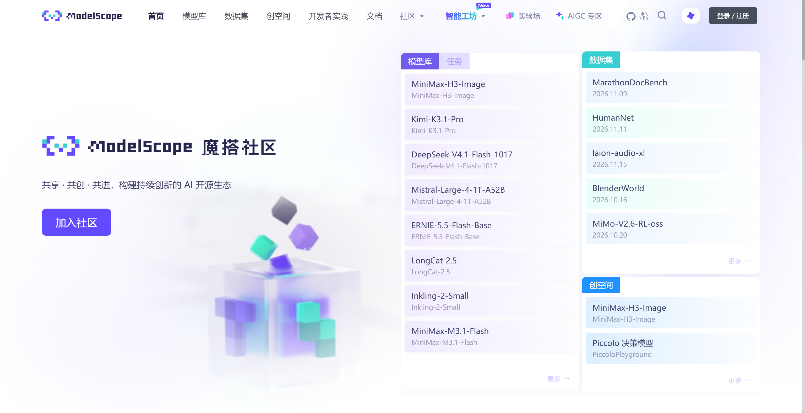
   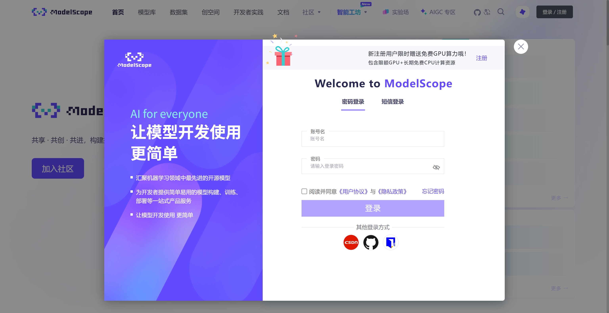
2. 进「我的魔粒」页领取免费魔粒：「注册并登录」+200、「绑定阿里云账号」+50（每日各一次，有效期 1 天），开源贡献任务（模型 / 数据集 / 创空间影响力）每项 +50；
   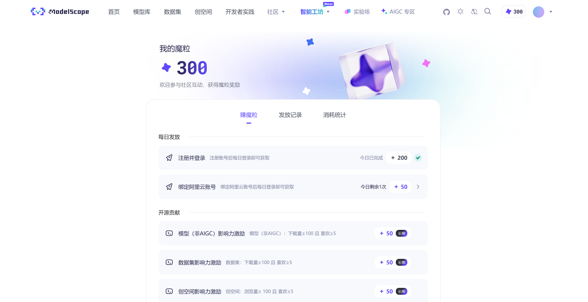
   「发放记录」页可见每日发放明细（示例累计 600 魔粒）：
   
3. 右上角头像 →「设置」→ 左侧「访问令牌」菜单，进入访问令牌页；
   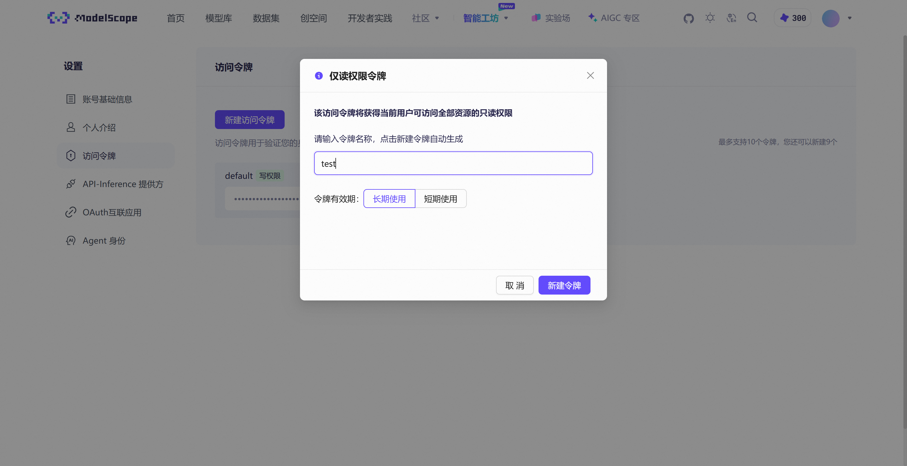
4. 点「新建访问令牌」，输入令牌名称（如 `facet`），有效期选「长期使用」；令牌由系统自动生成，单账号最多 10 个，**创建后只显示一次**，立即复制保存。
   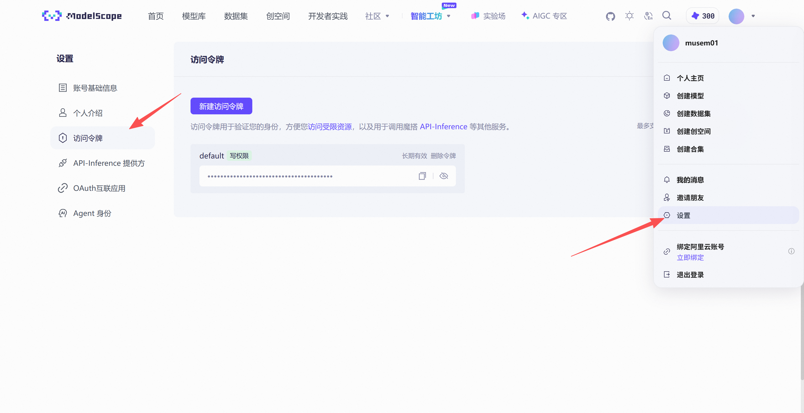

**付费形态**：**无任何付费套餐**，魔粒不可购买，官方明示商用请用商业平台 API。

**渠道参数**：协议 `openai`，端点 `https://api.modelscope.cn/v1`。

**模式说明**：

- 免费层：`tier: "free"`，`free_limits: {rpd: 250, note: 每日登录领 200 魔粒（约 200–400 次调用），当日有效}`（与注册表一致）；
- 无付费套餐，仅供非商用免费研究。

**常见模型**：`qwen-2-57b-a3b`, `chatglm3-6b`, `stable-diffusion` 等。

**适用场景**：学术研究、个人项目、非商业实验等。

---

### 4.5 小米 MiMo

**官方入口**：[https://mimo.mi.com](https://mimo.mi.com)（活动页）；控制台 [https://platform.xiaomimimo.com](https://platform.xiaomimimo.com)（API Keys 与余额页）

**免费额度**：
- **大陆新用户 ¥10 体验金**（40 天内，仅抵扣按量）；
- 邀请好友注册**双方各得 ¥10**（限前 30 人），好友首单 9 折、之后每单返实付 10% 赠金。

**步骤**

1. 打开官网，首页弹出「邀创造者体验 MiMo V2.6」促销活动（注册各得 ¥10 体验金，40 天有效）；
   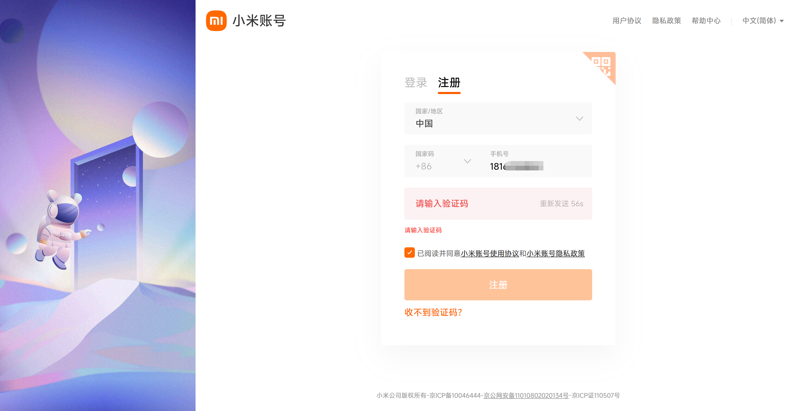
2. 用手机号注册小米账号（选国家/地区、填验证码、勾选协议后提交）；
   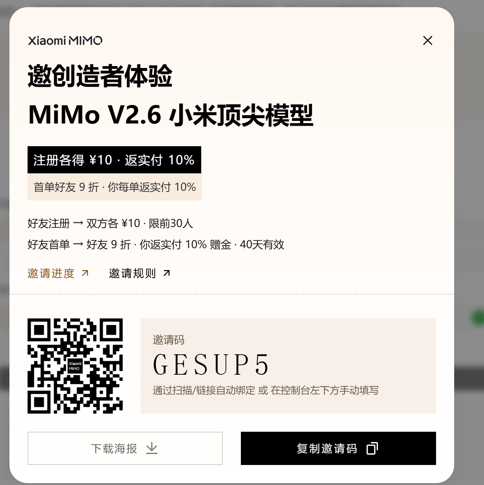
3. 注册后登录控制台，¥10 体验金在「账户余额」页可见：现金余额与赠送余额分列，可设预算阈值、在线充值（小米支付 / 支付宝 / 微信）；
   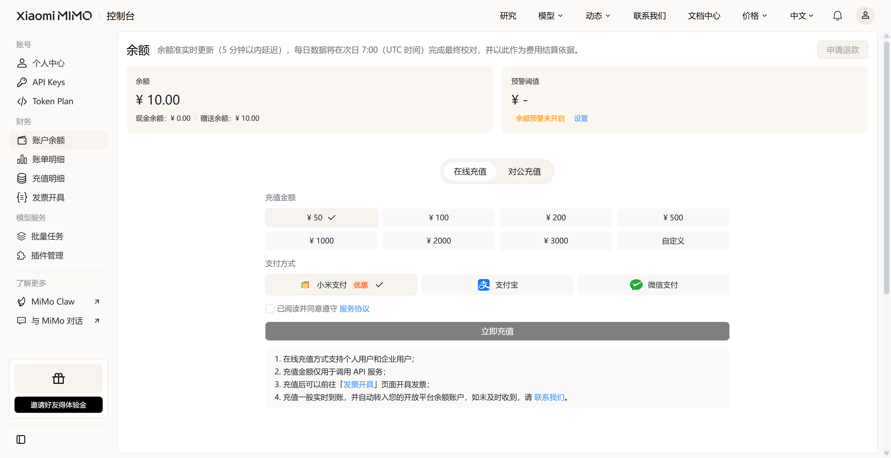
4. 控制台 → **API Keys** → 点「新建 API Key」，填一个名称（如 `facet`）；
   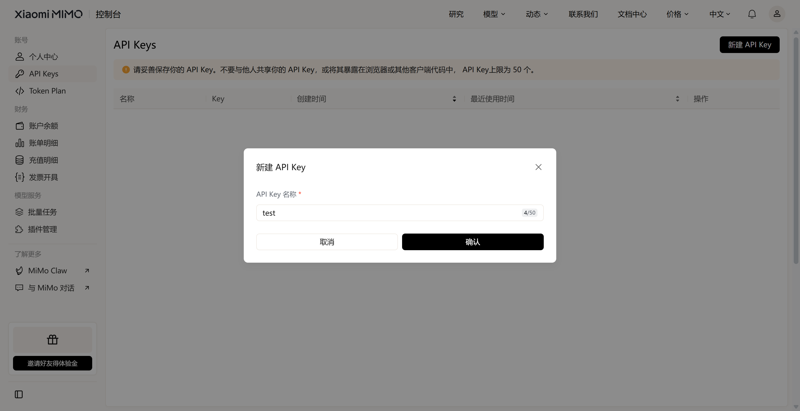
5. 复制生成的 Key（`sk-` 开头，**只显示一次**，关闭弹窗后无法再查看）。
   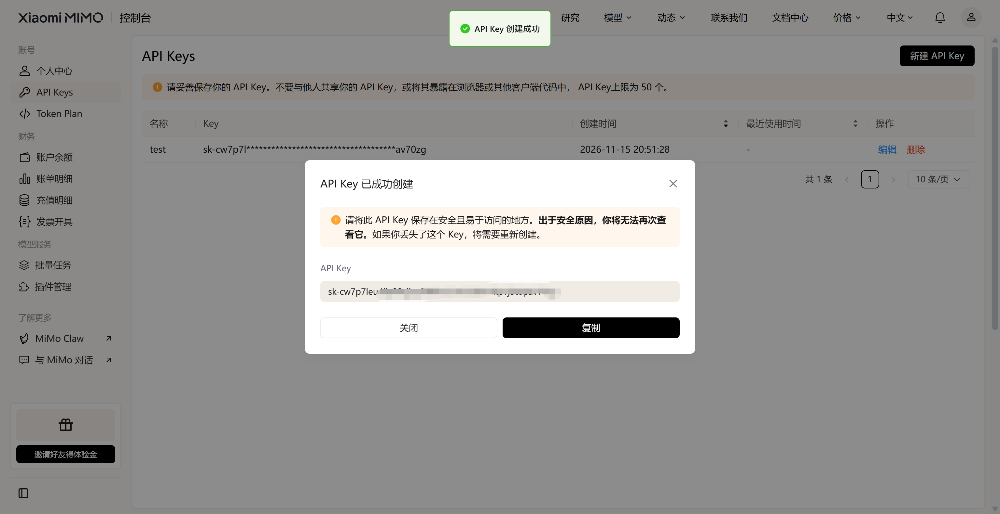

**付费形态**：

| 形态 | 说明 | 价格 |
|---|---|---|
| **按量计费** | mimo-v2.6-pro 输入¥3/输出¥6 每百万 | - |
| **Token Plan 个人版** | Lite 39 / Standard 99 / Pro 329 / Max 659 元/月（按年计费立减后折合 34 / 87 / 289 / 579 元/月） | - |
| **Token Plan 团队版** | 详见平台官网 | - |

个人版支持 V2.6 全旗舰模型（文本 / 视觉 / 语音），套餐 Credits 40 天内有效；连续包年 88 折、首购优惠限时限量，支持 OpenClaw / Codex / MiMo Claw 等主流编程框架：

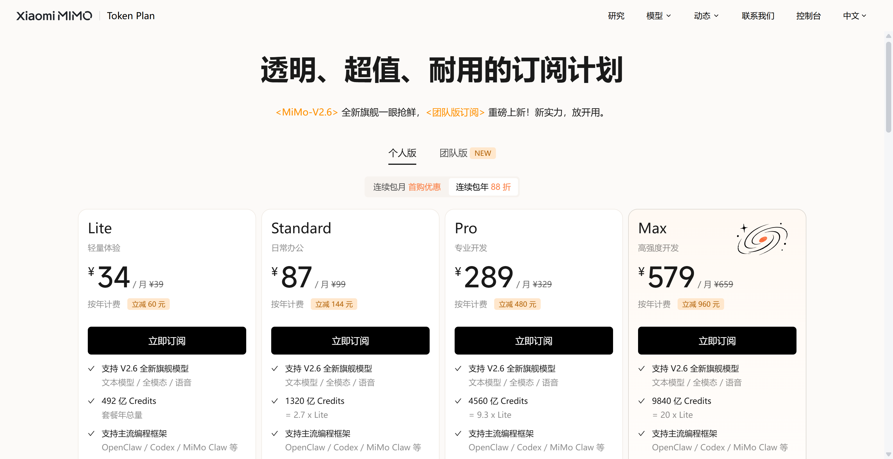

**渠道参数**：协议 `openai`；按量付费端点 `https://api.xiaomimimo.com/v1`，Token Plan 套餐端点 `https://token-plan-cn.xiaomimimo.com/v1`（与注册表一致，`/v1/models` 支撑模型自动同步）。

**模式说明**：

- `payg`：按量付费，`free_quota` 中建议标注 `¥10 体验金`（免费额度说明）
- `token_plan`：Token Plan 套餐，`tier: "paid"`，月付制，`billing: "token_plan"` 标识

**常见模型**：`mimo-v2.6-flash`, `mimo-v2.6-pro` 等（还有 `mimo-v2.5-asr` 等语音 / 嵌入模型；向导与渠道配置页「拉取模型清单」会自动挑可对话模型试通）。

**适用场景**：移动端 AI、个人开发、轻量级应用等。

**⚠️ 备注**：payg 建议在免费额度处标注“¥10 体验金（40天内仅抵扣按量）”，帮助用户快速识别免费入口。

---

### 4.6 Kimi（月之暗面）

**官方入口**：[https://platform.kimi.com](https://platform.kimi.com)

**免费额度**：
- **国内新用户注册实名后赠 15 元代金券**（3 个月有效），见官方帮助页：https://www.kimi.com/zh-cn/help/kimi-api/api-free-trial

**步骤**

1. 打开 [platform.kimi.com](https://platform.kimi.com)（KIMI 开放平台），验证码 / 手机 / 账号密码任选一种注册登录；
   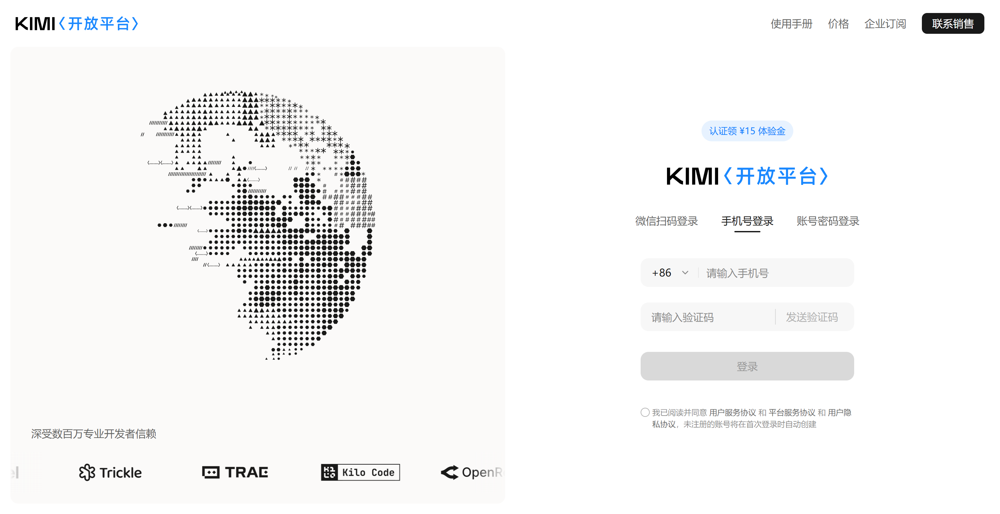
2. 左侧「模型认证」完成**个人认证**（实名）：未认证时 API 调用配额受限，15 元代金券也在实名后发放；企业主体可选「企业认证」；
   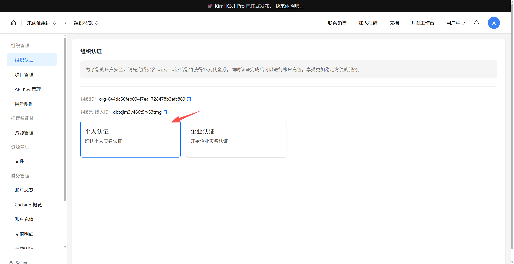
3. 左侧「账户总览」核对免费额度到账：余额卡显示**代金券 ¥15**（无门槛，示例提示限 Kimi K3.1 Pro Highspeed 版使用，以账户提示条为准），现金余额与今日 / 本月 / 总消费同行展示；
   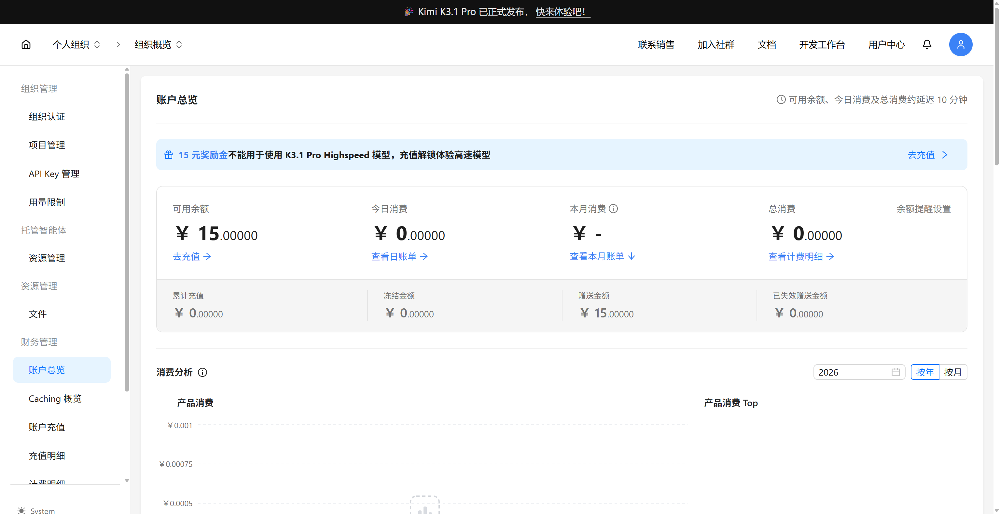
4. 左侧「API Key 管理」→ 右上「**创建 API Key**」，生成后立即复制保存（只显示一次）；
   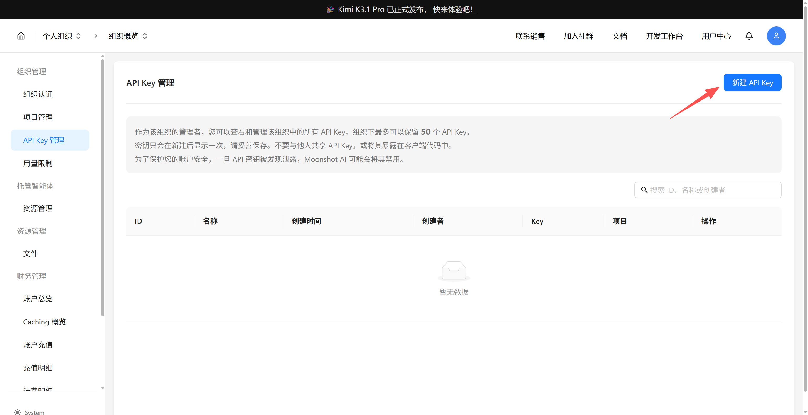
5. 把 Key 填进 Facet 渠道（协议 `openai`，端点见下）保存即可。

**付费形态**：**仅按量付费**（官方明确「无订阅制方案」）：

| 形态 | 说明 | 价格 |
|---|---|---|
| **kimi-k3.1-pro** | 输入¥13/输出¥68 每百万 tokens | - |

**渠道参数**：协议 `openai`，端点 `https://api.moonshot.cn/v1`（与注册表一致，`/v1/models` 支撑模型自动同步）。

**模式说明**：

- `payg`：按量付费，`free_limits` 或 `free_quota` 中建议标注“新人 15 元代金券（3个月有效）”，其余模型按量计费
- 官方明确：**API 无订阅制方案**，Kimi Code 订阅（Plus/Pro/Max/Ultra）与开放平台 API **不互通**，不计入 API 形态

**适用场景**：长文本对话、知识库检索、代码辅助等。

**⚠️ 备注**：payg 建议加免费标注（15 元券），帮助用户理解实际可用额度。

#### 套餐使用说明

- **无套餐，仅余额展示**：Kimi 开放平台没有包月/Token Plan 类 API 套餐（Kimi Code 订阅与 API 不互通），Facet 只注册了 `payg` 模式，渠道配置页渠道卡「厂家用量」行显示账户余额。
- **余额查询**：Facet 已接入 `GET https://api.moonshot.cn/v1/users/me/balance`（用渠道 Key 直查，TTL 5 分钟），显示「可用 / 现金 / 代金券」三项（CNY）：
  - 现金余额可为负（欠费状态），摘要会标注「欠费」；
  - 可用余额 ≤ 0 时推理会报 `exceeded_current_quota_error`，Facet 在摘要追加「余额不足，调用将失败」并按账户级失败冻结渠道。
- **可用模型**：以 `GET https://api.moonshot.cn/v1/models` 实时返回为准，由每日自动维护任务同步写入注册表。

---

### 4.7 DeepSeek

**官方入口**：[https://api-docs.deepseek.com](https://api-docs.deepseek.com)

**第一步：注册/登录开放平台**

1. 打开 DeepSeek 开放平台，用手机号验证码或微信扫码登录（没有账号验证码登录时自动注册）；
   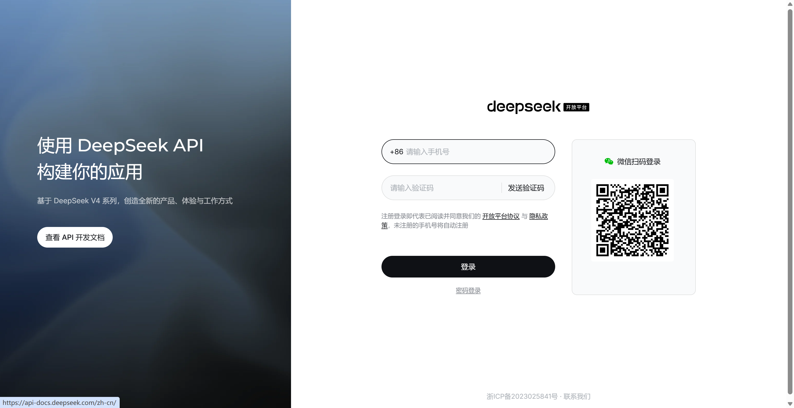

**第二步：创建 API Key**

- 登录后左侧「API keys」→「创建 API key」；Key **仅在创建时可复制**，立即保存；单个账号最多可保留 300 个 API Key；
  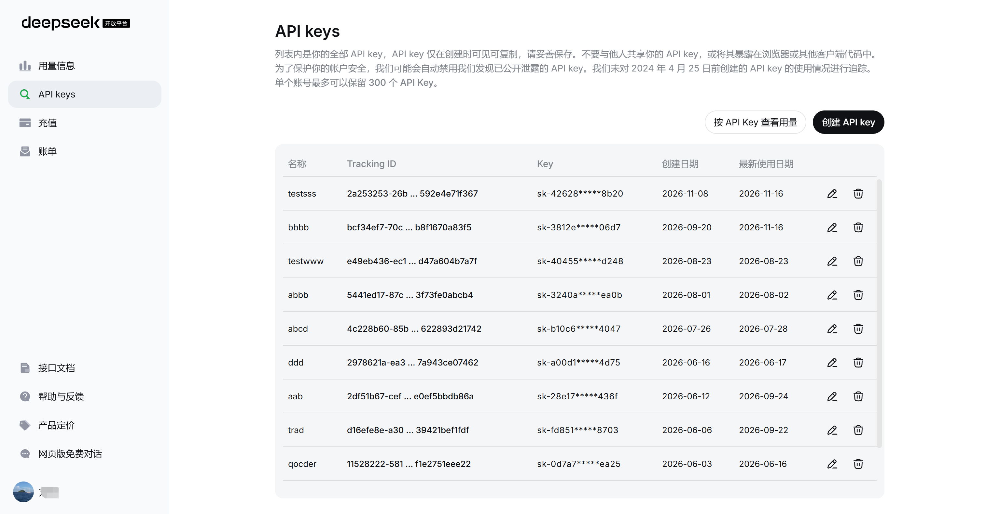

**用量与充值**（左侧「用量信息」）：

- 页面展示充值余额与累计消费金额，以及近 7 天消费金额 / API 请求次数 / Tokens 消耗图表，可按 API Key 过滤并导出；余额不足时在此「去充值」（建议顺手开启余额告警）；
  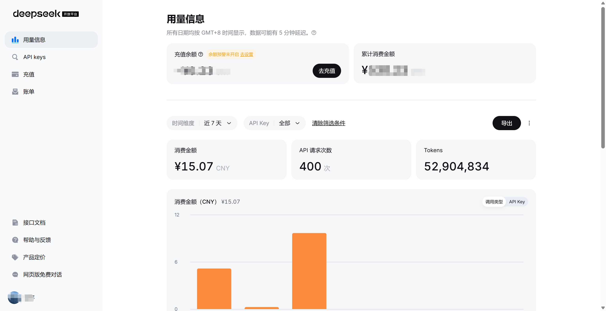

**免费额度**：
- **无明确官方免费额度**（仅活动性「赠送余额」机制，非常规福利）。

**付费形态**：**仅按量付费**（峰谷计价，峰时 = 谷时 ×2）：

| 形态 | 说明 | 价格 |
|---|---|---|
| **deepseek-flash** | 谷输入 $0.15/输出 $0.6，峰输入 $0.3/输出 $1.2 每百万 | - |
| **deepseek-v4-pro** | 同等峰谷计价（具体以官网定价页为准） | - |

**渠道参数**：协议 `openai`，端点 `https://api.deepseek.com/v1`。

**模式说明**：

- `payg`：按量付费，`tier: "paid"`，无免费额度（活动性赠送除外）
- 与注册表一致：无 Token Plan / Agent Plan 等套餐

**适用场景**：代码生成、长文本处理、多模态对话等。

**⚠️ 备注**：注册表无需修改，与官网保持一致。

---

### 4.8 腾讯混元

**官方入口**：[https://cloud.tencent.com/product/hunyuan](https://cloud.tencent.com/product/hunyuan)

**第一步：进入混元产品控制台**

1. 打开腾讯混元大模型官网，点「产品控制台」进入 TokenHub（模型调用、免费资源与 API Key 都在 TokenHub 里）；
   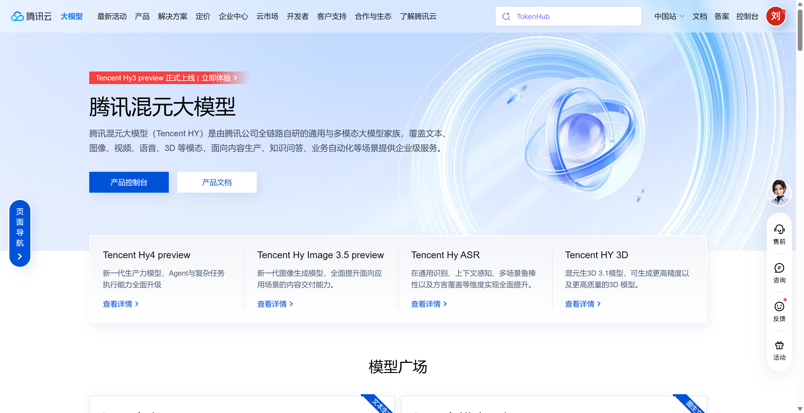

**第二步：开通管理与领取免费资源**

- TokenHub 左侧「开通管理」：顶部「免费体验」显示可领资源数（示例 23/53），点「领取免费资源」；下方模型列表逐行展示**免费额度余量、到期时间**与「开通按量计费」开关（示例 hy4-flash / hy4 / hy3 / kimi-k3.1-pro 等 34 个模型，免费额度剩余 100%、到期 2027-11-16）；顶部「按量计费」支持一键开启 / 一键关闭；
  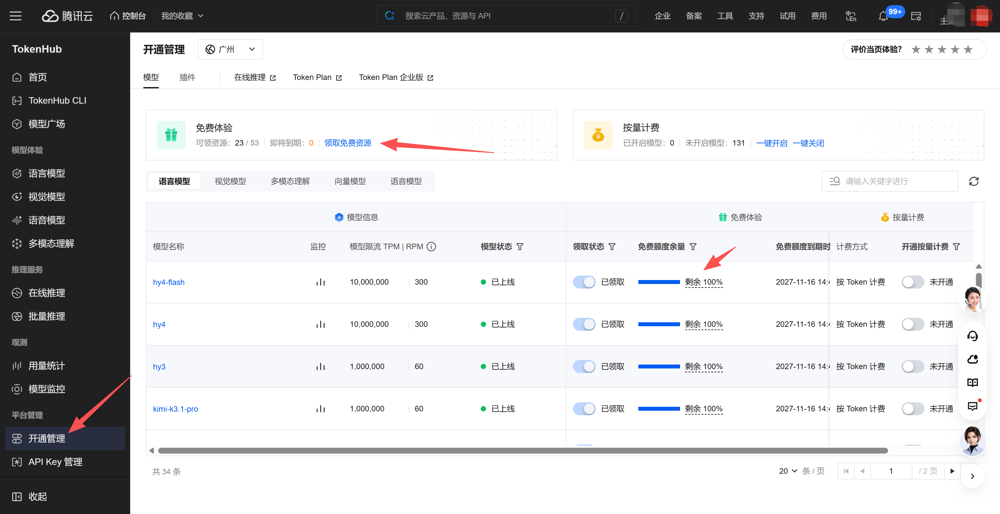
- 领取后可在「语言模型」页直接在线体验（当前旗舰 Hy4），无需写代码即可验证效果；
  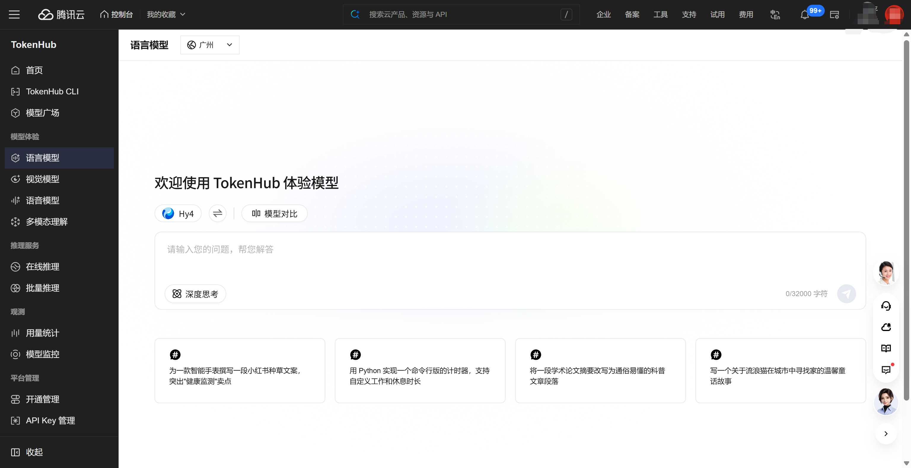

**第三步：创建 API Key**

- TokenHub 左侧「API Key 管理」→「创建 API Key」，创建后即可通过 API Key 调用 TokenHub 提供的模型和推理服务；
  

**免费额度**：
- **首次开通送一次性资源包**（8 款模型共享 100 万 tokens，1 年有效）；
- **TokenHub 新用户免费体验包**（活动至 2026-12-31）。

**付费形态**：

| 形态 | 说明 | 价格 |
|---|---|---|
| **token 后付费** | Hunyuan-a13b 输入¥0.5/输出¥2 每百万 tokens | - |
| **预付费资源包** | 如 1 万点 100 元 | - |
| **TokenHub Token Plan 包月** | Hy Token Plan 28/78/238/468 元/月；通用 Token Plan 39/99/299/599 元/月 | - |

**渠道参数**（与注册表一致）：
- `agent`（Token Plan）：`openai` 协议，端点 `https://tokenhub.tencentmaas.com/plan/v3`
- `payg`（按量付费 / 免费额度）：`openai` 协议，端点 `https://tokenhub.tencentmaas.com/v1`

> ⚠️ **Key 与端点必须成对**：TokenHub「API Key 管理」创建的 `sk-` Key 只认 `tokenhub.tencentmaas.com`；旧域名 `api.hunyuan.cloud.tencent.com` 只认旧混元控制台（`console.cloud.tencent.com/hunyuan/start`）创建的 Key，混用报 401（`Incorrect API key provided`）。腾讯官方已全面转向 TokenHub，免费额度资源也在 TokenHub「开通管理」领取，新接入一律用上表端点。

> ⚠️ **未购买 Token Plan 不要选套餐（agent）模式**：`/plan/v3` 是 Token Plan 订阅专用通道，且必须用**套餐专属 API Key**——在「Token Plan 个人版」页面内生成（每个套餐仅一把；通用 Token Plan 与 Hy Token Plan 共用同一把），与「API Key 管理」里的普通按量 Key **不是同一把**，混用报 401（`The API Key does not exist or signature verification failed`，引导链接指回 `console.tencentcloud.com/tokenhub/apikey`）。同一把 Key 在 `/v1` 鉴权通过、在 `/plan/v3` 报 401，即为此因——先走 `payg`（`/v1`）模式，买了套餐再切 agent。

> 📋 **agent 模式的两个限制**：① Token Plan 没有模型列表接口（`/plan/v3/models` 为 404），渠道「拉取模型」必然失败，请直接手填 Model ID（注册表已预置 `hy4-flash`、`deepseek/deepseek-v4-flash`、`glm-5.3`、`kimi-k3` 等清单，可在厂家管理页展开）；② 官方限制套餐仅限 AI 工具（Claude Code、CodeBuddy Code 等）内使用，**禁止自动化脚本/应用后端批量调用**，违规可能封禁 Key——作为网关后端接入请优先 `payg`。

> 📎 **Anthropic 协议入口**（注册表未单列模式，需要时在渠道编辑器里手动改）：套餐模式 Base 为 `https://tokenhub.tencentmaas.com/plan/anthropic`（Messages 路径 `/plan/anthropic/v1/messages`，Key 同套餐专属 Key）；按量模式 Base 为 `https://tokenhub.tencentmaas.com/v1`（Messages 路径 `/v1/messages`，仅部分模型支持）。

> 🎯 **拉取模型为什么只列免费模型**：TokenHub 的 `GET /v1/models` 会返回 **140+ 个**服务 ID（含图像 19、视频 48、3D 27、语音 17、向量 4——这些按积分/另计费，chat 网关也用不上），而新人免费体验包覆盖的是**全部语言模型 + 全部多模态理解模型**（各 100 万 Tokens / 1 年，主账号共享额度，2026-12-31 前可领）。渠道「拉取模型」只回免费且在线的模型，具体来源见下两条。

> 🔑 **实时清单（推荐，需 SecretId/SecretKey）**：TokenHub 管理面 `DescribeModelList` 会为每个模型返回 `FreeTrialInfo`（免费体验额度），是官方免费覆盖的机器可读来源。在「访问控制 → API 密钥管理」`https://console.cloud.tencent.com/cam/capi` 新建**SecretId/SecretKey**（子账号挂只读策略 `QcloudTokenHubReadOnlyAccess` 即可，别挂写权限），填到渠道凭据区。拉取时 `facet-tokenhub-quota` 用 TC3-HMAC-SHA256 签名调该接口，取有 `FreeTrialInfo` 且 token 计费的模型（语言 + 多模态理解，自动排除图像/视频/3D/语音等生成类）∩ 上游在线清单——官方新增或收缩免费模型**自动跟随，无需人工维护**。注意这里要的是 API 密钥，不是「API Key 管理」里 `sk-` 开头的 Bearer Key（后者只能调 chat，无法签名管理面）。

> 🔧 **没配凭据时：静态子集 + 对账告警**：回退注册表 `free_models` 子集（44 个 = 语言模型 40 + 多模态理解 4，取自官方模型列表文档 1823/130051），拉取时取 `free_models ∩ 上游在线清单`；若一个都对不上（登记清单过时），自动回退全量并提示。日常维护任务**只对账、不自动改**：每天刷新上游 `models` 后，登记的免费模型已不在上游（下线/改名）或上游新增 chat 类模型未登记，维护面板出 `provider_free_models` 告警，确认后手动增删。三种变化的影响：① 模型下线/改名——与上游取交集，自动不显示，无需处理；② 新增免费模型——不登记则漏列，按告警补登记；③ 免费政策收缩——未及时删会继续列出（可能计费），按告警清理。免费渠道的周期对账（free-align）在凭据缺失时**静默跳过**、保留现有映射，不会反复告警。清单整体失效时拉取自动回退全量并提示，不会把渠道弄空。

**第四步（可选）：购买 Token Plan**

- 「Token Plan 个人版」→「Hy Token Plan」（混元专用）四档：Lite 28 元/月（560 积分，约 70 轮问答）、Standard 78 元/月（推荐，1560 积分，约 200 轮）、Pro 238 元/月（4760 积分）、Max 468 元/月（9360 积分）；面向 Agent 工作负载设计，适配 Coding Agent、文档自动化、多步工具调用等工作流；
  
- **峰谷计费说明**（通用 Token Plan）：自北京时间 2026-10-30 22:30 起，除 DeepSeek-V4 Flash / DeepSeek-V4-Pro（原厂直供）外的其余 DeepSeek 模型执行峰谷计费——工作日（周一至周五）9:00–12:00、14:00–18:00 为高峰时段，其余时段为空闲时段，周末（周六、周日）全天为空闲时段；
- **联网搜索计费**：自北京时间 2026-11-16 00:00 起，Token Plan 中 DeepSeek 原厂供型发起的联网搜索调用（Search 搜索 / Fetch 网页抓取）计入套餐包积分抵扣。

**模式说明**：

- `payg`：按量付费，`free_quota: {tokens: 1000000, period: "total"}`（开通送 100 万 tokens/1 年）
- `agent` / `token_plan`：Token Plan 套餐，新增入口（此前缺失，现已补全）

  - **Hy Token Plan**：28/78/238/468 元/月（8 模型共享）
  - **通用 Token Plan**：39/99/299/599 元/月（含 DeepSeek/GLM/Kimi/MiMo 等）
  - `billing: "token_plan"` 标识，`plan_key: "agent"`（对应 agent 键名）

- `coding`：Coding Plan（可选，视官方是否保留旧版）

**常见模型**（TokenHub 官方 Model ID）：`hy4-flash`（免费额度）、`hy4`、`hy3`、`hy4-preview`（2026-12-07 下线）、`tc-code-latest`（Auto 智能路由）、`deepseek/deepseek-v4-flash`（原厂直供）、`deepseek-v4.1-flash-1017`、`deepseek-v4-pro-0813`、`glm-5.3`、`kimi-k3`、`minimax-m3`、`mimo-v2.6-flash` 等；以 `GET /v1/models` 返回（`status: online`）为准，旧名 `hunyuan-a13b` / `hunyuan-lite` / `hunyuan-large` 已不再使用。

**适用场景**：企业级大模型应用、8 模型混合调度、需要按月预算的场景。

#### 套餐使用说明

- **Token Plan（Hy Token Plan / 通用 Token Plan）**：待接入套餐用量查询。需调研项：套餐额度窗口、用量查询接口、各档位可用模型清单（待官网核实）。
- **按量付费**：开通送 100 万 tokens（1 年有效），余量查询待接入。

**⚠️ 备注**：注册表已补全 token_plan mode + payg 免费额度 100万 tokens/1年（见前文更新记录）。

---

### 4.9 MiniMax

**官方入口**：[https://platform.minimaxi.com](https://platform.minimaxi.com)

**免费额度**：

- 无固定长期免费层；新注册账号有一次性新人赠金（以账户页实际到账为准，有效期短），适合先跑通接入验证。

**付费形态**：

| 形态 | 说明 | 价格 |
|---|---|---|
| **按量付费（PAYG）** | 普通 API Key（`sk-api-` 开头），按实际 token 计费 | 以官网定价页为准 |
| **Token Plan** | 订阅 Key（非 `sk-api-` 前缀，如 `sk-cp-`），按「5 小时窗口 + 每周窗口」限流 | Plus ¥49/月 · Max ¥119/月 · Ultra ¥469/月（老用户保留档 Starter ¥29 / Plus-极速 ¥98） |

**渠道参数**（与注册表一致）：

| 模式 | 协议 | 端点 |
|---|---|---|
| `payg` | `openai` | `https://api.minimax.cn/v1`（`/v1/models` 支撑模型自动同步） |
| `agent`（Token Plan） | `openai` | `https://api.minimax.cn/v1`，Key 填**订阅 Key** |
| （可选）Anthropic 协议 | `anthropic` | `https://api.minimax.cn/anthropic` |

**步骤**

1. 打开 [platform.minimaxi.com](https://platform.minimaxi.com) → 微信扫码 / 手机号 / 账号邮箱登录；
   
2. 控制台「概览」核对账户情况：账户可用额度、最近 7 天消费金额与 M Plan 订阅状态（新人赠金到账也在这里看）；
   
3. 左侧 **API Key** → 右上「**创建 API Key**」，创建后立即复制；列表可查 API 类型（按量付费 / 订阅）、到期时间、创建时间与状态；
   
4. 需要包月时进 **M Plan** 订阅页（顶部「M Plan」）：连续包年视图示例 Go ¥490/年、Explore ¥1,190/年、Build ¥4,690/年（原价 ¥588 / ¥1,428 / ¥5,628；切「连续包月」查看月付价），订阅后拿到的是订阅 Key；
   
5. 按 Key 类型填进 Facet 渠道：`sk-api-` 按量 Key 选 `payg` 模式；M Plan 订阅 Key 选 `agent`（Token Plan）模式，端点均见上表。

**模式说明**：

- `payg`：`tier: "paid"`，无长期免费额度标注（新人赠金可在渠道备注里自行记录）
- `agent`：Token Plan 包月，`tier: "paid"`；**Key 必须是订阅 Key**，普通按量 Key 查 Token Plan 余量会报登录失败
- **双 Key 体系**：`sk-api-` 开头是按量付费 Key，其余前缀是 Token Plan 订阅 Key；Facet 按前缀自动选择对应用量接口，无需手工指定

**常见模型**：`MiniMax-M3`、`MiniMax-M2.1`、`MiniMax-Text-01` 等（以 `/v1/models` 同步结果为准）。

**适用场景**：高频编程 Agent、多模态调用、包月预算可控的日常使用等。

**⚠️ 备注**：同一厂家两种 Key 各建一个渠道即可；订阅 Key 渠道选「Token Plan」模式，按量 Key 渠道选「按量付费」模式。

#### 套餐使用说明

Facet 已接入 MiniMax 用量查询，显示在渠道配置页渠道卡「厂家用量」行（TTL 5 分钟）：

| 模式 | 查询接口 | 展示内容 |
|---|---|---|
| `payg`（`sk-api-` Key） | `GET https://api.minimax.cn/account/query_balance`（注意**不在 `/v1` 下**） | 可用 / 现金 / 代金券 / 信用 / 欠费（CNY，非零项才显示） |
| `agent`（Token Plan Key） | `GET https://api.minimax.cn/v1/token_plan/remains` | 5 小时窗口与每周窗口的已用百分比、已用量、重置时间；「不限额」「已耗尽」窗口各有状态标注 |

- 上游 `current_interval_remaining_percent` / `current_weekly_remaining_percent` 是**剩余**百分比，Facet 统一换算为**已用**百分比渲染，与其它厂家口径一致。
- 窗口重置时间取自 `end_time` / `weekly_end_time`（毫秒时间戳自动转秒）；`weekly_boost_permille`（如 1500 = 显示余量的 150%）已参与换算。
- 计数字段（`*_usage_count`）上游语义存在「已用/剩余」二义性，Facet 用百分比仲裁，保证绝对值与百分比不矛盾。
- 查询失败时渠道卡保留上一次成功快照并标注 `stale`，不会抛错打断页面。

---

### 4.10 百度千帆

**官方入口**：[https://cloud.baidu.com/product/qianfan](https://cloud.baidu.com/product/qianfan)（控制台 [console.bce.baidu.com](https://console.bce.baidu.com)）

**免费**：⚠️ 新人免费额度以控制台「领取页」为准——2026-11 复核时官网未公开固定口径（注册表历史 note 中「17 个指定模型各 100 万 tokens + 实名送 ¥20 券」为宣传语，已同步软化）。

**付费形态**：

| 形态 | 说明 | 价格 |
|---|---|---|
| **按量付费（PAYG）** | IAM API Key，按实际 token 计费 | 以官网定价页为准 |
| **Token Plan** | 订阅制，按窗口限流 | 个人版五档 Mini / Lite / Standard / Pro / Max（Mini ¥4.9 为首购限时价，Standard ¥49.9） |
| **算力包** | 专属部署算力单元 | 4500~7500 元/月起 |

**步骤**

1. 打开 [百度千帆官网](https://cloud.baidu.com/product/qianfan)，登录百度智能云账号（需实名）后点「控制台」进入千帆控制台；
   
2. 按量调用选型：控制台「模型服务 → 文本模型」可勾选 ERNIE-5.5-Flash-Preview 等新模型「立即开启体验」在线试用；按量调用无需逐模型开通，`/v2/models` 会同步全部可用模型；
   
3. （订阅制可选）「Token Plan」→ 个人版：积分制 / Token 制两种计费，按月 / 季 / 年付，五档 Mini ¥4.9（限时价，原 ¥9.9）/ Lite ¥19.9 / Standard ¥49.9 / Pro ¥99.9 / Max ¥299.9，双十一期间首月 5 折；
   
4. **创建 IAM API Key**：控制台左侧「API Key」→ 右上「创建 API Key」，填名称、选权限（建议自定义权限、最小化授权），创建后立即复制保存——这就是 `payg` 渠道要填的 Key；
   
5. 把 Key 填进 Facet 渠道（协议 `openai`，端点见下表）保存即可。

**渠道参数**（与注册表一致）：

| 模式 | 协议 | 端点 | tier |
|---|---|---|---|
| `payg` | `openai` | `https://qianfan.baidubce.com/v2`（`/v2/models` 支撑模型自动同步） | `free`（新人免费额度以领取页为准） |
| `agent`（Token Plan） | `openai` | `https://qianfan.baidubce.com/v2/tokenplan/personal` | `paid` |

**模式说明**：

- `payg`：`tier: "free"`，登记 `free_quota` 100 万 tokens；实际到账额度以控制台领取页为准
- `agent`：Token Plan 套餐，`tier: "paid"`；Key 用 Token Plan 订阅页颁发的 Key

**常见模型**（Token Plan 登记）：`deepseek-v4.1-flash`、`deepseek-v4-pro-0813`、`glm-5.3`；按量端点模型以 `/v2/models` 同步结果为准。

**适用场景**：需要 DeepSeek / GLM 等第三方模型的国内合规接入，或已实名的百度智能云主体。

**⚠️ 备注**：`agent` 端点为 Token Plan 个人版路径（`tokenplan/personal`），订阅档位以控制台为准。

---

## 五、海外按量付费厂家

### 5.1 Anthropic 直连

**官方入口**：[https://console.anthropic.com](https://console.anthropic.com)

**步骤**

1. 打开 [console.anthropic.com](https://console.anthropic.com) 注册（邮箱验证，部分情况要求手机验证）；
2. **预充值**：Billing 页买 credit（最低 $5）；
3. **一次性 $5 试用金**：完成手机验证后，Console 余额会自动发放 $5 试用金（有效期以官方页面为准），可用于按量调用；
4. **API Keys**（直链：[console.anthropic.com/settings/keys](https://console.anthropic.com/settings/keys)）→ **Create Key**（`sk-ant-` 开头）。

   📷 **截图 5-1** ｜ 拍什么：API Keys 页（Key 打码） ｜ 存为：`anthropic-01-apikeys.png`

**渠道参数**：协议 `anthropic`，端点 `https://api.anthropic.com`。国内直连不通时配 `proxy`。

💡 **提示**：Max/Ultra/Team 订阅后，每月会向 Console 附赠 API credits（$100/$200/至$500），若需持续使用建议订阅对应方案。

---

### 5.2 OpenAI 直连

**官方入口**：[https://platform.openai.com](https://platform.openai.com)

**步骤**

1. 打开 [chatgpt.com](https://chatgpt.com)（OpenAI 官网）→ 右上「登录」；或直接访问 [platform.openai.com](https://platform.openai.com)；
   
2. 登录方式任选：邮箱 / Google / Apple / Microsoft / 手机号（新账号注册走同一入口）；
   
3. 进入控制台首页：**创建 API 密钥 / 测试密钥 / 添加积分** 三张卡片与 `Default project` 用量概览；调用前先充值——左下「添加积分」→ Go to Billing（最低 $5，新账号赠送额度以账户为准；余额为零时调用报 `insufficient_quota`）；
   
4. **API keys**（直链：[platform.openai.com/api-keys](https://platform.openai.com/api-keys)）→ **Create new secret key**：Created by 选 You（个人）或 Service account（服务账号）；Name 选填；Project 选 `Default project`；权限 All / Restricted / Read only（建议按需最小化），创建后**立即复制**——`sk-proj-` 开头，只显示一次；
   
5. 把 Key 填进 Facet 渠道保存。国内直连不通时在渠道「出站代理」填代理：**网关跑在容器里，必须填宿主机网关地址**（如 `http://host.docker.internal:10809`），填 `127.0.0.1` 会 `Connection refused`。

**渠道参数**：协议 `openai`，端点 `https://api.openai.com/v1`。国内直连不通时配 `proxy`。

---

### 5.3 xAI Grok

**官方入口**：[https://console.x.ai](https://console.x.ai)

**步骤**

1. 打开 [x.ai](https://x.ai) 官网 →「Try Grok」旁进 Console，或直接访问 [console.x.ai](https://console.x.ai)；
   
2. Console 登录页 Sign in / Create an account（X、Google 或邮箱均可）；右侧列明 Console 能力：Manage API keys、Manage your team、Access latest models、Centralized billing；
   
3. Overview 总览：Free 套餐免费额度（示例 Resets Dec 1 / 每月重置）与 credit balance $0.00；调用前点 **Buy credits / Auto top-up** 充值（$10 起）；
   
4. 左侧 **Settings → API keys** → 右上「**Create API Key**」，命名并创建后**立即复制**——`xai-` 开头，只显示一次；
   
5. 左侧 **Models** 页可查当前可用模型与单价（Grok 4.7 / Grok 4.3 / Grok Build 0.1 等，按每百万 tokens 计价）及速率限制（RPM / TPM）；
   
6. 把 Key 填进 Facet 渠道保存。国内直连不通时配出站代理（同 5.2：容器内填宿主机网关地址，不填 `127.0.0.1`）。

**渠道参数**：协议 `openai`，端点 `https://api.x.ai/v1`。

---

## 六、订阅聚合类

### 6.1 OpenCode

**官方入口**：[https://opencode.ai/console](https://opencode.ai/console)

**步骤**

1. 打开 [opencode.ai](https://opencode.ai) 点 Sign in，用 GitHub / Google / 邮箱任选一种登录 Console（[opencode.ai/console](https://opencode.ai/console)）；
   
2. **Go** 标签页 →「Manage subscription」订阅 **Go**（$10/月；Go Plus $40/月、Go Teams $20/人/月），支付方式支持支付宝 / 微信支付；同页可看 5 小时滚动 / 周 / 月三窗口用量，以及套餐内可启用模型清单（Claude Haiku 5.5、DeepSeek V4 Pro、DeepSeek V4.1 Flash 1017、Gemini 4 Arrow 等，按需开关）；
   
3. **Activity** 页「Connect a client」→ **Create an API key** 创建 Key：Key 是 workspace 级服务密钥，只显示一次，创建后立即复制（`oc_sk_` 开头）；同页提供 SDK / cURL 接入示例（Base URL 即推理网关 `https://opencode.ai/inference/openai/v1`）；
   
4. （CI / 自动化可选）**Settings → Service accounts** → **Add Service Account**：GitHub Actions、Custom OIDC 走短期令牌（无需保存长期密钥）；其他环境选 **API key**（A secret key for anywhere else）创建常驻 Key；
   
5. 把 Key 填进 Facet 渠道并保存。按量端点与 Go 订阅端点各配各的 Key，不可混用（见下表）。

**渠道参数**：

| 模式 | 端点 |
|---|---|
| Go 订阅套餐 | `https://opencode.ai/inference/go/openai/v1` |
| 按量（Models） | `https://opencode.ai/inference/openai/v1` |

#### 套餐使用说明（Go 订阅）

Facet 已接入 Go 套餐用量查询，在「套餐订阅」页和仪表板「订阅用量」卡里可直接看余量。

| 项目 | 说明 |
|---|---|
| 档位 | Go（$10/月）、Go Plus（$40/月）、Go Teams（$20/人/月） |
| 用量窗口 | **滚动 5 小时窗口**（rolling）、**周窗口**（weekly）、**月窗口**（monthly） |
| 余量口径 | 百分比（已用百分比） |
| 重置时间 | ISO-8601 时间戳（厂家返回 `resetsAt`，Facet 自动转 epoch 秒） |
| 可用模型 | 以 Console → Go 页 Models 列表为准（按需开关，见步骤 2 截图；示例含 Beam Free、Claude Haiku 5.5、DeepSeek V4 Pro、DeepSeek V4.1 Flash 1017、Gemini 4 Arrow） |
| 用量查询 | 推理网关 `GET https://opencode.ai/inference/go/v1/usage`，用渠道的 `oc_sk_` Go key 直查（无需额外 AK/SK）；Facet 自动拉取，TTL 5 分钟 |
| 注意 | Console 管理面（`/console/api/...`）对 Bearer key 返回 403（仅登录态），所以走推理网关路由 |

Console 上的用量页长这样，Facet 展示的就是同一口径的数据：

---

### 6.2 Command Code

**官方入口**：[https://commandcode.ai](https://commandcode.ai)

**步骤**

1. 打开 [commandcode.ai](https://commandcode.ai) 官网 →「立即安装 / Sign up」注册（10 秒即可注册）；
   
2. 登录后进入 **Studio** 首页：欢迎条、今日 / 本周 / 本月用量与 Command Code CLI 安装命令；
   
3. 左侧 **概览** 核对免费层：Free 套餐 $0.00，免费模型 `glyph-cluster-free`（1000 请求/天）、`inkling-2-small-free`（200 请求/天）等；下方套餐卡 GO $1/月、GOAT $10/月、MAX $100/月——**这些档没有 API 权限**，Facet 要用必须选 Provider（下一步）；
   
4. 左侧 **账单 / 模型服务** 选 **Provider $15/月**（+ $1.01 支付手续费，含 $15 永不过期额度，按量扣；季付 / 年付有折扣），完成支付后才开放 API 权限；
   
5. 左侧 **API 密钥** → 右上「**生成 API 密钥**」，创建并立即复制；
   
6. 把 Key 填进 Facet 渠道（协议 `openai`，端点见下）保存。

**渠道参数**：协议 `openai`，端点 `https://api.commandcode.ai/provider/v1`。

📷 **截图 6-3** ｜ 拍什么：桥启动后的终端 + 控制台渠道行测试通过 ｜ 存为：`bridge-01-running.png`

**模式说明**：

- `agent`：套餐订阅（注册表登记的唯一模式，`tier: "free"`），Provider $15/月 + $1.01 手续费，含 $15 永不过期额度，按量扣；免费模型随套餐 `models` 清单下发（如 glyph-cluster:free 1000 requests/天、crouton-alpha 1000 requests/天、inkling-2-small:free 200 requests/天），无需额外配置即可使用
- `coding` / `coding_plan`：可选，视用户需求

**⚠️ 备注**：注册表仅登记 `agent` 模式（免费模型在 agent 的 models 清单中），无独立 `payg` mode。

---

### 6.3 LLM7

**官方入口**：[https://docs.llm7.io](https://docs.llm7.io)（控制台 [dash.llm7.io](https://dash.llm7.io)）

**免费层**（注册表 `payg` 模式，label「免费匿名」，`tier: "free"`）：

| 限额 | 值 |
|---|---|
| 请求频率 | 60 次/分（turbo 模型约 1 次/秒） |
| 每小时 | 250 次/时 |
| 24 小时 | 10 万 tokens/24h |

**付费**：Pro $12/月——25 次/秒、1500 次/分、15000 次/时，解锁 pro + turbo 模型；超出部分按账户余额扣费。

**步骤**

1. 打开 [dash.llm7.io](https://dash.llm7.io) 注册登录；
2. 控制台创建 API Key 并复制；
3. 填入 Facet：协议 `openai`，端点 `https://api.llm7.io/v1`，模式选「按量付费（免费匿名）」。

   📷 **截图 6-4** ｜ 拍什么：LLM7 控制台 Key 页（打码） ｜ 存为：`llm7-01-keys.png`

**渠道参数**（与注册表一致）：协议 `openai`，端点 `https://api.llm7.io/v1`（`/v1/models` 支撑模型自动同步）。

**常见模型**：`DeepSeek-V4-Flash-0731`、`deepseek-v4-pro`、`glm-5.3`、`kimi-k3.1-pro`、`claude-sonnet-5`、`grok-4.7` 等聚合清单，以 `/v1/models` 同步结果为准。

**适用场景**：零成本起步、聚合多厂家模型试跑、给免费档当兜底渠道。

**⚠️ 备注**：注册表仅登记 `payg` 模式（免费匿名层）；官网 Pro $12/月 订阅未在注册表登记，需要更高限流时按官网 Pro 档自建渠道（同一端点 + Pro Key）。

---

## 七、在 Trae / IDE 里使用 Facet

**前提**：你的机器上已经成功启动 Facet 网关（`facet serve`），并且用下面的网关 Key 能通
（`curl -H "Authorization: Bearer <gateway_key>" http://127.0.0.1:8787/v1/models` → 200）。

**快速开始**：

1. 打开 Trae / IDE，调出 Facet 侧边栏（或命令面板：`PlanRouter: Open`）；
2. 如果是首次使用，会弹出**新手向导**（8 步）——引导您设置管理密码、选择厂家、填入 Key，并自动测试连通性；
3. 向导完成后，配置会写入 `router.json`，此后可以直接在聊天中使用 `/scheduler`、`/route` 等指令；
4. 如需修改配置，可通过右上角「快速开始」重新打开向导，或直接编辑 `~/.facet/router.json`。

**常用指令**：

| 指令 | 说明 |
|---|---|
| `/scheduler` | 根据模型特性和当前负载自动调度至最合适的厂家/渠道 |
| `/route <模型名>` | 手动指定模型路由至指定厂家 |
| `/free-quota` | 查询当前可用的免费额度模型列表（Facet 每日自动对齐） |
| `/billing` | 查看当前渠道的计费模式（payg / token_plan / coding_plan / agent_plan） |

**密钥管理**：

- Key 存储在本地配置文件 `~/.facet/keys.json`（或 Trae 本地储存）
- 建议设置管理密码（默认为 `admin`），防止他人在共享环境下修改配置
- 每把 Key 都建议设置平台侧的额度上限或限速，避免意外大额消费
- 不再用的 Key 已在平台上删除或轮换，避免产生无效开销

**每日自动对齐**：

Facet 会每日后台检查各厂家免费额度状态，并在 `/free-quota` 指令中返回当前仍有免费额度的模型。这包括但不限于：

- 魔搭 ModelScope（每日 200 魔粒）
- 火山引擎方舟（剩余免费 tokens）
- 百度千帆（新人免费额度，以领取页为准）
- 智谱 GLM（Flash 系列免费）
- 以及其他已标注 free_quota/free_limits 的厂家

---

## 八、常见问题

### 8.1 套餐的 5 小时 / 周 / 月窗口用完了怎么办？

不用人工干预，网关自动处理：上游返回「用量已达上限」时，网关把该渠道的这一个模型冷却到厂家窗口的**精确重置时刻**（从订阅页关联的厂家凭据读取窗口快照），当次请求自动切换到下一个可用渠道；窗口重置后该模型自动恢复。同渠道其他模型的额度相互独立，不受影响。

注意：需要在控制台**订阅页**为套餐关联厂家凭据（AK/SK），网关才能读到「用到多少、何时重置」，冷却时间才算得准。

### 8.2 在 Trae / IDE 里指定的模型，后端所有渠道都用完了怎么办？

两层兜底，尽量不让请求失败：

1. 持有该模型的渠道全部冷却时，请求自动落到链上其他渠道的调度模型——响应里的**实际模型可能不是你指定的那个**；
2. 整条链都不可用时才返回 503，错误信息带每个渠道的失败原因（`failures`）。

冷却到期后自动恢复，指定的模型会重新回到候选首位。排查时看容器日志的 `[route]` 行：`skipped=` 列出因冷却被跳过的渠道，`picked=` 是最终实际选中的渠道/模型。

### 8.3 显式指定模型时，先调哪个渠道？

按计费优先级排序：**包月（有到期日的最先，快到期的先用；同日到期的剩额度比例高的先用）→ 包月未登记到期日 → 免费档 → 按量渠道**。`facet-auto` / `facet-free` 等聚合模型名不走此排序，保持控制台链序。详见 `docs/planrouter-billing-priority.md`。

---

## 附：安全清单

- [ ] 每张截图都检查过：完整 Key 不可见（至少打码到只剩前 6 位）
- [ ] 密钥只存进 Facet 渠道配置或 `env:` 环境变量，不进聊天记录 / 截图 / 仓库
- [ ] 给每把 Key 设了平台侧的额度上限或限速（能设的都设上）
- [ ] 不再用的 Key 已在平台上删除或轮换

---

## 修订记录

| 日期 | 修订人 | 说明 |
|---|---|---|
| 2026-11-13 | - | 初版发布，基于 19 家厂家官网核实 |
| 2026-11-13 | - | 更新魔粒每日领取数：250 → 200 |
| 2026-11-13 | - | 计划新增 LLM7 Pro $12/月 订阅说明（当时未写入正文，2026-11-16 补入 6.3 章节并订正本行） |
| 2026-11-13 | - | 新增 CommandCode 免费模型 note |
| 2026-11-13 | - | 新增 Z.AI Coding Plan 订阅信息 |
| 2026-11-13 | - | 新增 Anthropic $5 试用金说明 |
| 2026-11-13 | - | 更新千魔免费额度：¥10 体验金、¥20 代金券等 |
| 2026-11-14 | - | 新增 4.9 MiniMax 章节（按量 + Token Plan，双 Key 体系，用量查询已接入） |
| 2026-11-14 | - | 4.6 Kimi 补「套餐使用说明」：余额接口已接入，端点对齐注册表 api.moonshot.cn/v1 |
| 2026-11-14 | - | 新增「八、常见问题」：窗口用尽的精确冷却与自动恢复、显式模型全量用尽的两层兜底、显式模型的计费优先顺序 |
| 2026-11-15 | - | 修正 NVIDIA NIM 口径：免费层是速率限制（多数模型约 40 RPM）而非 credits；10,000 请求/日非官方承诺；端点对齐注册表 integrate.api.nvidia.com/v1 |
| 2026-11-16 | - | 全文口径核对：修正混元/智谱/百炼端点（混元此前误写火山方舟域名）；DeepSeek 峰谷价互换与在售模型、火山 doubao-seed-1.6 输入价与新用户特惠（已暂停）、魔搭免费口径（魔粒计费、完善邮箱即可，无需阿里云实名）、千帆 Token Plan 五档与免费额度软化、OpenCode 三档价、Anthropic 试用金有效期；CommandCode 模式说明与注册表对齐（仅 agent 模式）；新增 4.10 百度千帆、6.3 LLM7 章节；订正 2026-11-13 LLM7 修订记录（原文声称已新增说明但当时未落文）；3.1 NVIDIA、3.2 OpenRouter 截图占位替换为真实截图（各 4 张），5.4 Z.AI 补截图占位 |
| 2026-11-16 | - | 4.3 百炼章节重构：嵌入 8 张真实截图（登录页/控制台入口/免费额度/Token Plan/API-KEY/RAM 建用户/AK 配置/RAM 授权），新增第一步～第四步步进结构；第四步补全 RAM 子用户查免费额度流程（创建用户 → 永久 AccessKey → AliyunBailianFullAccess 授权 → 百炼业务空间加成员），对齐注册表 credential_help 与报错码（NoPermission / Team.NotAuthorised / Workspace.NotAuthorised）；Token Plan 表补月 Credits 与首购 5 折；渠道参数补业务空间专属域名与 DashScope 维护公告；免费额度补「用完即停」（403 AllocationQuota.FreeTierOnly）机制；套餐使用说明更新免费额度查询已接入（bl usage free） |
| 2026-11-16 | - | 4.3 百炼第四步补业务空间授权三张截图（bailian-09～11）：业务空间管理 → 账号管理「添加用户」选 RAM 用户 → 成员列表核对与权限管理入口；补业务空间链接 https://bailian.console.aliyun.com/cn-beijing/settings/workspace，说明业务空间 ID 即 API Host 前缀 |
| 2026-11-16 | - | 4.7 DeepSeek、4.8 腾讯混元章节接入真实截图：DeepSeek 三张（登录页/API keys 创建与上限 300/用量信息与充值）；混元五张（官网入口/TokenHub 开通管理免费资源领取/语言模型体验/API Key 创建/Hy Token Plan 四档 28/78/238/468 元与积分 560/1560/4760/9360），并补通用 Token Plan 峰谷计费时段说明（工作日高峰、周末全天空闲）与 DeepSeek 联网搜索积分抵扣（2026-11-16 起） |
| 2026-11-16 | - | 混元端点与官方逐一核对并修正：payg 迁至 TokenHub 标准入口 `https://tokenhub.tencentmaas.com/v1`（旧域名 `api.hunyuan.cloud.tencent.com` 只认旧控制台 Key，混用报 401），`keys_url`/`models_url` 同步；agent（`/plan/v3`）URL 与官方一致但补两点——Key 必须是 Token Plan 页生成的套餐专属 Key（普通按量 Key 报 401）、Token Plan 无模型列表接口（`/plan/v3/models` 404，拉取模型必失败），注册表预置 22 个官方 Model ID 兜底；新增 Anthropic 协议入口（`/plan/anthropic`、`/v1/messages`）说明；`常见模型` 由过时的 `hunyuan-a13b` 系列更新为 `hy4-flash`/`hy4`/`hy3` 等 |
| 2026-11-16 | - | 拉取模型免费子集过滤：TokenHub `/v1/models` 全量 140+（含图像/视频/3D/语音等积分计费模型），而免费体验只覆盖语言+多模态理解模型。注册表 `payg` 模式新增 `free_models` 子集（44 个：语言 40 + 多模态 4，取自官方模型列表 1823/130051），渠道拉取时返回 `free_models ∩ 上游在线清单`（source 为 free-quota），交集为空自动回退全量；后台目录扫描不受影响仍走全量。通用机制：任意厂家模式登记 `free_models` 即生效 |
| 2026-11-16 | - | free_models 持久化与维护对账：修两处会丢清单的缺口——`normalize_vendor` 字段白名单剥掉该字段（控制台保存厂家即丢）、旧 overlay 条目覆盖时不从内置注册表继承（均已修）；维护任务刷新上游 models 后对账免费子集（仅 api/llm 可信源）：已不在上游的发"已下线"告警、上游新增 chat 类模型发"疑似免费"告警，只告警不自动改（免费是政策判断），告警 kind 为 `provider_free_models` |
| 2026-11-16 | - | 免费清单改为 AK/SK 实时拉取：之前判定"TokenHub 无管理面免费额度接口"有误——官方 API 3.0（`tokenhub.tencentcloudapi.com`，Version 2026-03-22，TC3-HMAC-SHA256）的 `DescribeModelList` 每个模型带 `FreeTrialInfo{CapacitySize,Unit}`，即免费体验包的机器可读来源。新增 `facet-tokenhub-quota` CLI（stdlib 实现签名+分页），只输出 token 计费且能走 /chat/completions 的模型（排除 Speech/Embedding 与图像/视频/3D 生成）；`payg` 模式登记 `free_quota_cmd` + `TENCENT_SECRET_ID/KEY` 凭据，配了即实时跟随官方政策，未配回退 `free_models` 静态子集（拉取提示补凭据，free-align 周期对账静默跳过不告警） |
| 2026-11-16 | - | 截图补全并重写对应步骤：4.10 百度千帆 4 张（官网首页、文本模型选型、Token Plan 个人版五档价格、IAM API Key 创建弹窗），步骤按「控制台入口 → 选型 → 订阅可选 → 建 Key → 填渠道」重写；6.1 OpenCode 6 张（Console 登录、Go 订阅 Manage subscription 与三窗口用量、Activity 接入示例与建 Key、Service accounts 建 Key、My usage、Usage 工作区用量），建 Key 路径改为 Activity → Connect a client（或 Service accounts），套餐模型清单从截图落实（Claude Haiku 5.5、DeepSeek V4 Pro/Flash、Gemini 4 Arrow、Beam Free 等） |
| 2026-11-16 | - | 4.6 Kimi 截图补全并重写步骤：新增 4 张（登录页、模型认证个人实名、账户总览 15 元代金券到账、API Key 管理创建入口），步骤按「登录 → 实名认证 → 核对代金券 → 建 Key → 填渠道」重写，删除 4-9/4-10 占位 |
| 2026-11-16 | - | 5.2 OpenAI / 5.3 xAI Grok 截图补全并重写步骤：OpenAI 4 张（官网首页、Platform 登录方式、控制台首页三卡片与 Billing 充值、Create new secret key 弹窗），并加容器场景出站代理提示；Grok 5 张（x.ai 官网、Console 登录、Overview 免费额度与 Buy credits、API keys 创建、Models 页定价与限速），删除 5-2/5-3 占位 |
| 2026-11-16 | - | 移除 5.4 Z.AI（智谱海外）整节（含截图占位）与厂家总览表 Z.AI 行，模式速查表去掉 zai；总览表序号 11-19 重排为 10-18 |
| 2026-11-16 | - | 6.2 Command Code 截图补全并重写步骤：新增 5 张（官网首页、Studio 用量与 CLI、概览免费层与 GO/GOAT/MAX 档位、模型服务 Provider $15 付费卡、API 密钥生成），明确 GO/GOAT/MAX 无 API 权限须选 Provider，删除 6-2 占位 |
| 2026-11-16 | - | 4.9 MiniMax 截图补全并重写步骤：新增 4 张（开放平台登录、控制台概览账户概况、API Key 创建与列表、M Plan 连续包年三档），明确按量 Key 填 payg / 订阅 Key 填 agent，补连续包年 ¥490/¥1,190/¥4,690 价格示例，删除 4-15 占位 |