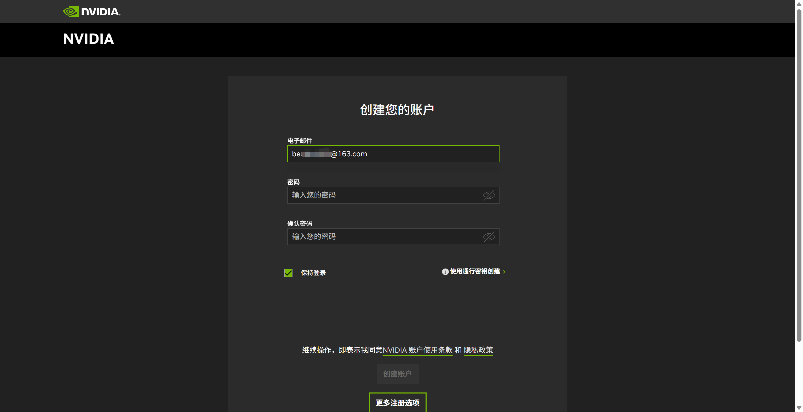
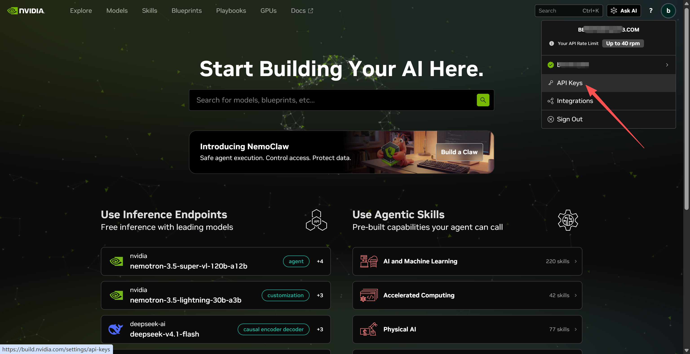
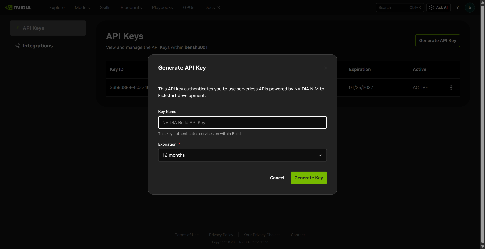

# Facet 渠道密钥获取指南

> **本手册怎么用**：按厂家分节，每节给出「注册 → 拿 Key → 填进 Facet」的完整步骤。
> 文中所有 📷 是**截图位**——按说明操作到对应页面时截图，保存到
> `docs/images/api-key-guide/` 目录并使用标注的文件名，图片会自动显示在本文档中。
>
> 密钥属于敏感信息：截图前请**遮住或截掉完整 Key**，只保留开头几个字符（如 `nvapi-…`）。
>
> 平台界面会随时间变化，本手册按 2026-11 时点整理；若界面不同，以实际为准并顺手更新本文。

---

## 目录

- [一、密钥怎么填进 Facet](#一密钥怎么填进-facet)
- [二、厂家总览](#二厂家总览)
- [三、免费渠道（零成本起步）](#三免费渠道零成本起步)
  - [Pollinations（免注册）](#31-pollinations免注册免-key)
  - [NVIDIA NIM（免费层）](#32-nvidia-nim免费层)
  - [OpenRouter 免费池](#33-openrouter免费池)
  - [Google AI Studio](#34-google-ai-studio)
- [四、国内按量付费厂家](#四国内按量付费厂家)
  - [火山引擎方舟（豆包）](#41-火山引擎方舟豆包)
  - [智谱 GLM](#42-智谱-glm)
  - [阿里云百炼](#43-阿里云百炼)
  - [腾讯元宝（混元）](#44-腾讯元宝混元)
  - [百度千帆](#45-百度千帆)
  - [DeepSeek](#46-deepseek)
  - [Kimi（Moonshot）](#47-kimimoonshot)
  - [小米 MiMo](#48-小米-mimo)
- [五、海外按量付费厂家](#五海外按量付费厂家)
  - [Anthropic 直连](#51-anthropic-直连)
  - [OpenAI 直连](#52-openai-直连)
  - [xAI Grok](#53-xai-grok)
- [六、订阅聚合类](#六订阅聚合类)
  - [OpenCode](#61-opencode)
  - [Command Code](#62-command-code)
  - [本地订阅桥（claude-plan / codex-plan）](#63-本地订阅桥claude-plan--codex-plan)

---

## 一、密钥怎么填进 Facet

所有厂家拿到 Key 后，填法都一样：

1. 打开控制台（`http://127.0.0.1:8787/ui`）→ **渠道配置** → **新增渠道**；
2. 照着对应厂家小节里的「渠道参数」填 **协议 / 端点 / 模型映射 / 优先级**；
3. **密钥**栏直接粘贴明文 Key（需要引用容器环境变量时才写 `env:VAR`）；
4. 保存即生效，网关热加载，无需重启。

要点：

- 编辑已有渠道时，密钥栏显示 `***` 表示不改已有 Key，留空保存即可；
- **导出配置不含密钥明文**，配置文件在本地 `<config 目录>/router.json`；
- 想用环境变量：写 `env:NVIDIA_API_KEY` 这样的引用，Facet 启动时解析；
- 添加渠道后点该行的 **测试** 按钮验证连通性（可在编辑器里预先填好「测试模型」并随渠道保存）。

📷 **截图 1-1** ｜ 拍什么：控制台「新增渠道」弹窗全貌（可遮住密钥值） ｜ 存为：`general-01-add-channel.png`

---

## 二、厂家总览

| 厂家 | 费用 | 注册门槛 | Key 形态 | 本节 |
|---|---|---|---|---|
| Pollinations | 免费匿名 | 无需注册 | 无 Key | [3.1](#31-pollinations免注册免-key) |
| NVIDIA NIM | 免费层 | 邮箱 + 手机验证 | `nvapi-` | [3.2](#32-nvidia-nim免费层) |
| OpenRouter | 免费模型 / 充值解锁更高限额 | 邮箱即可 | `sk-or-v1-` | [3.3](#33-openrouter免费池) |
| Google AI Studio | 有免费额度 | Google 账号 | `AIza…` | [3.4](#34-google-ai-studio) |
| LLM7 | 免费匿名（token 可选提额） | 无需注册 | 无 Key | [3.5](#35-llm7免注册免-key) |
| OVHcloud AI Endpoints | 免费匿名（2 RPM） | 无需注册 | 无 Key | [3.6](#36-ovhcloud-ai-endpoints免注册) |
| 火山引擎方舟 | 按量 + 部分免费模型 + Coding 套餐 | 实名认证 | 火山方舟 Key | [4.1](#41-火山引擎方舟豆包) |
| 智谱 GLM | 按量 + 新人额度 + Coding 套餐 | 手机号 | `id.` 长串 | [4.2](#42-智谱-glm) |
| 阿里云百炼 | 按量 + 新人免费额度 + Token Plan | 实名认证 | `sk-` | [4.3](#43-阿里云百炼) |
| 腾讯元宝（混元） | 按量 | 实名认证 | 混元 API KEY | [4.4](#44-腾讯元宝混元) |
| 百度千帆 | 按量 + ERNIE-Speed 永久免费 | 实名认证 | `bce-v3/ALTAK-…` | [4.5](#45-百度千帆) |
| DeepSeek | 按量（便宜） | 手机号 | `sk-` | [4.6](#46-deepseek) |
| Kimi (Moonshot) | 按量 + 新人额度 | 手机号 | `sk-` | [4.7](#47-kimimoonshot) |
| 小米 MiMo | 按量 + Token Plan | 小米账号 | `sk-` / `tp-` | [4.8](#48-小米-mimo) |
| Anthropic | 按量（预充值） | 邮箱（可能验证手机） | `sk-ant-` | [5.1](#51-anthropic-直连) |
| OpenAI | 按量（预充值） | 邮箱 | `sk-proj-` / `sk-` | [5.2](#52-openai-直连) |
| xAI Grok | 按量 | X 账号 | `xai-` | [5.3](#53-xai-grok) |
| Z.AI（智谱海外） | 按量 | 邮箱 | `sk-` 类 | [5.4](#54-zai智谱海外) |
| OpenCode | 订阅（$10/月起） | 邮箱 | Console 内复制 | [6.1](#61-opencode) |
| Command Code | 订阅（$15/月起） | 邮箱 | `cc-…` 类 | [6.2](#62-command-code) |

---

## 三、免费渠道（零成本起步）

### 3.1 Pollinations（免注册、免 Key）

**官方入口**：[接口文档（APIDOCS）](https://raw.githubusercontent.com/pollinations/pollinations/master/APIDOCS.md) ｜ [模型清单](https://gen.pollinations.ai/v1/models) ｜ [注册/捐赠获取 Token](https://pollinations.ai)

零密钥首启的默认渠道，**不需要任何 Key**，网关种子配置已自动建好。

- 渠道参数：协议 `openai`，端点 `https://gen.pollinations.ai/v1`，密钥留空；
- 匿名限速较低（个位数 RPM 级），适合当首启体验和最末兜底，不建议当主力；
- 若要更高限额可到 [pollinations.ai](https://pollinations.ai) 捐赠/注册获取 Token，填进密钥栏即可。

📷 **截图 3-1** ｜ 拍什么：控制台中 pollinations 渠道行（显示「测试通过」的绿色提示更佳） ｜ 存为：`pollinations-01-channel.png`

### 3.2 NVIDIA NIM（免费层）

**官方入口**：[注册/登录](https://build.nvidia.com) ｜ [API Key 页](https://build.nvidia.com/settings/api-keys) ｜ [接口文档](https://docs.api.nvidia.com/nim/)

当前推荐的免费兜底：免充值、OpenAI 兼容、免费层约 40 RPM。

**步骤**

1. 打开 [build.nvidia.com](https://build.nvidia.com)，用邮箱注册 / 登录；
   **注册需要手机验证码**（部分国家地区不在支持列表时，可发邮件到
   help@build.nvidia.com 申诉）。

   📷 **截图 3-2** ｜ 拍什么：build.nvidia.com 注册页（输入手机号之前的状态） ｜ 存为：`nvidia-01-signup.png`

   

2. 登录后点右上角头像 → **API Keys**（直链：[build.nvidia.com/settings/api-keys](https://build.nvidia.com/settings/api-keys)）。

   📷 **截图 3-3** ｜ 拍什么：API Keys 页面（无 Key 或已有 Key 列表均可） ｜ 存为：`nvidia-02-keys-page.png`

   

3. 点 **Generate API Key**，复制生成的 Key（`nvapi-` 开头，**只显示一次**）。

   📷 **截图 3-4** ｜ 拍什么：生成成功弹窗（Key 值打码） ｜ 存为：`nvidia-03-key-created.png`

   

**渠道参数**（种子配置已内置 `nvidia-nim` 渠道，填上 Key、启用即可）：

| 项 | 值 |
|---|---|
| 协议 | `openai` |
| 端点 | `https://integrate.api.nvidia.com/v1` |
| 模型映射（auto） | `nvidia/nemotron-3.5-nano-30b-a3b` |
| 建议优先级 | 50（排在链尾当兜底） |
| 限速建议 | `rpm: 40` |

### 3.3 OpenRouter（免费池）

**官方入口**：[注册/登录](https://openrouter.ai) ｜ [API Key 页](https://openrouter.ai/settings/keys) ｜ [接口文档](https://openrouter.ai/docs)

聚合几百个上游，`:free` 后缀模型免费。Facet 示例配置的 `free-tier` 渠道就是它。

**步骤**

1. 打开 [openrouter.ai](https://openrouter.ai) → **Sign in**（Google/GitHub/邮箱均可，无需手机验证）；
2. 右上角头像 → **Keys**（直链：[openrouter.ai/settings/keys](https://openrouter.ai/settings/keys)）。

   📷 **截图 3-5** ｜ 拍什么：Keys 页面 ｜ 存为：`openrouter-01-keys-page.png`

   

3. **Create Key**，命名后复制（`sk-or-v1-` 开头，只显示一次）。可给单 Key 设额度上限。

   📷 **截图 3-6** ｜ 拍什么：创建 Key 弹窗（Key 值打码） ｜ 存为：`openrouter-02-key-created.png`

   

**限额须知**：账户不充值时，免费模型约 **50 请求/天**；在 Credits 充值 $10 后提升到 **1000 请求/天**。免费模型池共享限速，高峰期容易 429——Facet 的冷却与故障转移就是为这种场景准备的，`free-tier` 的 `cooldown_minutes: 1440` 即每日额度耗尽后冷却一天。

**渠道参数**（示例配置 `free-tier`）：

| 项 | 值 |
|---|---|
| 协议 | `openai` |
| 端点 | `https://openrouter.ai/api/v1` |
| 模型映射 | 只映射 `:free` 后缀模型 |
| 建议限速 | `rpm: 20` |

### 3.4 Google AI Studio

**官方入口**：[控制台（Google 账号登录）](https://aistudio.google.com) ｜ [API Key 页](https://aistudio.google.com/apikey) ｜ [接口文档](https://ai.google.dev/gemini-api/docs)

Google 官方免费额度（Gemini 系列），零密钥种子模板内置了禁用占位渠道。

**步骤**

1. 打开 [aistudio.google.com](https://aistudio.google.com)，用 Google 账号登录（部分地区需代理，渠道可配 `proxy`）；
2. 左侧 **Get API key**（直链：[aistudio.google.com/apikey](https://aistudio.google.com/apikey)）。

   📷 **截图 3-7** ｜ 拍什么：API Keys 页面 ｜ 存为：`google-01-keys-page.png`

   

3. **Create API key** → 复制（`AIza` 开头）。

   📷 **截图 3-8** ｜ 拍什么：创建结果（Key 值打码） ｜ 存为：`google-02-key-created.png`

   

**渠道参数**（种子配置 `google-ai-studio`）：

| 项 | 值 |
|---|---|
| 协议 | `openai`（Google 提供 OpenAI 兼容端点） |
| 端点 | `https://generativelanguage.googleapis.com/v1beta/openai` |
| 备注 | 国内直连不通，渠道里配出站代理 |

---

### 3.5 LLM7（免注册、免 Key）

**官方入口**：[接口文档](https://docs.llm7.io) ｜ [模型清单](https://api.llm7.io/v1/models) ｜ [注册/获取 Token（可选提额）](https://dash.llm7.io)

无需注册即可调用的 OpenAI 兼容免费端点，模型清单以官方 `GET /v1/models` 实时返回为准。

📷 **截图 3-9** ｜ 拍什么：docs.llm7.io 文档首页 ｜ 存为：`llm7-01-docs.png`

**步骤**：无需注册，控制台直接新增渠道即可用。想要更高限额（60 RPM / 每小时 250 次 / 10 万 tokens 每天）再去 [dash.llm7.io](https://dash.llm7.io) 免费注册拿 token，可选。

**渠道参数**：

| 项 | 值 |
|---|---|
| 协议 | `openai` |
| 端点 | `https://api.llm7.io/v1` |
| 限额 | 免费档 60 RPM / 250 次/小时 / 10 万 tokens/24h（匿名档未公布） |

---

### 3.6 OVHcloud AI Endpoints（免注册、免 Key）

**官方入口**：[接口文档（Getting started）](https://docs.ovhcloud.com/en/guides/public-cloud/ai-machine-learning/ai-endpoints-getting-started) ｜ [模型目录](https://www.ovhcloud.com/en/public-cloud/ai-endpoints/catalog/) ｜ [OVHcloud 账号（仅 token 档需要）](https://www.ovhcloud.com)

OVHcloud 公共 AI 端点，匿名档 2 次/分钟/IP/模型——很慢，但完全免费、无需注册，适合兜底而非主力；模型有 3 个月宽限期后下线的机制。

📷 **截图 3-10** ｜ 拍什么：OVHcloud AI Endpoints 模型目录页 ｜ 存为：`ovhcloud-01-catalog.png`

**步骤**：无需注册，控制台直接新增渠道即可用。带 key 档需要 OVHcloud 项目绑定支付方式且按量计费，不建议。

**渠道参数**：

| 项 | 值 |
|---|---|
| 协议 | `openai` |
| 端点 | `https://oai.endpoints.kepler.ai.cloud.ovh.net/v1` |
| 限额 | 匿名 2 RPM/IP/模型；超限 429 |

---

## 四、国内按量付费厂家

> 国内平台注册普遍需要**实名认证**；新用户多有免费 token 额度，按量价格以各官网为准。

### 4.1 火山引擎方舟（豆包）

**官方入口**：[注册/登录火山引擎](https://console.volcengine.com) ｜ [方舟 API Key 管理](https://console.volcengine.com/ark/region:cn-beijing/apiKey) ｜ [方舟接口文档](https://www.volcengine.com/docs/82379)

**步骤**

1. 打开 [console.volcengine.com](https://console.volcengine.com) 注册火山引擎账号并完成**实名认证**；

   📷 **截图 4-1** ｜ 拍什么：实名认证入口/完成状态页 ｜ 存为：`volcengine-01-realname.png`

2. 进入**方舟**控制台（直链：[console.volcengine.com/ark](https://console.volcengine.com/ark)）→ 左侧 **API Key 管理** → **创建 API Key**。

   📷 **截图 4-2** ｜ 拍什么：方舟「API Key 管理」页面 ｜ 存为：`volcengine-02-apikey-page.png`

3. 开通模型：在方舟的**开通管理**里启用要用的模型。豆包 `doubao-seed-*-lite` 等 lightweight 模型常有**免费额度**（示例配置的「火山引擎免费」渠道即由此而来）。

   📷 **截图 4-3** ｜ 拍什么：模型开通管理页（显示免费额度标识） ｜ 存为：`volcengine-03-models.png`

**渠道参数**：

| 模式 | 端点 |
|---|---|
| 按量付费 | `https://ark.cn-beijing.volces.com/api/v3` |
| Coding 套餐（订阅后） | `https://ark.cn-beijing.volces.com/api/coding/v3` |

### 4.2 智谱 GLM

**官方入口**：[注册/登录](https://open.bigmodel.cn) ｜ [API Key 页（按量）](https://bigmodel.cn/usercenter/proj-mgmt/apikeys) ｜ [接口文档](https://docs.bigmodel.cn)

**步骤**

1. 打开 [bigmodel.cn](https://bigmodel.cn) 注册（手机号 + 验证码），新用户有各模型免费 token 额度；
2. 右上角头像 → **API Keys**（直链：[bigmodel.cn/usercenter/proj-mgmt/apikeys](https://bigmodel.cn/usercenter/proj-mgmt/apikeys)）→ 复制 API Key。

   📷 **截图 4-4** ｜ 拍什么：API Keys 页面（Key 打码） ｜ 存为：`zhipu-01-apikeys.png`

3. GLM **Coding 套餐**用户注意：套餐 Key 与按量 Key **相互独立**，在
   [bigmodel.cn/apikey/coding-plan-per](https://bigmodel.cn/apikey/coding-plan-per) 单独获取，端点也不同（见下表）。

   📷 **截图 4-5** ｜ 拍什么：Coding 套餐 Key 页面（如已订阅） ｜ 存为：`zhipu-02-coding-plan.png`

**渠道参数**：

| 模式 | 端点 |
|---|---|
| 按量付费 | `https://open.bigmodel.cn/api/paas/v4` |
| Coding 套餐 | `https://open.bigmodel.cn/api/coding/paas/v4` |
| 国际版 z.ai（种子模板 `z-ai-glm`） | `https://api.z.ai/api/paas/v4` |

### 4.3 阿里云百炼

**官方入口**：[注册/登录阿里云](https://www.aliyun.com) ｜ [百炼控制台（右上角 API-KEY）](https://bailian.console.aliyun.com) ｜ [接口文档](https://help.aliyun.com/zh/model-studio/)

**步骤**

1. 注册阿里云账号并完成**实名认证**；
2. 打开**百炼**控制台（直链：[bailian.console.aliyun.com](https://bailian.console.aliyun.com)）→ 右上角选择**业务空间/地域** → **API-KEY** 页 → **创建 API Key**（`sk-` 开头）。

   📷 **截图 4-6** ｜ 拍什么：百炼 API-KEY 管理页（Key 打码） ｜ 存为：`bailian-01-apikeys.png`

3. 新用户多数模型有**免费额度**（百万 token 级），在模型广场看各模型标注；
4. **注意**：API Key 按地域/业务空间隔离，不同空间的 Key 不可互换。

**渠道参数**：

| 模式 | 端点 |
|---|---|
| 按量付费 | `https://dashscope.aliyuncs.com/compatible-mode/v1` |
| Token Plan 套餐（订阅后） | `https://token-plan.cn-beijing.maas.aliyuncs.com/compatible-mode/v1` |

### 4.4 腾讯元宝（混元）

**官方入口**：[注册/登录腾讯云](https://console.cloud.tencent.com) ｜ [混元 Key 创建页](https://console.cloud.tencent.com/hunyuan/start) ｜ [接口文档](https://cloud.tencent.com/document/product/1729)

**步骤**

1. 注册腾讯云账号并完成**实名认证**；
2. 开通混元服务：[console.cloud.tencent.com/hunyuan/settings](https://console.cloud.tencent.com/hunyuan/settings)；

   📷 **截图 4-7** ｜ 拍什么：开通服务页面 ｜ 存为：`hunyuan-01-activate.png`

3. 控制台混元页 → **立即接入**（[console.cloud.tencent.com/hunyuan/start](https://console.cloud.tencent.com/hunyuan/start)）→ **创建 API KEY**；
   ⚠️ 主账号才能创建，**删除不可恢复**。

   📷 **截图 4-8** ｜ 拍什么：API KEY 管理页面（Key 打码） ｜ 存为：`hunyuan-02-apikeys.png`

**渠道参数**：协议 `openai`，端点 `https://api.hunyuan.cloud.tencent.com/v1`。

### 4.5 百度千帆

**官方入口**：[注册/登录百度智能云](https://console.bce.baidu.com) ｜ [API Key 管理](https://console.bce.baidu.com/iam/#/iam/apikey/list) ｜ [接口文档](https://cloud.baidu.com/doc/WENXINWORKSHOP/index.html)

**步骤**

1. 注册百度智能云账号并完成**实名认证**；
2. 打开千帆控制台（直链：[console.bce.baidu.com/qianfan](https://console.bce.baidu.com/qianfan)）→ **API Key 管理** → **创建 API Key**（选工作空间、勾选要启用的服务）；
   Key 形如 `bce-v3/ALTAK-…/…`，整串复制；一页管理 ModelBuilder / AppBuilder / 开放能力全部鉴权。

   📷 **截图 4-9** ｜ 拍什么：千帆 API Key 管理页（Key 打码） ｜ 存为：`qianfan-01-apikeys.png`

3. `ERNIE-Speed` 系列模型**永久免费**，适合做低成本兜底；新模型多有试用额度。

**渠道参数**：协议 `openai`，端点 `https://qianfan.baidubce.com/v2`。

### 4.6 DeepSeek

**官方入口**：[注册/登录开放平台](https://platform.deepseek.com) ｜ [API Key 页](https://platform.deepseek.com/apikeys) ｜ [接口文档](https://api-docs.deepseek.com)

**步骤**

1. 打开 [platform.deepseek.com](https://platform.deepseek.com)，手机号注册；
2. 左侧 **API keys** → **创建 API key**（`sk-` 开头，只显示一次）。

   📷 **截图 4-10** ｜ 拍什么：API keys 页面（Key 打码） ｜ 存为：`deepseek-01-apikeys.png`

3. **充值**：左侧「充值」页，人民币预付费，价格很低，几块钱够个人用很久。

**渠道参数**：协议 `openai`，端点 `https://api.deepseek.com/v1`。

### 4.7 Kimi（Moonshot）

**官方入口**：[注册/登录开放平台](https://platform.moonshot.cn) ｜ [API Key 页](https://platform.moonshot.cn/console/api-keys) ｜ [接口文档](https://platform.moonshot.cn/docs)

**步骤**

1. 打开 [platform.moonshot.cn](https://platform.moonshot.cn)，手机号注册，新用户赠送体验额度；
2. 左侧 **API Key 管理** → **新建**（`sk-` 开头，只显示一次）。

   📷 **截图 4-11** ｜ 拍什么：API Key 管理页（Key 打码） ｜ 存为：`moonshot-01-apikeys.png`

**渠道参数**：协议 `openai`，端点 `https://api.moonshot.cn/v1`。

### 4.8 小米 MiMo

**官方入口**：[MiMo 开放平台（注册 / Key / 文档同站）](https://platform.xiaomimimo.com)

**步骤**

1. 用小米账号登录 [platform.xiaomimimo.com](https://platform.xiaomimimo.com)；
2. **按量付费**：控制台充值（预付费）→ **API Keys** 页创建（`sk-` 开头，只显示一次）；

   📷 **截图 4-12** ｜ 拍什么：API Keys 页（Key 打码） ｜ 存为：`mimo-01-payg-keys.png`

3. **Token Plan 套餐**：[platform.xiaomimimo.com/#/token-plan](https://platform.xiaomimimo.com/#/token-plan) 订阅 → 在**订阅管理**（`#/console/plan-manage`）复制 Key（`tp-` 开头，团队版 `ttp-`）；
   ⚠️ `tp-` 与 `sk-` 两套 Key **互不通用**：`tp-` 走 Token Plan 端点，套餐过期即失效；`sk-` 走按量端点。

   📷 **截图 4-13** ｜ 拍什么：订阅管理页显示 tp- Key（打码） ｜ 存为：`mimo-02-tokenplan.png`

**渠道参数**：

| 模式 | 端点 |
|---|---|
| 按量付费 | `https://api.xiaomimimo.com/v1` |
| Token Plan 套餐 | `https://token-plan-cn.xiaomimimo.com/v1` |

---

## 五、海外按量付费厂家

### 5.1 Anthropic 直连

**官方入口**：[注册/登录 Console](https://console.anthropic.com) ｜ [API Key 页](https://console.anthropic.com/settings/keys) ｜ [接口文档](https://docs.anthropic.com)

**步骤**

1. 打开 [console.anthropic.com](https://console.anthropic.com) 注册（邮箱验证，部分情况要求手机验证）；
2. **预充值**：Billing 页买 credit（最低 $5）；
3. **API Keys**（直链：[console.anthropic.com/settings/keys](https://console.anthropic.com/settings/keys)）→ **Create Key**（`sk-ant-` 开头）。

   📷 **截图 5-1** ｜ 拍什么：API Keys 页（Key 打码） ｜ 存为：`anthropic-01-apikeys.png`

**渠道参数**：协议 `anthropic`，端点 `https://api.anthropic.com`。国内直连不通时配 `proxy`。

### 5.2 OpenAI 直连

**官方入口**：[注册/登录 Platform](https://platform.openai.com) ｜ [API Key 页](https://platform.openai.com/api-keys) ｜ [接口文档](https://platform.openai.com/docs)

**步骤**

1. 打开 [platform.openai.com](https://platform.openai.com) 注册；
2. Billing 页预充值（最低 $5）；
3. **API keys**（直链：[platform.openai.com/api-keys](https://platform.openai.com/api-keys)）→ **Create new secret key**（`sk-proj-` 开头）。

   📷 **截图 5-2** ｜ 拍什么：API keys 页（Key 打码） ｜ 存为：`openai-01-apikeys.png`

**渠道参数**：协议 `openai`，端点 `https://api.openai.com/v1`。国内直连不通时配 `proxy`。

### 5.3 xAI Grok

**官方入口**：[注册/登录 Console](https://console.x.ai) ｜ [接口文档](https://docs.x.ai)

**步骤**

1. 打开 [console.x.ai](https://console.x.ai)，用 X（Twitter）账号登录；
2. 团队/计费初始化后 → **API Keys** → **Create API Key**（`xai-` 开头）；新账号常有少量赠送额度。

   📷 **截图 5-3** ｜ 拍什么：API Keys 页（Key 打码） ｜ 存为：`xai-01-apikeys.png`

**渠道参数**：协议 `openai`，端点 `https://api.x.ai/v1`。

### 5.4 Z.AI（智谱海外）

**官方入口**：[注册/登录](https://z.ai) ｜ [API Key 管理页](https://z.ai/manage-api-key/apikey-keys) ｜ [接口文档](https://docs.z.ai)

智谱 GLM 的国际站（`api.z.ai`），账号体系与 bigmodel.cn 相互独立，Key 不通用。种子模板 `z-ai-glm` 用的是这一家。

**步骤**

1. 打开 [z.ai](https://z.ai) 注册登录；
2. 进入 **API Keys**（直链：[z.ai/manage-api-key/apikey-keys](https://z.ai/manage-api-key/apikey-keys)）→ 创建并复制 API Key。

**渠道参数**：协议 `openai`，端点 `https://api.z.ai/api/paas/v4`。

---

## 六、订阅聚合类

### 6.1 OpenCode

**官方入口**：[注册/登录（含订阅与 Key）](https://opencode.ai/console) ｜ [接口文档](https://opencode.ai/docs)

SST/OpenCode 的订阅推理服务（Zen），Go 套餐 $10/月。

**步骤**

1. 打开 [opencode.ai](https://opencode.ai) 注册登录；
2. **Console**（[opencode.ai/console](https://opencode.ai/console)）→ 订阅 **Go**（$10/月，另有 Plus/Teams）并绑定支付方式；
3. Console 内直接**复制 API Key**。

   📷 **截图 6-1** ｜ 拍什么：Console 概览页显示订阅状态与 Key（打码） ｜ 存为：`opencode-01-console.png`

**渠道参数**：

| 模式 | 端点 |
|---|---|
| Go 订阅套餐 | `https://opencode.ai/inference/go/openai/v1` |
| 按量（Models） | `https://opencode.ai/inference/openai/v1` |

### 6.2 Command Code

**官方入口**：[注册/订阅](https://commandcode.ai) ｜ [API Key 页](https://commandcode.ai/settings/keys)

编码 CLI + Provider API 聚合（Claude / GPT / Gemini / 开源模型，不加价转售）。

**步骤**

1. 打开 [commandcode.ai](https://commandcode.ai) 注册；
2. Studio → **Billing**（[commandcode.ai/billing](https://commandcode.ai/billing)）选套餐：**Provider** $15/月 + $1.01 手续费，含 $15 永不过期额度，按量扣；Go 档（$1/月）**没有 API 权限**，勿选；
3. **Settings → Keys**（[commandcode.ai/settings/keys](https://commandcode.ai/settings/keys)）创建并复制。

   📷 **截图 6-2** ｜ 拍什么：Keys 页（Key 打码） ｜ 存为：`commandcode-01-keys.png`

**渠道参数**：协议 `openai`，端点 `https://api.commandcode.ai/provider/v1`。

### 6.3 本地订阅桥（claude-plan / codex-plan）

示例配置里的 `claude-plan`（`http://127.0.0.1:8080`，anthropic 协议）和
`codex-plan`（`http://127.0.0.1:8081`，openai 协议）是**本地桥接服务**——把
Claude Code / Codex 的订阅额度转成 API 供网关调用。它们不填官方 API Key，
**密钥栏填的是桥自己约定的口令**（与桥的配置保持一致，示例配置用
`env:CLAUDE_PLAN_KEY` / `env:CODEX_PLAN_KEY` 引用）。

前置条件：本机先跑起对应的桥，再启用这两个渠道。

📷 **截图 6-3** ｜ 拍什么：桥启动后的终端 + 控制台渠道行测试通过 ｜ 存为：`bridge-01-running.png`

---

## 附：安全清单

- [ ] 每张截图都检查过：完整 Key 不可见（至少打码到只剩前 6 位）
- [ ] 密钥只存进 Facet 渠道配置或 `env:` 环境变量，不进聊天记录 / 截图 / 仓库
- [ ] 给每把 Key 设了平台侧的额度上限或限速（能设的都设上）
- [ ] 不再用的 Key 已在平台上删除或轮换
