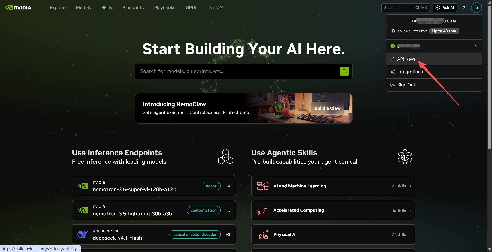
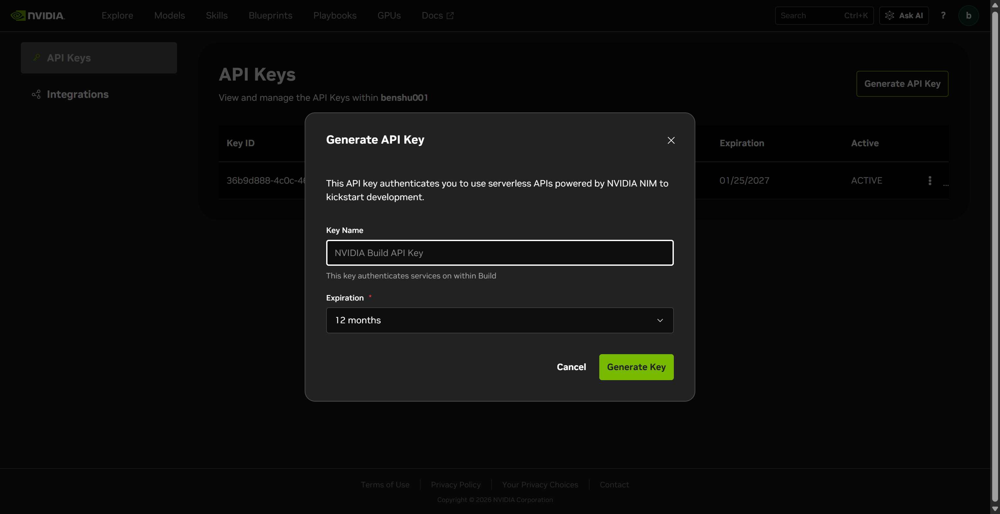
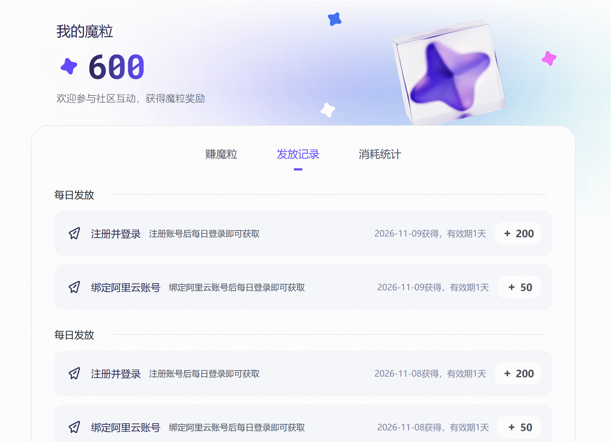

# Facet 渠道密钥获取指南

> **本手册怎么用**：按厂家分节，每节给出「注册 → 拿 Key → 填进 Facet」的完整步骤。
> 文中所有 📷 是**截图位**——按说明操作到对应页面时截图，保存到
> `docs/images/api-key-guide/` 目录并使用标注的文件名，图片会自动显示在本文档中。
>
> 密钥属于敏感信息：截图前请**遮住或截掉完整 Key**，只保留开头几个字符（如 `nvapi-…`）。
>
> 平台界面会随时间变化，本手册按 2026-11 时点整理；若界面不同，以实际为准并顺手更新本文。

---

## 目录

- [一、密钥怎么填进 Facet](#一密钥怎么填进-facet)
- [二、厂家总览](#二厂家总览)
- [三、免费渠道（零成本起步）](#三免费渠道零成本起步)
  - [Pollinations（免注册）](#31-pollinations免注册免-key)
  - [NVIDIA NIM（免费层）](#32-nvidia-nim免费层)
  - [OpenRouter 免费池](#33-openrouter免费池)
  - [Google AI Studio](#34-google-ai-studio)
  - [LLM7（免注册）](#35-llm7免注册免-key)
  - [OVHcloud AI Endpoints（免注册）](#36-ovhcloud-ai-endpoints免注册)
  - [魔搭 ModelScope（免费推理）](#37-魔搭-modelscope免费推理)
- [四、国内按量付费厂家](#四国内按量付费厂家)
  - [火山引擎方舟（豆包）](#41-火山引擎方舟豆包)
  - [智谱 GLM](#42-智谱-glm)
  - [阿里云百炼](#43-阿里云百炼)
  - [腾讯元宝（混元）](#44-腾讯元宝混元)
  - [百度千帆](#45-百度千帆)
  - [DeepSeek](#46-deepseek)
  - [Kimi（Moonshot）](#47-kimimoonshot)
  - [小米 MiMo](#48-小米-mimo)
- [五、海外按量付费厂家](#五海外按量付费厂家)
  - [Anthropic 直连](#51-anthropic-直连)
  - [OpenAI 直连](#52-openai-直连)
  - [xAI Grok](#53-xai-grok)
- [六、订阅聚合类](#六订阅聚合类)
  - [OpenCode](#61-opencode)
  - [Command Code](#62-command-code)
  - [本地订阅桥（claude-plan / codex-plan）](#63-本地订阅桥claude-plan--codex-plan)
- [七、在 Trae / IDE 里使用 Facet](#七在-trae--ide-里使用-facet)
  - [Trae（推荐优先试这节）](#71trae推荐优先试这节)
  - [VS Code / Cursor / Zed（通用 OpenAI SDK）](#72vs-code--cursor--zed通用-openai-sdk)
  - [Python SDK 快速示例](#73python-sdk-快速示例)
  - [Docker 里也要用？](#74docker-里也要用)
  - [三种内置别名：facet-auto / facet-cheap / facet-agent](#741-三种内置别名facet-auto--facet-cheap--facet-agent)
  - [Claude Code（CLI Agent）](#75claude-codecli-agent)
  - [Cline / Roo Code（VS Code 插件 Agent）](#76cline--roo-codevs-code-插件 agent)
  - [OpenHands / Devika / Devin（开源 DevAgent）](#77openhands--devika--devin开源 devagent)
  - [Windsurf / Zed / Cursor（AI 原生编辑器）](#78windsurf--zed--cursorai-原生编辑器)
  - [LangChain / LlamaIndex（Python Agent 框架）](#79langchain--llamaindexpython-agent-框架)
  - [LangGraph / AutoGen / CrewAI（多 Agent 框架）](#710langgraph--autogen--crewaimulti-agent-框架)
  - [故障排查](#711-故障排查)
- [八、附录：端点与协议速查表](#八附录端点与协议速查表)

---

## 一、密钥怎么填进 Facet

所有厂家拿到 Key 后，填法都一样：

1. 打开控制台（`http://127.0.0.1:8787/ui`）→ **渠道配置** → **新增渠道**；
2. 照着对应厂家小节里的「渠道参数」填 **协议 / 端点 / 模型映射 / 优先级**；
3. **密钥**栏直接粘贴明文 Key（需要引用容器环境变量时才写 `env:VAR`）；
4. 保存即生效，网关热加载，无需重启。

要点：

- 编辑已有渠道时，密钥栏显示 `***` 表示不改已有 Key，留空保存即可；
- **导出配置不含密钥明文**，配置文件在本地 `<config 目录>/router.json`；
- 想用环境变量：写 `env:NVIDIA_API_KEY` 这样的引用，Facet 启动时解析；
- 添加渠道后点该行的 **测试** 按钮验证连通性（可在编辑器里预先填好「测试模型」并随渠道保存）。

📷 **截图 1-1** ｜ 拍什么：控制台「新增渠道」弹窗全貌（可遮住密钥值） ｜ 存为：`general-01-add-channel.png`


---

## 二、厂家总览

| 厂家 | 费用 | 注册门槛 | Key 形态 | 本节 |
|---|---|---|---|---|
| Pollinations | 免费匿名 | 无需注册 | 无 Key | [3.1](#31-pollinations免注册免-key) |
| NVIDIA NIM | 免费层 | 邮箱 + 手机验证 | `nvapi-` | [3.2](#32-nvidia-nim免费层) |
| OpenRouter | 免费模型 / 充值解锁更高限额 | 邮箱即可 | `sk-or-v1-` | [3.3](#33-openrouter免费池) |
| Google AI Studio | 有免费额度 | Google 账号 | `AIza…` | [3.4](#34-google-ai-studio) |
| LLM7 | 免费匿名（token 可选提额） | 无需注册 | 无 Key | [3.5](#35-llm7免注册免-key) |
| OVHcloud AI Endpoints | 免费匿名（2 RPM） | 无需注册 | 无 Key | [3.6](#36-ovhcloud-ai-endpoints免注册) |
| 魔搭 ModelScope | 每日登录领 250 魔粒（约 250–500 次调用） | 手机号（需绑阿里云） | `ms-` | [3.7](#37-魔搭-modelscope免费推理) |
| 火山引擎方舟 | 按量 + 部分免费模型 + Coding 套餐 | 实名认证 | 火山方舟 Key；免费额度对齐另需 IAM AK/SK | [4.1](#41-火山引擎方舟豆包) |
| 智谱 GLM | 按量 + 新人额度 + Coding 套餐 | 手机号 | `id.` 长串 | [4.2](#42-智谱-glm) |
| 阿里云百炼 | 按量 + 新人免费额度（新模型 90 天窗口）+ Token Plan | 实名认证 | `sk-` | [4.3](#43-阿里云百炼) |
| 腾讯元宝（混元） | 按量 | 实名认证 | 混元 API KEY | [4.4](#44-腾讯元宝混元) |
| 百度千帆 | 按量 + ERNIE-Speed 永久免费 | 实名认证 | `bce-v3/ALTAK-…` | [4.5](#45-百度千帆) |
| DeepSeek | 按量（便宜） | 手机号 | `sk-` | [4.6](#46-deepseek) |
| Kimi (Moonshot) | 按量 + 新人额度 | 手机号 | `sk-` | [4.7](#47-kimimoonshot) |
| 小米 MiMo | 按量 + Token Plan | 小米账号 | `sk-` / `tp-` | [4.8](#48-小米-mimo) |
| Anthropic | 按量（预充值） | 邮箱（可能验证手机） | `sk-ant-` | [5.1](#51-anthropic-直连) |
| OpenAI | 按量（预充值） | 邮箱 | `sk-proj-` / `sk-` | [5.2](#52-openai-直连) |
| xAI Grok | 按量 | X 账号 | `xai-` | [5.3](#53-xai-grok) |
| Z.AI（智谱海外） | 按量 | 邮箱 | `sk-` 类 | [5.4](#54-zai智谱海外) |
| OpenCode | 订阅（$10/月起） | 邮箱 | Console 内复制 | [6.1](#61-opencode) |
| Command Code | 订阅（$15/月起） | 邮箱 | `cc-…` 类 | [6.2](#62-command-code) |

---

## 三、免费渠道（零成本起步）

### 3.1 Pollinations（免注册、免 Key）

**官方入口**：[接口文档（APIDOCS）](https://raw.githubusercontent.com/pollinations/pollinations/master/APIDOCS.md) ｜ [模型清单](https://gen.pollinations.ai/v1/models) ｜ [注册/捐赠获取 Token](https://pollinations.ai)

零密钥首启的默认渠道，**不需要任何 Key**，网关种子配置已自动建好。

- 渠道参数：协议 `openai`，端点 `https://gen.pollinations.ai/v1`，密钥留空；
- 匿名限速较低（个位数 RPM 级），适合当首启体验和最末兜底，不建议当主力；
- 若要更高限额可到 [pollinations.ai](https://pollinations.ai) 捐赠/注册获取 Token，填进密钥栏即可。

📷 **截图 3-1** ｜ 拍什么：控制台中 pollinations 渠道行（显示「测试通过」的绿色提示更佳） ｜ 存为：`pollinations-01-channel.png`


### 3.2 NVIDIA NIM（免费层）

**官方入口**：[注册/登录](https://build.nvidia.com) ｜ [API Key 页](https://build.nvidia.com/settings/api-keys) ｜ [接口文档](https://docs.api.nvidia.com/nim/)

当前推荐的免费兜底：免充值、OpenAI 兼容、免费层约 40 RPM。

**步骤**

1. 打开 [build.nvidia.com](https://build.nvidia.com)，用邮箱注册 / 登录；
   注册需完成**邮箱验证**——验证码发到邮箱，填回页面验证通过后才能注册成功；
   
   然后还需**手机验证码**（部分国家地区不在支持列表时，可发邮件到
   help@build.nvidia.com 申诉）。
   


2. 登录后点右上角头像 → **API Keys**（直链：[build.nvidia.com/settings/api-keys](https://build.nvidia.com/settings/api-keys)）。

   

3. 点 **Generate API Key**，复制生成的 Key（`nvapi-` 开头，**只显示一次**）。

   

**渠道参数**（种子配置已内置 `nvidia-nim` 渠道，填上 Key、启用即可）：

| 项 | 值 |
|---|---|
| 协议 | `openai` |
| 端点 | `https://integrate.api.nvidia.com/v1` |
| 模型映射（auto） | `nvidia/nemotron-3.5-nano-30b-a3b` |
| 建议优先级 | 50（排在链尾当兜底） |
| 限速建议 | `rpm: 40` |

### 3.3 OpenRouter（免费池）

**官方入口**：[注册/登录](https://openrouter.ai) ｜ [API Key 页](https://openrouter.ai/settings/keys) ｜ [接口文档](https://openrouter.ai/docs)

聚合几百个上游，`:free` 后缀模型免费。Facet 示例配置的 `free-tier` 渠道就是它。

**步骤**

1. 打开 [openrouter.ai](https://openrouter.ai) → **Sign in**（Google/GitHub/邮箱均可，无需手机验证）；
2. 右上角头像 → **Keys**（直链：[openrouter.ai/settings/keys](https://openrouter.ai/settings/keys)）。

   📷 **截图 3-5** ｜ 拍什么：Keys 页面 ｜ 存为：`openrouter-01-keys-page.png`

   

3. **Create Key**，命名后复制（`sk-or-v1-` 开头，只显示一次）。可给单 Key 设额度上限。

   📷 **截图 3-6** ｜ 拍什么：创建 Key 弹窗（Key 值打码） ｜ 存为：`openrouter-02-key-created.png`

   

**限额须知**：账户不充值时，免费模型约 **50 请求/天**；在 Credits 充值 $10 后提升到 **1000 请求/天**。免费模型池共享限速，高峰期容易 429——Facet 的冷却与故障转移就是为这种场景准备的，`free-tier` 的 `cooldown_minutes: 1440` 即每日额度耗尽后冷却一天。

**渠道参数**（示例配置 `free-tier`）：

| 项 | 值 |
|---|---|
| 协议 | `openai` |
| 端点 | `https://openrouter.ai/api/v1` |
| 模型映射 | 只映射 `:free` 后缀模型 |
| 建议限速 | `rpm: 20` |

### 3.4 Google AI Studio

**官方入口**：[控制台（Google 账号登录）](https://aistudio.google.com) ｜ [API Key 页](https://aistudio.google.com/apikey) ｜ [接口文档](https://ai.google.dev/gemini-api/docs)

Google 官方免费额度（Gemini 系列），零密钥种子模板内置了禁用占位渠道。

**步骤**

1. 打开 [aistudio.google.com](https://aistudio.google.com)，用 Google 账号登录（部分地区需代理，渠道可配 `proxy`）；
2. 左侧 **Get API key**（直链：[aistudio.google.com/apikey](https://aistudio.google.com/apikey)）。

   📷 **截图 3-7** ｜ 拍什么：API Keys 页面 ｜ 存为：`google-01-keys-page.png`

   

3. **Create API key** → 复制（`AIza` 开头）。

   📷 **截图 3-8** ｜ 拍什么：创建结果（Key 值打码） ｜ 存为：`google-02-key-created.png`

   

**渠道参数**（种子配置 `google-ai-studio`）：

| 项 | 值 |
|---|---|
| 协议 | `openai`（Google 提供 OpenAI 兼容端点） |
| 端点 | `https://generativelanguage.googleapis.com/v1beta/openai` |
| 备注 | 国内直连不通，渠道里配出站代理 |

---

### 3.5 LLM7（免注册、免 Key）

**官方入口**：[接口文档](https://docs.llm7.io) ｜ [模型清单](https://api.llm7.io/v1/models) ｜ [注册/获取 Token（可选提额）](https://dash.llm7.io)

无需注册即可调用的 OpenAI 兼容免费端点，模型清单以官方 `GET /v1/models` 实时返回为准。

📷 **截图 3-9** ｜ 拍什么：docs.llm7.io 文档首页 ｜ 存为：`llm7-01-docs.png`


**步骤**：无需注册，控制台直接新增渠道即可用。想要更高限额（60 RPM / 每小时 250 次 / 10 万 tokens 每天）再去 [dash.llm7.io](https://dash.llm7.io) 免费注册拿 token，可选。

**渠道参数**：

| 项 | 值 |
|---|---|
| 协议 | `openai` |
| 端点 | `https://api.llm7.io/v1` |
| 限额 | 免费档 60 RPM / 250 次/小时 / 10 万 tokens/24h（匿名档未公布） |

---

### 3.6 OVHcloud AI Endpoints（免注册、免 Key）

**官方入口**：[接口文档（Getting started）](https://docs.ovhcloud.com/en/guides/public-cloud/ai-machine-learning/ai-endpoints-getting-started) ｜ [模型目录](https://www.ovhcloud.com/en/public-cloud/ai-endpoints/catalog/) ｜ [OVHcloud 账号（仅 token 档需要）](https://www.ovhcloud.com)

OVHcloud 公共 AI 端点，匿名档 2 次/分钟/IP/模型——很慢，但完全免费、无需注册，适合兜底而非主力；模型有 3 个月宽限期后下线的机制。

📷 **截图 3-10** ｜ 拍什么：OVHcloud AI Endpoints 模型目录页 ｜ 存为：`ovhcloud-01-catalog.png`


**步骤**：无需注册，控制台直接新增渠道即可用。带 key 档需要 OVHcloud 项目绑定支付方式且按量计费，不建议。

**渠道参数**：

| 项 | 值 |
|---|---|
| 协议 | `openai` |
| 端点 | `https://oai.endpoints.kepler.ai.cloud.ovh.net/v1` |
| 限额 | 匿名 2 RPM/IP/模型；超限 429 |

### 3.7 魔搭 ModelScope（免费推理）

**官方入口**：[注册/登录](https://modelscope.cn) ｜ [访问令牌页](https://modelscope.cn/my/myaccesstoken) ｜ [接口文档](https://modelscope.cn/docs)

阿里魔搭社区的免费推理 API（API-Inference）：OpenAI 兼容，覆盖 4 万+ 开源模型（Qwen / DeepSeek / GLM 系基本都在）。免费额度走「魔粒」积分制：**每天登录魔搭领 250 魔粒**（登录 +200，绑定阿里云后每日再 +50），单次调用约消耗 0.5–1 魔粒，折算下来每天约 250–500 次调用。两个要点：魔粒**当日有效、不累积**，不领就作废；「每日登录领魔粒」是网页上的手动动作，网关代不了——哪天忘了领，这个渠道当天就没额度，Facet 的冷却与故障转移会自动落到下一渠道。

**步骤**

1. 打开 [modelscope.cn](https://modelscope.cn)，手机号注册 / 登录（支持阿里云等第三方登录；**建议绑定阿里云账号**——每日魔粒从 200 涨到 250）。
2. 登录后进入「访问令牌」页（直链：[modelscope.cn/my/myaccesstoken](https://modelscope.cn/my/myaccesstoken)），点 **创建访问令牌**，复制生成的令牌（`ms-` 开头）。
3. **之后每天登录一次**魔搭领当日魔粒——「我的魔粒」页可查发放与消耗记录，不领当日作废。

📷 **截图 3-11** ｜ 拍什么：魔搭「访问令牌」页创建令牌后的界面 ｜ 存为：`modelscope-01-token.png`


📷 **截图 3-12** ｜ 拍什么：「我的魔粒」页的发放记录（每日 250 魔粒的构成一目了然） ｜ 存为：`modelscope-02-moli.png`



**渠道参数**：

| 项 | 值 |
|---|---|
| 协议 | `openai` |
| 端点 | `https://api-inference.modelscope.cn/v1` |
| 上游路径 | `/chat/completions`（端点已含 `/v1`，防止重复拼接） |
| 建议优先级 | 45（排 OpenRouter 免费池之后，当日常补充燃料） |
| 限额 | 每日登录领 250 魔粒（登录 200 + 绑阿里云 50），单次调用约 0.5–1 魔粒，当日有效不累积；渠道限速建议 `rpd: 250` |

新增渠道保存后点「拉取模型」拉取目录，挑带 **Free 限免** 标记的模型填映射与「测试模型」，再启用渠道即可。

---

## 四、国内按量付费厂家

> 国内平台注册普遍需要**实名认证**；新用户多有免费 token 额度，按量价格以各官网为准。

### 4.1 火山引擎方舟（豆包）

**官方入口**：[注册/登录火山引擎](https://console.volcengine.com) ｜ [方舟 API Key 管理](https://console.volcengine.com/ark/region:cn-beijing/apiKey) ｜ [方舟接口文档](https://www.volcengine.com/docs/82379)

**步骤**

1. 打开 [console.volcengine.com](https://console.volcengine.com) 注册火山引擎账号并完成**实名认证**；

   📷 **截图 4-1** ｜ 拍什么：实名认证入口/完成状态页 ｜ 存为：`volcengine-01-realname.png`

2. 进入**方舟**控制台（直链：[console.volcengine.com/ark](https://console.volcengine.com/ark)）→ 左侧 **API Key 管理** → **创建 API Key**。

   📷 **截图 4-2** ｜ 拍什么：方舟「API Key 管理」页面 ｜ 存为：`volcengine-02-apikey-page.png`

3. 开通模型：在方舟的**开通管理**里启用要用的模型。豆包 `doubao-seed-*-lite` 等 lightweight 模型常有**免费额度**（示例配置的「火山引擎免费」渠道即由此而来）。

   📷 **截图 4-3** ｜ 拍什么：模型开通管理页（显示免费额度标识） ｜ 存为：`volcengine-03-models.png`

**渠道参数**：

| 模式 | 端点 |
|---|---|
| 按量付费 | `https://ark.cn-beijing.volces.com/api/v3` |
| Coding 套餐（订阅后） | `https://ark.cn-beijing.volces.com/api/coding/v3` |

**查哪些模型还有免费额度（协作奖励计划）**

步骤 3 里说的免费额度（如 `doubao-seed-*-lite` 的赠送 token）来自火山「协作奖励计划」。它的剩余额度没有公开查询 API，需要走**管理面**接口查询——这需要 **IAM AK/SK**：控制台右上角头像 → **访问控制 IAM** → **API 访问密钥**（直链：[console.volcengine.com/iam](https://console.volcengine.com/iam)）创建。注意区分两种 Key：方舟「API Key 管理」发的是 `ark-` 开头的**数据面** Key，只用于调用模型；免费额度对齐用的是**管理面** IAM 密钥，两者互不通用。

**配置推荐走控制台界面**：管理台 → 渠道配置 → 编辑「火山引擎免费」渠道，厂家选火山引擎（按量付费）后，弹窗底部会出现 **IAM Access Key（AK）／ IAM Secret Key（SK）** 输入框，填入保存即可。凭据写入 `router.json` 的 `credentials` 段（与渠道 API Key 同级保护）；提交后回显为 `***`，留空表示保持已配值；界面配置值优先于环境变量。无头部署可用 `VOLC_ACCESSKEY` / `VOLC_SECRETKEY` 环境变量兜底（compose.yaml 已透传）。配好后在渠道编辑器点「从上游拉取模型清单」，拉到的就是管理面上**有免费额度的模型**清单（未配 IAM AK/SK 时仍走数据面 `/models` 的全量清单）。

这套对齐与百炼一样内置为 Facet 的**每日定时任务**（`defaults.free_align_hours` 控制间隔，0 关闭）：网关自动执行随包安装的 `facet-ark-quota` CLI，只保留仍有免费额度的模型作为渠道映射，额度耗尽/过期的自动摘掉，**日常无需手动管理**。想手动核对可单独执行 `facet-ark-quota --output json`；机制细节见[方舟免费额度接入](planrouter-ark-free-quota.md)。

### 4.2 智谱 GLM

**官方入口**：[注册/登录](https://open.bigmodel.cn) ｜ [API Key 页（按量）](https://bigmodel.cn/usercenter/proj-mgmt/apikeys) ｜ [接口文档](https://docs.bigmodel.cn)

**步骤**

1. 打开 [bigmodel.cn](https://bigmodel.cn) 注册（手机号 + 验证码），新用户有各模型免费 token 额度；
2. 右上角头像 → **API Keys**（直链：[bigmodel.cn/usercenter/proj-mgmt/apikeys](https://bigmodel.cn/usercenter/proj-mgmt/apikeys)）→ 复制 API Key。

   📷 **截图 4-4** ｜ 拍什么：API Keys 页面（Key 打码） ｜ 存为：`zhipu-01-apikeys.png`

3. GLM **Coding 套餐**用户注意：套餐 Key 与按量 Key **相互独立**，在
   [bigmodel.cn/apikey/coding-plan-per](https://bigmodel.cn/apikey/coding-plan-per) 单独获取，端点也不同（见下表）。

   📷 **截图 4-5** ｜ 拍什么：Coding 套餐 Key 页面（如已订阅） ｜ 存为：`zhipu-02-coding-plan.png`

**渠道参数**：

| 模式 | 端点 |
|---|---|
| 按量付费 | `https://open.bigmodel.cn/api/paas/v4` |
| Coding 套餐 | `https://open.bigmodel.cn/api/coding/paas/v4` |
| 国际版 z.ai（种子模板 `z-ai-glm`） | `https://api.z.ai/api/paas/v4` |

### 4.3 阿里云百炼

**官方入口**：[注册/登录阿里云](https://www.aliyun.com) ｜ [百炼控制台（右上角 API-KEY）](https://bailian.console.aliyun.com) ｜ [接口文档](https://help.aliyun.com/zh/model-studio/)

**步骤**

1. 注册阿里云账号并完成**实名认证**；
2. 打开**百炼**控制台（直链：[bailian.console.aliyun.com](https://bailian.console.aliyun.com)）→ 右上角选择**业务空间/地域** → **API-KEY** 页 → **创建 API Key**（`sk-` 开头）。

   📷 **截图 4-6** ｜ 拍什么：百炼 API-KEY 管理页（Key 打码） ｜ 存为：`bailian-01-apikeys.png`

3. 新用户免费额度规则（2026-10 官方口径）：开通百炼后各模型自动发放**新人免费额度**，每个模型 100 万 token；有效期 **90 天**，从账号开通、**模型发布**或模型申请通过之日起算（以较晚者为准——新上线的模型会刷新一个 90 天窗口）。仅**华北2（北京）**地域模型有额度，且只抵扣**实时推理**（Batch 调用不算）。建议在控制台开启「**免费额度用完即停**」，额度耗尽自动停止调用、不转按量扣费；
4. **注意**：API Key 按地域/业务空间隔离，不同空间的 Key 不可互换。

**查哪些模型还有免费额度（官方 CLI）**

百炼没有公开的免费额度查询 REST API；官方 CLI（npm 包 `bailian-cli`，命令 `bl`）的 `usage free` 可以查：

```powershell
npm install -g bailian-cli                  # 无 Node.js 时：irm https://bailian.aliyun.com/cli/install.ps1 | iex
                                            # 若报 notarget（npm 发布缺陷），改用 npm install -g bailian-cli@2.8.3
bl auth login --console                     # 拉起浏览器完成阿里云控制台授权
bl usage free --output json --sort expires  # 全部模型剩余额度 + 到期时间（JSON）
bl usage free --expiring 7                  # 只看 7 天内到期的额度
```

**渠道映射必须以 `usage free` 的输出为准**——不要用控制台「拉取模型」目录来填百炼的映射：目录不区分免费/计费，拉进来的可能都是按量计费模型，路由打过去就变成后付费扣费。

这套对齐已经内置为 Facet 的**每日定时任务**（与目录刷新、每日自维护同一批后台任务，`defaults.free_align_hours` 控制间隔，0 关闭）：网关会自动执行 `bl usage free --output json`，只保留**type 为 Text、剩余额度 > 0、未过期**的模型作为渠道映射（恒等映射），额度耗尽/过期的自动摘掉，命令失败则保留原映射等下一轮。因此**日常无需手动管理**——你只需要在首次使用时装一次 CLI 并完成一次控制台授权（`usage free` 属于控制台类命令，**只配 API Key 不够**，必须 `--console` 浏览器授权；授权过期后重新登录一次即可，定时任务下一轮自动恢复对齐）。想立即对齐（不等定时）可在管理台手动触发；`bl usage free` 命令本身也适合人工核对额度状态。

**渠道参数**：

| 模式 | 端点 |
|---|---|
| 按量付费 | `https://dashscope.aliyuncs.com/compatible-mode/v1` |
| Token Plan 套餐（订阅后） | `https://token-plan.cn-beijing.maas.aliyuncs.com/compatible-mode/v1` |

### 4.4 腾讯元宝（混元）

**官方入口**：[注册/登录腾讯云](https://console.cloud.tencent.com) ｜ [混元 Key 创建页](https://console.cloud.tencent.com/hunyuan/start) ｜ [接口文档](https://cloud.tencent.com/document/product/1729)

**步骤**

1. 注册腾讯云账号并完成**实名认证**；
2. 开通混元服务：[console.cloud.tencent.com/hunyuan/settings](https://console.cloud.tencent.com/hunyuan/settings)；

   📷 **截图 4-7** ｜ 拍什么：开通服务页面 ｜ 存为：`hunyuan-01-activate.png`

3. 控制台混元页 → **立即接入**（[console.cloud.tencent.com/hunyuan/start](https://console.cloud.tencent.com/hunyuan/start)）→ **创建 API KEY**；
   ⚠️ 主账号才能创建，**删除不可恢复**。

   📷 **截图 4-8** ｜ 拍什么：API KEY 管理页面（Key 打码） ｜ 存为：`hunyuan-02-apikeys.png`

**渠道参数**：协议 `openai`，端点 `https://api.hunyuan.cloud.tencent.com/v1`。

### 4.5 百度千帆

**官方入口**：[注册/登录百度智能云](https://console.bce.baidu.com) ｜ [API Key 管理](https://console.bce.baidu.com/iam/#/iam/apikey/list) ｜ [接口文档](https://cloud.baidu.com/doc/WENXINWORKSHOP/index.html)

**步骤**

1. 注册百度智能云账号并完成**实名认证**；
2. 打开千帆控制台（直链：[console.bce.baidu.com/qianfan](https://console.bce.baidu.com/qianfan)）→ **API Key 管理** → **创建 API Key**（选工作空间、勾选要启用的服务）；
   Key 形如 `bce-v3/ALTAK-…/…`，整串复制；一页管理 ModelBuilder / AppBuilder / 开放能力全部鉴权。

   📷 **截图 4-9** ｜ 拍什么：千帆 API Key 管理页（Key 打码） ｜ 存为：`qianfan-01-apikeys.png`

3. `ERNIE-Speed` 系列模型**永久免费**，适合做低成本兜底；新模型多有试用额度。

**渠道参数**：协议 `openai`，端点 `https://qianfan.baidubce.com/v2`。

### 4.6 DeepSeek

**官方入口**：[注册/登录开放平台](https://platform.deepseek.com) ｜ [API Key 页](https://platform.deepseek.com/apikeys) ｜ [接口文档](https://api-docs.deepseek.com)

**步骤**

1. 打开 [platform.deepseek.com](https://platform.deepseek.com)，手机号注册；
2. 左侧 **API keys** → **创建 API key**（`sk-` 开头，只显示一次）。

   📷 **截图 4-10** ｜ 拍什么：API keys 页面（Key 打码） ｜ 存为：`deepseek-01-apikeys.png`

3. **充值**：左侧「充值」页，人民币预付费，价格很低，几块钱够个人用很久。

**渠道参数**：协议 `openai`，端点 `https://api.deepseek.com/v1`。

### 4.7 Kimi（Moonshot）

**官方入口**：[注册/登录开放平台](https://platform.moonshot.cn) ｜ [API Key 页](https://platform.moonshot.cn/console/api-keys) ｜ [接口文档](https://platform.moonshot.cn/docs)

**步骤**

1. 打开 [platform.moonshot.cn](https://platform.moonshot.cn)，手机号注册，新用户赠送体验额度；
2. 左侧 **API Key 管理** → **新建**（`sk-` 开头，只显示一次）。

   📷 **截图 4-11** ｜ 拍什么：API Key 管理页（Key 打码） ｜ 存为：`moonshot-01-apikeys.png`

**渠道参数**：协议 `openai`，端点 `https://api.moonshot.cn/v1`。

### 4.8 小米 MiMo

**官方入口**：[MiMo 开放平台（注册 / Key / 文档同站）](https://platform.xiaomimimo.com)

**步骤**

1. 用小米账号登录 [platform.xiaomimimo.com](https://platform.xiaomimimo.com)；
2. **按量付费**：控制台充值（预付费）→ **API Keys** 页创建（`sk-` 开头，只显示一次）；

   📷 **截图 4-12** ｜ 拍什么：API Keys 页（Key 打码） ｜ 存为：`mimo-01-payg-keys.png`

3. **Token Plan 套餐**：[platform.xiaomimimo.com/#/token-plan](https://platform.xiaomimimo.com/#/token-plan) 订阅 → 在**订阅管理**（`#/console/plan-manage`）复制 Key（`tp-` 开头，团队版 `ttp-`）；
   ⚠️ `tp-` 与 `sk-` 两套 Key **互不通用**：`tp-` 走 Token Plan 端点，套餐过期即失效；`sk-` 走按量端点。

   📷 **截图 4-13** ｜ 拍什么：订阅管理页显示 tp- Key（打码） ｜ 存为：`mimo-02-tokenplan.png`

**渠道参数**：

| 模式 | 端点 |
|---|---|
| 按量付费 | `https://api.xiaomimimo.com/v1` |
| Token Plan 套餐 | `https://token-plan-cn.xiaomimimo.com/v1` |

---

## 五、海外按量付费厂家

### 5.1 Anthropic 直连

**官方入口**：[注册/登录 Console](https://console.anthropic.com) ｜ [API Key 页](https://console.anthropic.com/settings/keys) ｜ [接口文档](https://docs.anthropic.com)

**步骤**

1. 打开 [console.anthropic.com](https://console.anthropic.com) 注册（邮箱验证，部分情况要求手机验证）；
2. **预充值**：Billing 页买 credit（最低 $5）；
3. **API Keys**（直链：[console.anthropic.com/settings/keys](https://console.anthropic.com/settings/keys)）→ **Create Key**（`sk-ant-` 开头）。

   📷 **截图 5-1** ｜ 拍什么：API Keys 页（Key 打码） ｜ 存为：`anthropic-01-apikeys.png`

**渠道参数**：协议 `anthropic`，端点 `https://api.anthropic.com`。国内直连不通时配 `proxy`。

### 5.2 OpenAI 直连

**官方入口**：[注册/登录 Platform](https://platform.openai.com) ｜ [API Key 页](https://platform.openai.com/api-keys) ｜ [接口文档](https://platform.openai.com/docs)

**步骤**

1. 打开 [platform.openai.com](https://platform.openai.com) 注册；
2. Billing 页预充值（最低 $5）；
3. **API keys**（直链：[platform.openai.com/api-keys](https://platform.openai.com/api-keys)）→ **Create new secret key**（`sk-proj-` 开头）。

   📷 **截图 5-2** ｜ 拍什么：API keys 页（Key 打码） ｜ 存为：`openai-01-apikeys.png`

**渠道参数**：协议 `openai`，端点 `https://api.openai.com/v1`。国内直连不通时配 `proxy`。

### 5.3 xAI Grok

**官方入口**：[注册/登录 Console](https://console.x.ai) ｜ [接口文档](https://docs.x.ai)

**步骤**

1. 打开 [console.x.ai](https://console.x.ai)，用 X（Twitter）账号登录；
2. 团队/计费初始化后 → **API Keys** → **Create API Key**（`xai-` 开头）；新账号常有少量赠送额度。

   📷 **截图 5-3** ｜ 拍什么：API Keys 页（Key 打码） ｜ 存为：`xai-01-apikeys.png`

**渠道参数**：协议 `openai`，端点 `https://api.x.ai/v1`。

### 5.4 Z.AI（智谱海外）

**官方入口**：[注册/登录](https://z.ai) ｜ [API Key 管理页](https://z.ai/manage-api-key/apikey-keys) ｜ [接口文档](https://docs.z.ai)

智谱 GLM 的国际站（`api.z.ai`），账号体系与 bigmodel.cn 相互独立，Key 不通用。种子模板 `z-ai-glm` 用的是这一家。

**步骤**

1. 打开 [z.ai](https://z.ai) 注册登录；
2. 进入 **API Keys**（直链：[z.ai/manage-api-key/apikey-keys](https://z.ai/manage-api-key/apikey-keys)）→ 创建并复制 API Key。

**渠道参数**：协议 `openai`，端点 `https://api.z.ai/api/paas/v4`。

---

## 六、订阅聚合类

### 6.1 OpenCode

**官方入口**：[注册/登录（含订阅与 Key）](https://opencode.ai/console) ｜ [接口文档](https://opencode.ai/docs)

SST/OpenCode 的订阅推理服务（Zen），Go 套餐 $10/月。

**步骤**

1. 打开 [opencode.ai](https://opencode.ai) 注册登录；
2. **Console**（[opencode.ai/console](https://opencode.ai/console)）→ 订阅 **Go**（$10/月，另有 Plus/Teams）并绑定支付方式；
3. Console 内直接**复制 API Key**。

   📷 **截图 6-1** ｜ 拍什么：Console 概览页显示订阅状态与 Key（打码） ｜ 存为：`opencode-01-console.png`

**渠道参数**：

| 模式 | 端点 |
|---|---|
| Go 订阅套餐 | `https://opencode.ai/inference/go/openai/v1` |
| 按量（Models） | `https://opencode.ai/inference/openai/v1` |

### 6.2 Command Code

**官方入口**：[注册/订阅](https://commandcode.ai) ｜ [API Key 页](https://commandcode.ai/settings/keys)

编码 CLI + Provider API 聚合（Claude / GPT / Gemini / 开源模型，不加价转售）。

**步骤**

1. 打开 [commandcode.ai](https://commandcode.ai) 注册；
2. Studio → **Billing**（[commandcode.ai/billing](https://commandcode.ai/billing)）选套餐：**Provider** $15/月 + $1.01 手续费，含 $15 永不过期额度，按量扣；Go 档（$1/月）**没有 API 权限**，勿选；
3. **Settings → Keys**（[commandcode.ai/settings/keys](https://commandcode.ai/settings/keys)）创建并复制。

   📷 **截图 6-2** ｜ 拍什么：Keys 页（Key 打码） ｜ 存为：`commandcode-01-keys.png`

**渠道参数**：协议 `openai`，端点 `https://api.commandcode.ai/provider/v1`。

### 6.3 本地订阅桥（claude-plan / codex-plan）

示例配置里的 `claude-plan`（`http://127.0.0.1:8080`，anthropic 协议）和
`codex-plan`（`http://127.0.0.1:8081`，openai 协议）是**本地桥接服务**——把
Claude Code / Codex 的订阅额度转成 API 供网关调用。它们不填官方 API Key，
**密钥栏填的是桥自己约定的口令**（与桥的配置保持一致，示例配置用
`env:CLAUDE_PLAN_KEY` / `env:CODEX_PLAN_KEY` 引用）。

前置条件：本机先跑起对应的桥，再启用这两个渠道。

📷 **截图 6-3** ｜ 拍什么：桥启动后的终端 + 控制台渠道行测试通过 ｜ 存为：`bridge-01-running.png`

---

## 附：安全清单

- [ ] 每张截图都检查过：完整 Key 不可见（至少打码到只剩前 6 位）
- [ ] 密钥只存进 Facet 渠道配置或 `env:` 环境变量，不进聊天记录 / 截图 / 仓库
- [ ] 给每把 Key 设了平台侧的额度上限或限速（能设的都设上）
- [ ] 不再用的 Key 已在平台上删除或轮换

---

## 七、在 Trae / IDE 里使用 Facet

**前提**：你的机器上已经成功启动 `facet-planrouter`，并且用下面的网关 Key 能通
（`curl -H "Authorization: Bearer <gateway_key>" http://127.0.0.1:8787/v1/models` → 200）。

- **网关 Key**（用于 `/v1/*` 请求）：从 `.env` 的 `ROUTER_API_KEY` 取值
- **管理密钥**（用于 `/api/*` 控制台）：默认 `admin`；首次登录后可在控制台右上角「管理密钥」重设或随机生成

### 7.1 Trae（推荐优先试这节）

> 若你的 Trae 版本有「自定义模型 / OpenAI 兼容」入口：

1. 打开 **设置** → **AI / LLM** → **添加提供方**（类型选择 **OpenAI** / **Custom Model**）
2. 填写参数：

| 字段 | 值 |
|---|---|
| API Base / Endpoint | `http://127.0.0.1:8787/v1` |
| API Key | `<ROUTER_API_KEY>`（网关 key，不要填管理密钥） |
| 模型名 | **具体模型**（推荐先写明确：`deepseek-flash` 或 `deepseek-v4-pro`；或用路由链 `facet-auto`/`facet-cheap`） |

3. 保存后点 **测试**（或发一条只问两个字的短消息），应能看到回复。

**注意**：
- 选 `facet-auto` 时会落到任意健康渠道，我刚才实测落到只会输出 `reasoning`、内容空白的免费模型；如果看到 Trae 不回答，请把模型名改成**具体渠道模型**，如 `deepseek-flash`。
- Trae 的 Agent 模式强依赖 tool calling；不少免费上游不支持 tools → 会 400。建议把支持 tools 的渠道模型（例如 DeepSeek 组、GPT-5 等）作为首选。
- 远程/容器部署时，Base URL 的 IP 要换成宿主机 LAN IP，并确保 8787 可访问。

📷 **截图 7-1**｜拍什么：Trae 的 AI 配置页面（API Base / Key / 模型名清晰可见）｜存为：`trae-01-config.png`

### 7.2 VS Code / Cursor / Zed（通用 OpenAI SDK）

以 VS Code 插件为例（Cursor/Zed同理）：

1. 安装任一 OpenAI 兼容的 Chat 插件（如 "Chat with Open Source Models"、"Continue"）
2. 新增 Provider：

```jsonc
// 示例：continue.config.ts 里的 provider
{
  "name": "Facet",
  "provider": "openai",
  "apiKey": "<ROUTER_API_KEY>",
  "apiBase": "http://127.0.0.1:8787/v1",
  "model": "deepseek-flash"   // 或用 facet-auto / facet-cheap
}
```

3. 验证连通性：输入 `ping`，期望返回简短文本。

### 7.3 Python SDK 快速示例

```python
import openai

client = openai.OpenAI(
    api_key="<ROUTER_API_KEY>",
    base_url="http://127.0.0.1:8787/v1",
)

chat = client.chat.completions.create(
    model="facet-cheap",       # 或用具体模型 deepseek-flash
    messages=[{"role":"user","content":"只用两个字回答：通了"}],
    stream=False,
)
print(chat.choices[0].message.content)
```

流式调用只需加 `stream=True`，并在返回对象上迭代 `chunk.choices[0].delta.content`。

### 7.4 Docker 里也要用？

如果你的应用跑在容器内，**容器的 host 解析**要指向宿主机：

- Linux 使用 `--add-host=host.docker.internal:host-gateway`
- Windows/macOS 容器通常已内置 `host.docker.internal`，端口透传正常即可

然后在代码里把 `base_url` 改为 `http://host.docker.internal:8787/v1`。

### 7.4.1 三种内置别名：`facet-auto` / `facet-cheap` / `facet-agent`

Facet 网关提供三个可直接填进工具「模型名」框的内置别名：

| 模型名 | 含义 | 适用场景 |
|--------|------|----------|
| `facet-auto` | 在 `default` 链上挑任意健康渠道 | 普通对话、单轮问答 |
| `facet-cheap` | 在 `cheap` 链上挑最便宜的（通常全是免费） | 大批量补全、闲聊 |
| **`facet-agent`** | **只挑「支持 tool calling」的模型**（免费优先，自动剔除已冷却）；具体落到哪个由网关运行时决定 | **Cline / Claude Code / OpenHands / LangGraph / 任意需要 function calling 的 Agent 工具** |

**为什么要有 `facet-agent`？**

`facet-auto` 不区分模型能力，可能随机落到一个只输出 reasoning、不支持 tools 的免费上游，导致 Agent 工具反复报 `tool_call failed`。`facet-agent` 在运行时会：

1. 遍历当前启用、未冷却的所有渠道；
2. 从每个渠道已记录的模型目录里挑候选人：registry 标记 `tool_call=True` 的排最前，**能力未知的排在后面，明确标记 `tool_call=False` 的直接剔除**（不会「把目录里有什么就试什么」）；
3. 免费优先、按稳定性分排序（失败过的模型分数下降，自然沉底，不会反复撞同一个坏模型）；
4. 上游失败自动切下一个候选。

**怎么验证？**

```bash
curl -H "Authorization: Bearer $ROUTER_API_KEY" \
  -H "Content-Type: application/json" \
  -d '{"model":"facet-agent","messages":[{"role":"user","content":"hi"}],"max_tokens":20}' \
  http://127.0.0.1:8787/v1/chat/completions -i
```

响应头里应该能看到：

```
X-Routed-Model-Mode: agent
X-Routed-Via: <某个渠道>/<具体模型>
```

`X-Routed-Via` 就是这次实际落到的模型——**你不需要关心它**，但调试时可以用来确认 tool calling 能力。

**自维护页「Agent 模型推荐」卡片**

控制台「自维护」页会实时列出 `facet-agent` 当前能挑到的所有候选模型（含渠道、档位、是否支持 tools、稳定性分）。顶部的蓝色高亮行就是一键复制的 `facet-agent`。

> 旧说明里曾建议「手动指定 deepseek-v4-pro / GPT-5 等具体名字」。现在直接用 `facet-agent` 即可——只有当你想锁定一个特定付费模型时才需要写具体名。

### 7.5 Claude Code（CLI Agent）

Claude Code 本身支持订阅桥，如果你想让它通过 Facet 路由：

1. **方式 A - 本地桥接**（推荐）：保持种子配置里的 `claude-plan` 渠道，密钥填桥的口令；
2. **方式 B - 直接走网关**：修改 Claude Code 的环境变量指向你的 Facet 端点。

方式 B 的用法（环境变量方式）：

```powershell
# PowerShell
$env:CLAUDE_CODE_API_BASE = "http://127.0.0.1:8787/v1"
$env:CLAUDE_CODE_API_KEY = "<ROUTER_API_KEY>"
claude --model facet-agent
```

⚠️ Claude Code 强依赖 tool calling，务必用 `facet-agent`（它自动只挑支持 tools 的模型），不要用 `facet-auto`。

📷 **截图 7-2**｜拍什么：终端运行 Claude Code + 输出显示调用成功｜存为：`claude-code-01-run.png`

### 7.6 Cline / Roo Code（VS Code 插件 Agent）

Cline 和 Roo Code 都是 VS Code 里最火的 Agent 插件，都支持自定义 OpenAI 兼容端点：

**Cline 配置步骤**：

1. 安装 Cline 插件 → 打开设置 → **API Provider** 选择 **Custom OpenAI**
2. 填写参数：

| 字段 | 值 |
|---|---|
| Base URL | `http://127.0.0.1:8787/v1` |
| API Key | `<ROUTER_API_KEY>` |
| Model Name | **`facet-agent`**（网关自动挑支持 tools 的模型） |

3. 点击 **Test Connection** 验证。

**Roo Code 配置步骤**：

1. 安装 Roo Code → Settings → **Custom Modes** 新建一个 mode
2. Provider settings JSON：

```jsonc
{
  "provider": "openai",
  "openAiApiKey": "<ROUTER_API_KEY>",
  "openAiBaseUrl": "http://127.0.0.1:8787/v1",
  "openAiModelId": "facet-agent",
  "openAiStreamingEnabled": true
}
```

⚠️ **关键提示**：直接填 `facet-agent` 即可，网关会自动从所有渠道里挑一个支持 function calling 的模型（免费优先）。只有当你需要锁定某个具体付费模型（比如 DeepSeek v4-pro）时，才写具体名。

📷 **截图 7-3**｜拍什么：Cline/Roo Code 设置页面（端点与模型名清晰可见）｜存为：`cline-01-config.png`

### 7.7 OpenHands / Devika / Devin（开源 DevAgent）

这类 DevAgent 通常需要：

1. 在 `.env` 或配置文件里指定 API 端点
2. 强制用支持工具调用的模型

**OpenHands 示例**（`.env`）：

```bash
LLM_API_KEY=<ROUTER_API_KEY>
LLM_BASE_URL=http://127.0.0.1:8787/v1
LLM_MODEL=facet-agent  # 网关自动挑支持 tools 的免费/付费模型
```

**Devika 示例**（`config.yaml`）：

```yaml
llm:
  api_key: <ROUTER_API_KEY>
  base_url: http://127.0.0.1:8787/v1
  model: deepseek-v4-pro
  function_calling: true   # 一定要开
```

### 7.8 Windsurf / Zed / Cursor（AI 原生编辑器）

这些新一代编辑器都有内置 AI，配置类似 Trae：

**Windsurf**: Settings → AI → Custom Provider
- Endpoint: `http://127.0.0.1:8787/v1`
- API Key: `<ROUTER_API_KEY>`
- Model: `deepseek-flash`

**Zed**: `.zed/settings.json`

```jsonc
{
  "ai_settings": {
    "open_ai_api_base": "http://127.0.0.1:8787/v1",
    "open_ai_api_key": "<ROUTER_API_KEY>",
    "default_model": "deepseek-v4-pro"
  }
}
```

**Cursor**: Settings → General → LLM Provider
- Provider: Custom / OpenAI
- Base URL: `http://127.0.0.1:8787/v1`
- API Key: `<ROUTER_API_KEY>`
- Model: `deepseek-v4-pro`

📷 **截图 7-4**｜拍什么：Cursor 的 AI 配置页｜存为：`cursor-01-config.png`

### 7.9 LangChain / LlamaIndex（Python Agent 框架）

如果你用自己的 Agent 代码，Facet 可以作为后端统一切换上游：

**LangChain 示例**：

```python
from langchain_openai import ChatOpenAI
from langchain_core.messages import HumanMessage

llm = ChatOpenAI(
    model="facet-cheap",           # 或用具体模型
    openai_api_key="<ROUTER_API_KEY>",
    openai_api_base="http://127.0.0.1:8787/v1",
)

response = llm.invoke([HumanMessage(content="hi")])
print(response.content)
```

**带 Function Calling**：

```python
from langchain_openai import ChatOpenAI
from langchain_core.tools import tool

@tool
def get_weather(city: str) -> str:
    """Get weather for a city."""
    return f"Weather in {city}: sunny"

# Agent / tool calling 场景直接用 facet-agent —— 网关只挑支持 tools 的模型
llm_with_tools = ChatOpenAI(
    model="facet-agent",
    openai_api_key="<ROUTER_API_KEY>",
    openai_api_base="http://127.0.0.1:8787/v1",
).bind_tools([get_weather])

response = llm_with_tools.invoke("What's the weather in Beijing?")
# 网关会自动把请求落到一个支持 function calling 的上游
```

**LlamaIndex 示例**：

```python
from llama_index.core.llms import ChatMessage
from llama_index.llms.openai import OpenAI

llm = OpenAI(
    model="facet-auto",
    api_key="<ROUTER_API_KEY>",
    additional_kwargs={"api_base": "http://127.0.0.1:8787/v1"},
)

response = llm.chat([ChatMessage(role="user", content="hi")])
print(response.message.content)
```

### 7.10 LangGraph / AutoGen / CrewAI（多 Agent 框架）

多 Agent 框架对 tool calling 的要求更高。**直接用 `facet-agent`**——网关会自动从所有渠道目录里挑一个 registry 标记为「支持工具调用」的模型（免费优先，已冷却的自动剔除）。只有当 `facet-agent` 返回 tool_call 失败时，才需要退一步填具体模型名。

**LangGraph 示例**（精简版）：

```python
from langgraph.prebuilt import create_react_agent
from langchain_openai import ChatOpenAI

llm = ChatOpenAI(
    model="facet-agent",           # 网关自动挑工具调用模型；若失败可换成 deepseek-v4-pro
    openai_api_key="<ROUTER_API_KEY>",
    openai_api_base="http://127.0.0.1:8787/v1",
)

agent = create_react_agent(llm, tools=[...])
```

**AutoGen 示例**：

```python
from autogen import ConversableAgent, config_list_from_json

# config_list.json:
# [{"model": "deepseek-v4-pro", "base_url": "http://127.0.0.1:8787/v1", "api_type": "open_ai", "api_key": "<ROUTER_API_KEY>"}]

config_list = config_list_from_json(env_or_file="config_list.json")
assistant = ConversableAgent("assistant", llm_config={"config_list": config_list})
user_proxy = ConversableAgent("user", human_input_mode="NEVER")

user_proxy.initiate_chat(assistant, message="Write a hello world python")
```

### 7.11 故障排查

| 症状 | 可能原因 | 处置 |
|---|---|---|
| 401 Unauthorized | 用了 admin 密钥而不是网关 key；或 `.env` 里 `ROUTER_API_KEY` 没生效 | 换用 `sk-router-...`；或在控制台的「订阅」→「凭据」页检查是否漏了 Gateway API Key |
| 502 / 超时 | 渠道未启用或模型映射错误 | 进控制台「渠道配置」，看对应渠道是否为 enabled，且 auto 映射存在；可用 `GET /v1/models` 看列表 |
| 200 但没内容（只 return reasoning） | 落到了不支持 content 的免费上游 | 把模型名改成支持完整对话的上游（如 `deepseek-flash`） |
| 429 Too Many Requests | 上游免费额度耗尽 | 观察控制台的「自维护」→「定时任务」→「免费对齐」日志，下一轮会自动摘掉失效渠道 |
| Agent 反复报 tool_call 失败 | 模型不支持 function calling | 工具里改填 `facet-agent`（网关只挑支持 tools 的模型）；或明确指定 deepseek-v4-pro / GPT-5 等付费模型 |

---

## 八、附录：端点与协议速查表

| 厂家 | 端点 (按量) | 端点 (套餐) | 协议 |
|---|---|---|---|
| NVIDIA NIM | `https://integrate.api.nvidia.com/v1` | — | openai |
| OpenRouter | `https://openrouter.ai/api/v1` | — | openai |
| Google AI Studio | `https://generativelanguage.googleapis.com/v1beta/openai` | — | openai |
| LLM7 | `https://api.llm7.io/v1` | — | openai |
| OVHcloud | `https://oai.endpoints.kepler.ai.cloud.ovh.net/v1` | — | openai |
| ModelScope | `https://api-inference.modelscope.cn/v1` | — | openai |
| 火山引擎方舟 | `https://ark.cn-beijing.volces.com/api/v3` | `https://ark.cn-beijing.volces.com/api/coding/v3` | openai |
| 智谱 GLM | `https://open.bigmodel.cn/api/paas/v4` | `https://open.bigmodel.cn/api/coding/paas/v4` | openai |
| 阿里云百炼 | `https://dashscope.aliyuncs.com/compatible-mode/v1` | `https://token-plan.cn-beijing.maas.aliyuncs.com/compatible-mode/v1` | openai |
| DeepSeek | `https://api.deepseek.com/v1` | — | openai |
| Kimi Moonshot | `https://api.moonshot.cn/v1` | — | openai |
| Anthropic | `https://api.anthropic.com` | — | anthropic |
| OpenAI | `https://api.openai.com/v1` | — | openai |
| xAI Grok | `https://api.x.ai/v1` | — | openai |
| 小米 MiMo | `https://api.xiaomimimo.com/v1` | `https://token-plan-cn.xiaomimimo.com/v1` | openai |

---

## 更新记录

| 日期 | 变动 |
|---|---|
| 2026-11-10 | 新增第七章「在 Trae / IDE 里使用 Facet」及第八章端点速查；补充容器 host 与常见 401/200 空白问题；**扩充分支**：Claude Code、Cline/Roo Code、OpenHands/Devika、Windsurf/Zed/Cursor、LangChain/LlamaIndex、LangGraph/AutoGen/CrewAI 共 9 个流行框架的配置示例，并强化 Agent tool calling 注意事项 |
| 2026-11-10 | 新增 7.4.1 「三种内置别名」章节，说明 `facet-auto` / `facet-cheap` / **`facet-agent`** 的区别与适用场景；同步把 Claude Code / Cline / Roo Code / LangChain / OpenHands 的示例模型名统一改为 `facet-agent`，并说明响应头 `X-Routed-Model-Mode: agent` 的验证方式 |
